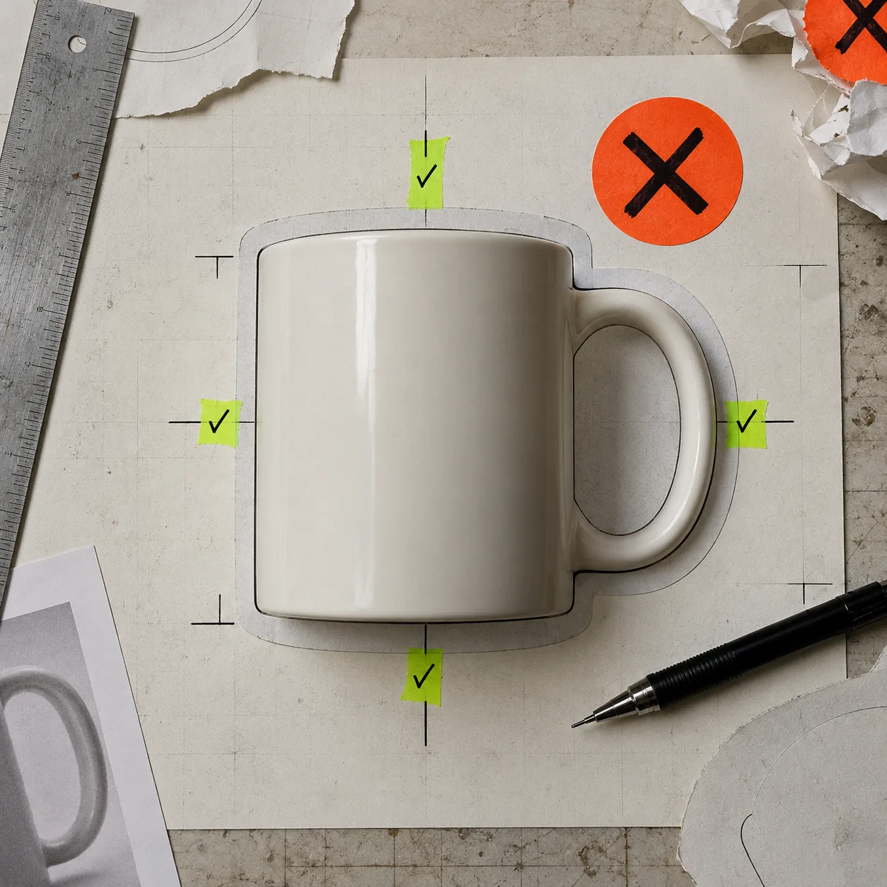
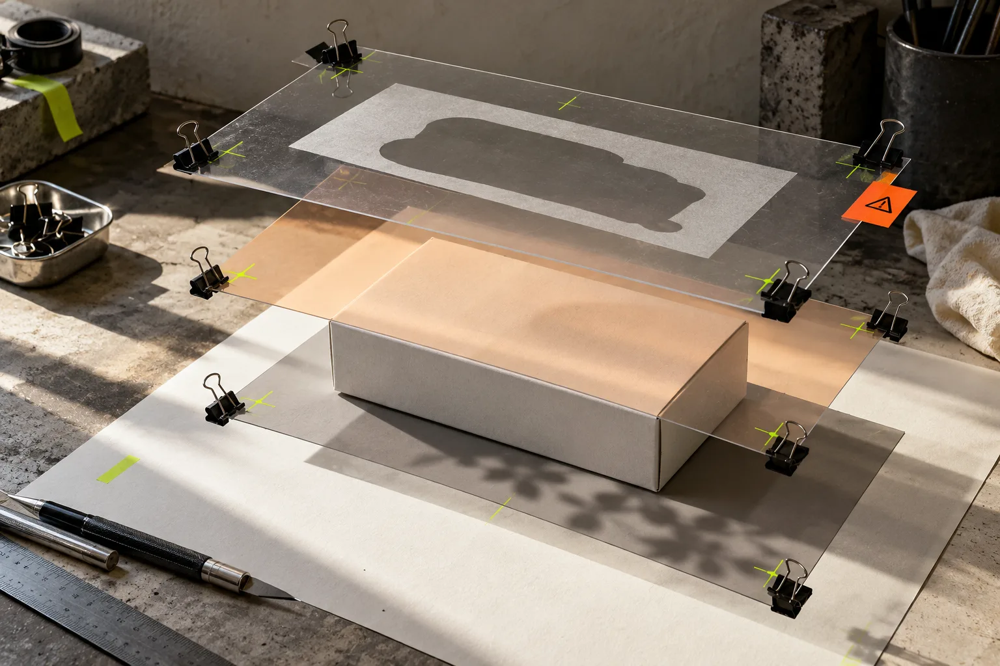
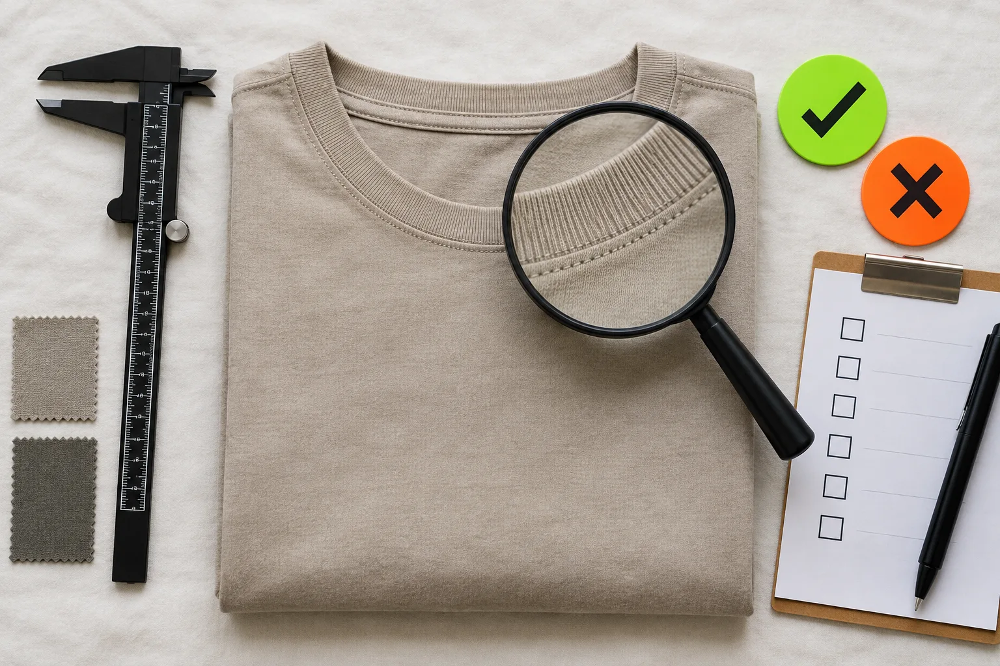

# A Practical Product Photo Export Checklist for Shopify Listings

A good Shopify product image is not finished when the background is gone. Before you export, check the cutout edge, product truth, crop, color, and file purpose at full size. A browser editor such as [ImageFlow](https://imageflow.dev/) is useful here because it keeps the working document editable with layers, masks, adjustments, smart objects, and PSD import/export—so you can correct a small issue without rebuilding the image.

This is a release check, not a beauty contest. The goal is a storefront image that shows the actual item clearly, not an image that invents a nicer version of it. Shopify supports product images alongside other media, and its own documentation warns that files placed in the store’s Files area are intended for public access. Keep private source files and customer material out of that path. [Shopify’s product-media guide](https://help.shopify.com/en/manual/products/product-media) is the useful reference for the publishing side.

## Use one master, then make deliberate exports

Start with an editable master file: the original photo on its own layer, any selection or cleanup behind a mask, and adjustments above it. That structure gives you a way back if the collection-card crop needs a change later. Flattening first is how a tiny late correction becomes a reshoot or a rebuild.

For a PSD received from someone else, run the handoff check before you touch the look: confirm the canvas, visible layers, linked or smart-object content, and expected export. Our earlier guide on [checking a PSD handoff before ecommerce export](https://tools-and-how-tos.github.io/2026/10/27/how-to-check-a-psd-handoff-before-exporting-ecommerce-assets/) covers that intake step.

ImageFlow is a reasonable browser-based option for this small-workflow job. Its public page lists layers, masks, blend modes, adjustment layers, smart objects, text, filters, plus PSD import and export. That does not mean every complicated production PSD will round-trip exactly as expected; use one representative file as a test before making it your team’s standard.

## The five checks before export

Use this sequence at 100% zoom, then repeat it at the size a shopper will actually see.

| Check | What to inspect | Stop and fix when |
| --- | --- | --- |
| Edge | Mask around handles, stitching, glass, hair, reflections, and shadows | You see a halo, clipped detail, or a background color fringe |
| Product truth | Logo, label, material texture, included parts, and color | Cleanup has altered a product detail or implies an included accessory |
| Crop | The main subject in the intended product-page and collection context | The subject is cramped, inconsistently scaled, or a key feature is cut off |
| Tone | White balance, exposure, and shadow density across the product set | One SKU is visibly warmer, darker, or more contrasty than its neighbors |
| File purpose | Name, dimensions, and the specific image version you mean to publish | You are about to overwrite the master or upload a working/source file |

The edge check deserves more time than it gets. Automatic selection is a starting point; it is not evidence. Switch the mask view against both light and dark temporary backgrounds, then zoom around the difficult parts. If you need a targeted repair, [remove the distracting object first](https://how-to.the-lean-ecommerce.com/2026/10/30/how-to-remove-a-distracting-object-from-a-product-photo-in-your-browse/) and inspect the surrounding texture before treating the file as finished.

## Keep corrections reversible until the pass is clear

A fast, safe arrangement is simple: keep the source at the bottom, put object removal or background work behind masks, add color and exposure changes as adjustment layers, and name the final export layer or group. This makes an edit reviewable. It also tells the next person what changed.

The decision rule is equally simple: correct the photograph’s presentation, not the product. Cleaning dust from the sweep, softening a distracting background, or balancing exposure can make the real item easier to read. Changing a fabric color, deleting a functional feature, or making an accessory look included crosses into misleading merchandising.

When an image needs a larger repair, make a copy of the master and write down the problem before experimenting. That is the recovery discipline in [this product-photo recovery note](https://the-lean-ecommerce.gitlab.io/2026/10/30/i-make-a-product-photo-recovery-note-before-i-touch-the-pixels/): preserve the source, define the smallest correction, and judge the result against the original.

## Test the export where it will be used

Exporting successfully only proves that a file exists. It does not prove that the page makes sense. Upload the candidate image to a draft product or staging theme and inspect it in the exact placements that matter: product page, collection grid, and any feed or campaign crop you control.

If your team uses AI-generated lifestyle work alongside catalog photography, keep this check separate from image generation. A useful companion is [a Shopify product-photo QA workflow before generating lifestyle images](https://tools-and-how-tos.github.io/2026/10/23/how-to-build-a-shopify-product-photo-qa-workflow-before-you-generate-l/). It helps prevent a clean cutout from being mistaken for a final claim about the product.

## A two-minute release gate

Before you add the image to Shopify, answer these six questions:

1. Can I see the true edge against a contrasting background?
2. Does the image preserve the product’s color, construction, branding, and included parts?
3. Is this crop useful at both product-page and collection-card scale?
4. Does its lighting match the nearby images in the same product family?
5. Is the upload a deliberate export, not the editable master or a private source file?
6. Have I checked the uploaded result in the storefront context?

If any answer is no, return to the master. The fix is usually smaller than the consequences of shipping an ambiguous image.

## Make the smallest useful edit first

Open [ImageFlow](https://imageflow.dev/) with one real product photo and try the smallest correction that clears this checklist: refine one mask edge, remove one distraction, or balance one exposure issue. Keep the master editable, export a named copy, and inspect that copy in Shopify before rolling the workflow across the catalog.
