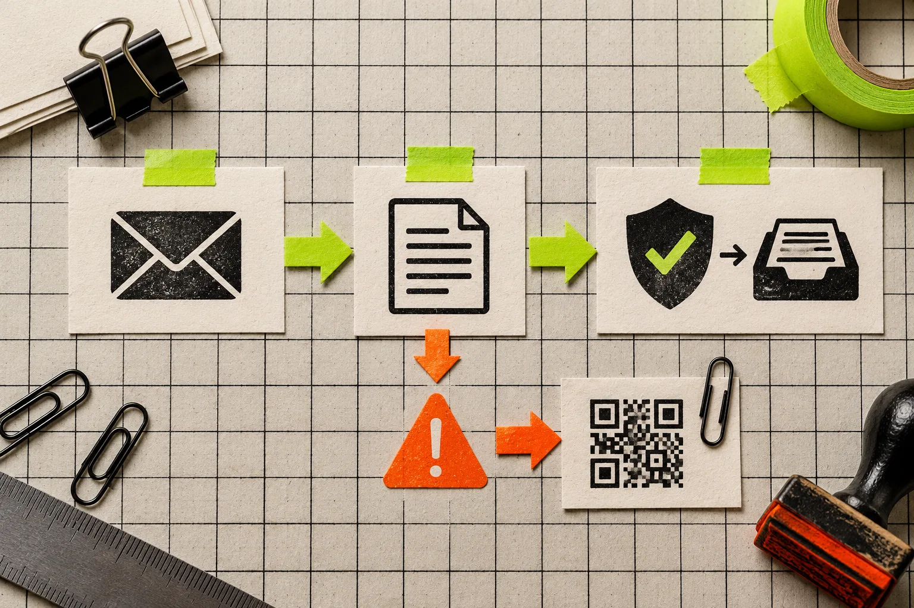
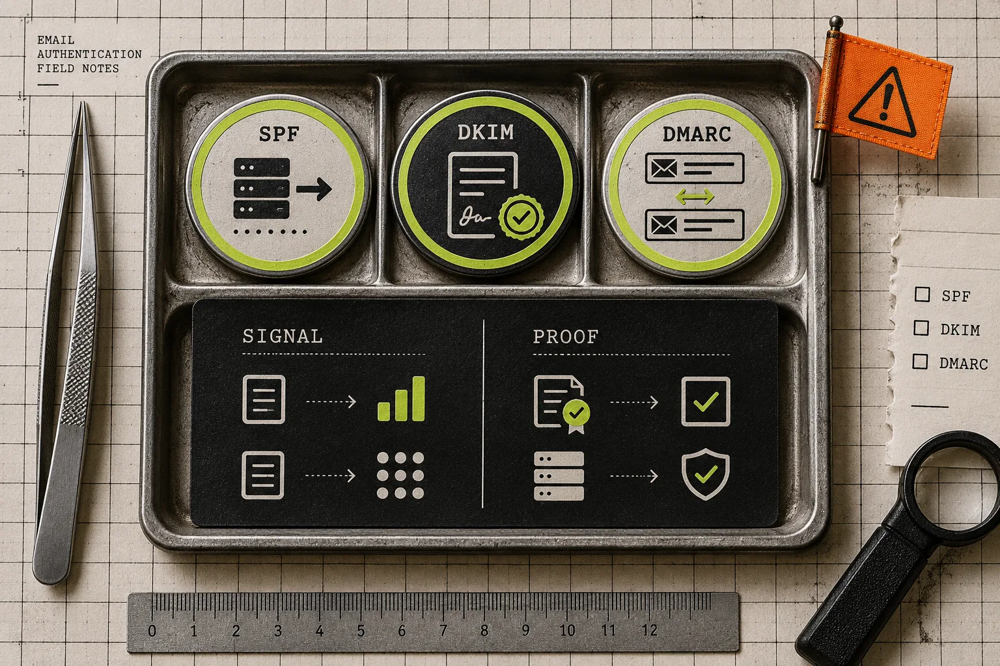

# How to Check a Suspicious Email Header Without Clicking Anything

When a message looks like a login alert, invoice, or urgent request, the safest first move is to **not click, reply, download, or forward it**. Instead, copy the message’s full header and inspect the receiving service’s authentication results and its trusted delivery hops. That will not prove an email is safe, but it can give you a defensible reason to report or escalate it.

For a no-upload first pass, [Tiny Online Tools’ Email Header Analyzer](https://tiny-online.tools/email-tools/email-header-analyzer) reads a pasted header locally in the browser. It is deliberately narrow: it surfaces the `Received` chain and existing SPF, DKIM, and DMARC results without pretending to make a network-backed forensic determination.

## Start with the evidence ladder, not a verdict

A header is supporting evidence. Treat it as three levels of confidence:

| Level | What to inspect | What it supports | What it cannot prove |
| --- | --- | --- | --- |
| 1. Preserve | Full original header, message time, visible sender | A record someone else can review | That the message is legitimate or malicious |
| 2. Read recipient-side results | `Authentication-Results`, especially SPF, DKIM, DMARC | How the receiving system evaluated the message | That a pass makes a risky link safe |
| 3. Escalate | Your organization’s reporting path or provider controls | A repeatable security decision | An independent incident investigation |

This ordering matters. A forged `From:` line is easy. A long header can also look impressively technical while telling you almost nothing. The useful signals are the values stamped by the mailbox provider that received the message, plus the topmost delivery hops that your own infrastructure controls. Tiny Online Tools makes the same limitation explicit: the lower, sender-controlled part of a `Received:` chain is not trustworthy evidence on its own.

## 1. Capture the full header without interacting with the message

In Gmail on the web, open the message menu and choose **Show original**, then copy the full header. Google’s [header guide](https://support.google.com/mail/answer/29436?hl=en) documents that route; Outlook exposes comparable data under message properties. Copy only the header block—everything before the first blank line is enough for the analyzer.

Do not turn a header check into a risky workflow. Avoid opening attachments, following a “verify” link, or replying to the visible sender. If the message is already in a managed work mailbox, use its built-in report-phishing control first when policy says to do so. Header review should complement the reporting path, not delay it.

This is also a good pattern for sensitive operational data. The same principle is behind our [no-upload JSON review workflow](https://tools-and-how-tos.github.io/2026/10/18/a-no-upload-json-review-workflow-for-api-handoffs/): use a small local browser tool for the narrow inspection job, rather than pasting internal material into an unknown service.

## 2. Read `Authentication-Results` before the rest of the noise

Paste the header into the [Email Header Analyzer](https://tiny-online.tools/email-tools/email-header-analyzer). Start with `Authentication-Results`, not the raw wall of `Received:` lines. Microsoft documents that incoming Microsoft 365 messages record SPF, DKIM, and DMARC outcomes there, and that DMARC requires an aligned SPF or DKIM result with the visible `From` domain.

Here is the short reading guide:

- **SPF** asks whether the sending IP was allowed to send for the envelope domain. A pass is useful context, but may refer to a different domain than the one the recipient sees.
- **DKIM** says whether a signed message verified against the signing domain. Look at the `header.d` domain, not just the word `pass`.
- **DMARC** is the most helpful alignment clue for ordinary triage: it evaluates whether authenticated SPF or DKIM aligns with the visible `From` domain.
- **`none`, `temperror`, or `fail`** are reasons to slow down and report or route for review—not standalone proof of a scam. Legitimate forwarding and mailing lists can change authentication outcomes.

Microsoft’s [authentication troubleshooting reference](https://learn.microsoft.com/defender-office-365/email-authentication-troubleshoot) has a practical matrix of these states. Google likewise tells users to find `Authentication-Results` and notes that SPF and DKIM can authenticate a sender; neither source says authentication is a substitute for judging the content, link destination, or request.

## 3. Use the received chain for delivery context, not detective theatre

Every receiving server adds a `Received:` line, and the stack reads newest first. In a genuine delivery trail, reversing the chain describes the route a message took. The analyzer can make delivery delays and host names easier to scan.

But there is an important boundary: lines below the final receiver can be forged by a sender. Treat unusual host names, impossible-looking dates, or a strange route as **reasons to escalate**, not as evidence that lets you confront a sender or declare an incident closed. Clock differences can even produce small negative delays; they are not a finding by themselves.

This is the same discipline that keeps routine data work sane. Before sharing a source export, use a bounded check such as [reducing a CSV export before sharing it](https://tools-and-how-tos.github.io/2026/10/24/how-to-reduce-a-csv-export-before-sharing-it/) or [auditing Excel formulas before an import](https://tools-and-how-tos.github.io/2026/10/28/how-to-audit-excel-formulas-before-a-spreadsheet-import/). Inspect the signal that can change the next decision; do not mistake a tool’s output for a final business judgment.

## 4. Make the next action explicit

Use this tiny decision rule after the header pass:

- **Unexpected request + authentication or alignment concern:** report through your mail provider or security team, then delete or quarantine according to policy.
- **Unexpected request + authentication passes:** independently verify using a known phone number, vendor portal, or a newly typed URL. Never use the message’s own link to verify it.
- **Known sender + authentication failure:** do not assume fraud. Forward the original as an attachment or use the approved report path so the sender or IT team can investigate forwarding, configuration, or compromise.
- **Customer, employee, or other sensitive data in the message:** preserve the original and limit redistribution. Local analysis can reduce exposure, but it does not replace your organization’s retention or incident procedures.

For ecommerce teams, customer-related exports deserve the same care: [prepare a Shopify customer CSV before sharing it](https://how-to.the-lean-ecommerce.com/2026/10/31/how-to-prepare-a-shopify-customer-csv-before-sharing-it/) before treating a convenience handoff as harmless.

## A small tool is useful when its boundary is clear

The practical value of [Tiny Online Tools](https://tiny-online.tools/) here is not a promise to identify every phishing attempt. It is a quick, browser-based way to make a specific piece of evidence legible without uploading it or creating an account. Its [Email Header Analyzer](https://tiny-online.tools/email-tools/email-header-analyzer) is especially useful when you need to separate “this feels suspicious” from “these are the authentication and routing details an expert should see.”

Use the header to preserve context, read the recipient-side results, and choose a safe reporting or verification path. That is a much better outcome than clicking a link just to satisfy your curiosity.
