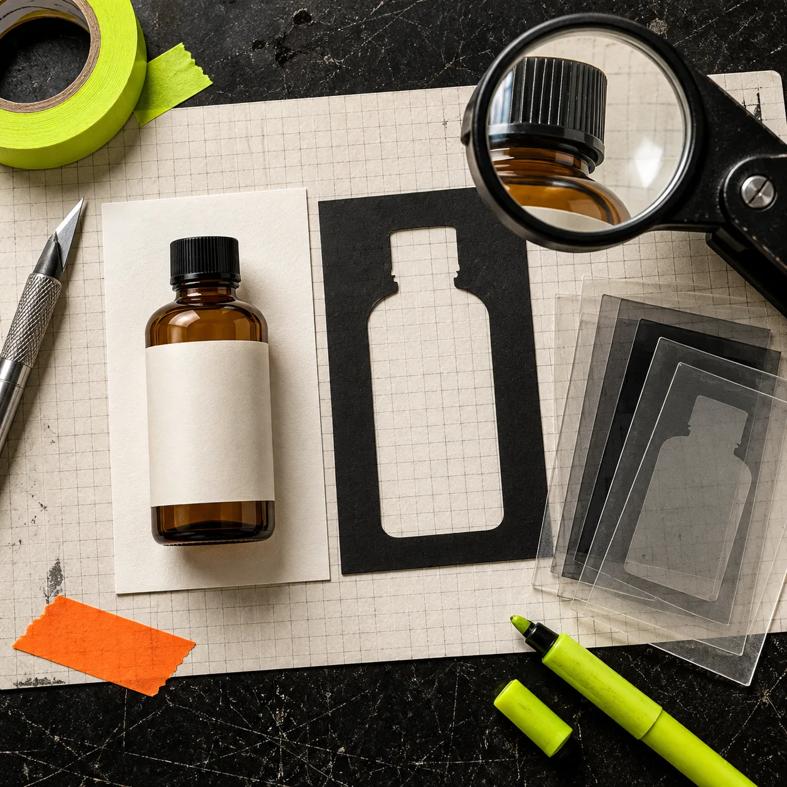
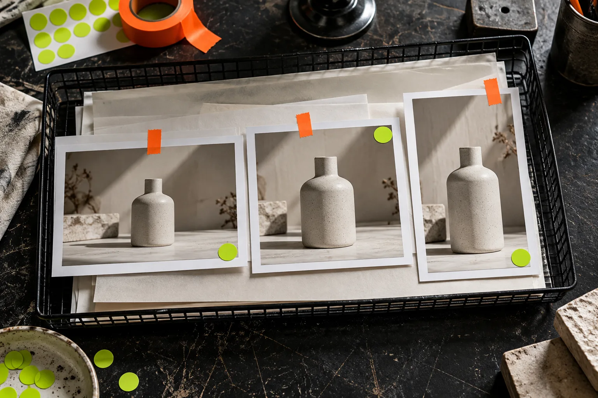
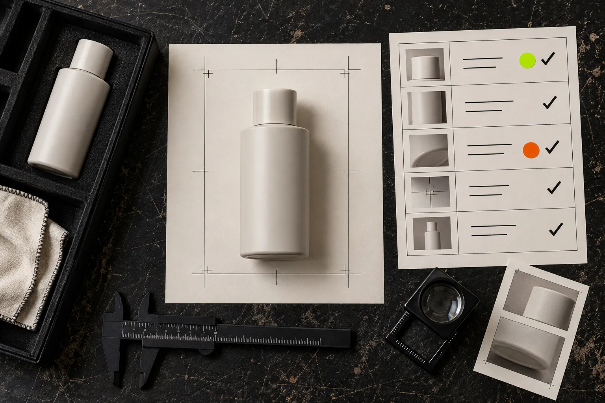

# How to Make Shopify Product Image Variants Without Replacing the Master

The safest way to make Shopify product-image variants is to keep one protected master, then build each square, collection, and campaign crop as a named derivative. That sounds fussy until a seasonal banner crop overwrites the only clean source image. A browser editor such as [ImageFlow](https://imageflow.dev/) is enough for this workflow because it keeps layers, masks, adjustments, and export decisions in one editable document.

Shopify accepts several image formats and serves images across sales channels; it also recommends consistent aspect ratios when collection images sit together. That means the practical job is not simply “make a prettier photo.” It is to create the right crop without changing the product, losing the original, or quietly breaking a collection grid.

## Start with a master that is not an export

Make a working document before you make a variant. Save the unedited source as `SKU-angle-master`; if you received a PSD, retain it and work in a duplicate rather than flattening it. In ImageFlow, that can mean putting the original on a locked bottom layer, with masks, adjustment layers, and backgrounds above it. Its browser editor lists layers, groups, masks, adjustment layers, smart objects, and PSD import/export, so the work can remain editable rather than becoming a chain of irreversible JPEGs.

The useful distinction is simple:

| File | Purpose | May change? |
| --- | --- | --- |
| Master | The traceable source for the SKU | Never overwrite |
| Working file | Masks, crops, and reversible corrections | Yes, non-destructively |
| Export | One named output for one placement | Yes, regenerate when needed |

This protects against a common catalog failure: someone reuses a thumbnail crop as the next starting point, then discovers the product is too small for a PDP or the original margin has disappeared. If you are already maintaining a [Shopify product-photo QA workflow](https://tools-and-how-tos.github.io/2026/10/23/how-to-build-a-shopify-product-photo-qa-workflow-before-you-generate-l/), make the master/variant rule one of its required checks.

## Make the smallest truthful edit first

Use selection and masking only when they serve the placement. A clean cutout can help a collection grid; a small tonal adjustment can help a product read on a neutral background. It should not change the item’s color, dimensions, finish, included accessories, or condition.

For a cutout, select the product, inspect the edge at 100%, and refine with a mask instead of deleting pixels. ImageFlow describes on-device selection and background removal, but that is a starting point—not a proof that difficult edges are correct. Glass, translucent packaging, loose fibres, reflections, and pale labels all need a close review.

For an adjustment, use an adjustment layer. For a cleanup, use a separate retouch layer. Those two habits make it possible to switch off an edit, compare it with the original, and explain what changed. They also keep an ordinary product correction from turning into a misleading image.

## Define the placement before you crop

Write the destination beside each derivative name. “Summer crop” is a poor instruction. `SKU-101-collection-square-v1` tells the next person where it belongs and what it is not. Shopify says product and collection images can be up to 5,000 × 5,000 px or 25 megapixels, under 20 MB; image format and presentation still depend on the storefront context. Check your theme’s actual cards rather than treating those limits as a design brief.

Here is the crop card I use before exporting:

| Placement | Preserve | Crop rule | Failure to watch for |
| --- | --- | --- | --- |
| Product detail page | Product scale and material detail | Leave comfortable edge room | Cap, handle, or shadow clipped |
| Collection card | A repeatable silhouette | Use the same ratio across the collection | Product jumps in size between cards |
| Campaign block | The selling context | Reserve deliberate space for surrounding copy | Copy or crop hides a defining detail |

This also makes related work easier. If a product needs more than a 2D crop to show its construction, see [how to add Shopify 3D product media](https://tools-and-how-tos.github.io/2026/10/25/how-to-add-shopify-3d-product-media-without-rebuilding-your-theme/); it is a different asset decision, not a substitute for a truthful main image.

## Keep a tiny variant ledger

A ledger can be a spreadsheet, a file comment, or a row in your asset manager. It only needs five fields: master filename, derivative filename, placement, reversible edits, and reviewer. This is especially useful when an editor has to remake a crop after packaging, color, or product copy changes.

For example: `BOTTLE-04-master.psd` → `BOTTLE-04-collection-1x1-v2.webp` → collection card → mask refined; exposure +0.2 → reviewed against physical sample. Notice what is missing: “made it look premium.” That is not an auditable edit.

A short ledger is cheaper than a folder full of `final-final-2` files. It gives a new teammate a way to rebuild an export from the master, and it prevents a campaign derivative from becoming accidental source material.

## Run the four-point truth check

Before upload, compare the derivative against the master at full size. I use four questions:

1. **Identity:** Is the SKU, color, packaging, and included item still accurate?
2. **Edges:** Are labels, transparent areas, shadows, and fine details believable at 100%?
3. **Placement:** Does the crop work in the actual product card or page—not just in the editor?
4. **Recovery:** Could another person recreate this export from the master and ledger?

If any answer is no, return to the editable working file. Do not patch the exported JPEG. The same principle applies when a listing has many image changes: a [PSD handoff check before exporting ecommerce assets](https://tools-and-how-tos.github.io/2026/10/27/how-to-check-a-psd-handoff-before-exporting-ecommerce-assets/) is a useful reminder that a small naming decision can become a catalog-wide mistake.

## Export only after the preview passes

Upload a test derivative to a draft product or staging theme and look at it in the contexts shoppers actually see. Shopify documents that all themes support images, while display varies by theme; consistent aspect ratio matters when collection images are displayed side by side. Check mobile and desktop, then verify the export is the intended asset rather than an old cached file.

This is where an editable browser workflow earns its place. [ImageFlow](https://imageflow.dev/) is a sensible fit when you need to open a working file, preserve the master, and make a small layer- or mask-based variant without installing a desktop app. It is not a reason to skip review or assume every complex PSD will round-trip perfectly—test your own production file first.

The next time a collection needs a new crop, open one real product image, make one named derivative, and run the four-point truth check before it reaches Shopify. That is enough process to protect the original without making image work ceremonial.

### Sources

- [ImageFlow](https://imageflow.dev/)
- [Shopify: Product media types](https://help.shopify.com/en/manual/products/product-media/product-media-types)
