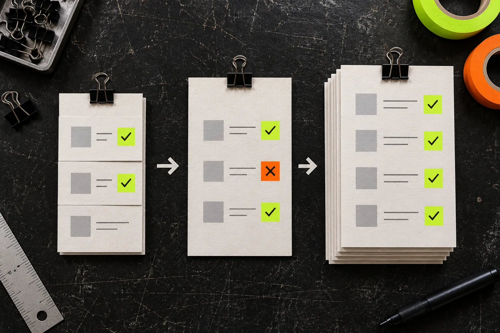

# How to Reconcile a Shopify Bulk Edit Before You Call It Done

A Shopify bulk edit is done only when you can prove four things: the right records changed, the intended field changed, the exceptions were handled, and the storefront still behaves as expected. A task report alone is not that proof. Use a short reconciliation sheet after each meaningful catalog change—especially price, tag, SKU, inventory, or product-type work.

[Ultimator Bulk Editor](https://apps.shopify.com/ultimate-bulk-editor) is useful here because it lets you target products or variants, define an update, and run it now or schedule it. But the control point is your review method, not the button. Shopify itself treats product details, organization fields, SKUs, barcodes, and pricing as separate catalog concerns; a bulk change can therefore be technically successful while still being operationally wrong.

## Start with a change card, not a vague intention

Before you run the task, write four lines somewhere your team can find later:

| Field | What to record | Example |
| --- | --- | --- |
| Scope | The saved selection rule and expected count | `vendor:Northline AND tag:summer` — 84 products |
| Operation | Exact field and transformation | append `-SS` to a private workflow tag |
| Exclusions | Records that must not change | gift cards, archived products, bundles |
| Proof sample | Specific records to inspect afterward | 3 expected changes + 2 expected non-changes |

That last row is what makes this different from simply looking at a green success message. Pick the sample before the update, not after you have seen the result. If your scope is based on tags, first make sure the tag grammar is stable; this [Shopify tag-cleanup test](https://tools-and-how-tos.github.io/2026/10/16/how-to-test-a-shopify-tag-cleanup-before-applying-it-storewide/) is a useful precursor.

## Make the first run deliberately small

Do not use a production-wide task as the experiment. Select a pilot with enough variation to expose a bad rule: a single-SKU product, a multi-variant product, an item with a sale price, and a product that should be excluded. A five-to-ten record pilot is often enough to reveal a wrong search condition or an operation that behaves differently than your mental model.

Check the pilot in two places: the Shopify admin record and the customer-facing product page where applicable. That matters for changes such as titles, descriptions, images, SEO fields, or collection assignments. For a visual catalog update, also use the same discipline as a [product-photo export checklist](https://tools-and-how-tos.github.io/2026/11/01/a-practical-product-photo-export-checklist-for-shopify-listings/): inspect the actual listing, not just the source asset.

## Use a four-column reconciliation sheet

Once the pilot is correct, run the intended batch and reconcile it immediately. This takes minutes and gives you a reusable audit trail.

| Check | Question | Pass condition | What to do if it fails |
| --- | --- | --- | --- |
| Scope | Did the count match the change card? | Actual count equals expected count | Stop; compare the selection rule before another run |
| Field | Did only the planned field change? | Sampled records show the intended transformation | Correct the rule on a new small pilot |
| Exceptions | Did excluded records remain unchanged? | Every preselected non-change sample is intact | Treat this as a scope failure, not a minor exception |
| Storefront | Did the shopper-visible result still make sense? | Relevant pages render with accurate names, prices, and media | Fix the catalog record, then recheck the live page |

For price work, include both the numeric value and the sale presentation in your sample. Product prices and compare-at prices answer different jobs, so a correct-looking discount can still be misleading if the relationship is wrong. For variant work, include at least one product with multiple options. Shopify uses SKUs and barcodes to identify stock and marketplace records, which makes accidental identifier edits much harder to unwind than a cosmetic typo.

## Treat exceptions as data, not cleanup

A reconciliation sheet earns its keep when it finds a weird record. Do not patch the one odd product and move on without noting why it was odd. Capture the handle, the unexpected value, the reason it escaped the rule, and the resolution. Over a few tasks, that exception log becomes your best source of safer selection rules.

This is particularly useful when you are standardizing product types, collections, or tags. An old product type may be serving a workflow, a third-party integration, or a collection condition. If you are changing a related presentation rule, review the customer-facing implication too—for example, a [swatch retirement plan](https://tools-and-how-tos.github.io/2026/11/02/how-to-retire-shopify-color-swatches-without-confusing-shoppers/) needs a different verification sample than a back-office tag cleanup.

## Decide whether to release, correct, or pause

Use the sheet to make one explicit decision:

- **Release:** counts match, samples pass, exceptions are explained, and storefront checks are clean.
- **Correct:** the intended scope is sound but a field rule needs adjustment. Build a smaller corrective task; do not improvise record-by-record unless the exception is genuinely unique.
- **Pause:** counts do not match, excluded records changed, or the customer-facing result is unclear. Preserve the evidence and investigate before a second broad update.

This release decision is important when a scheduled task is involved. Scheduling is a timing feature, not an approval system. Give the task a named owner and a review window after it runs. If your catalog has lots of dependent options, use a [size-chart rules audit](https://tools-and-how-tos.github.io/2026/10/30/how-to-audit-shopify-size-chart-rules-before-a-catalog-launch/) as a model: validate the logic at the edges, not only on the typical record.

## Keep the evidence with the task

You do not need a heavyweight change-management system. Save the original change card, expected and actual count, five sample handles, exceptions, and final decision next to the task name. That is enough to answer the next practical question: “What exactly happened when we touched these records?”

If you need a tool for applying the change, [Ultimator Bulk Editor](https://apps.shopify.com/ultimate-bulk-editor) supports bulk edits across products and variants, including fields such as prices, tags, inventory, SEO details, and metafields, with immediate or scheduled execution. Start with one bounded task, run the four-column reconciliation, and only then reuse the rule at catalog scale.

The next time a bulk edit feels routine, make the reconciliation sheet first. It is the small piece of friction that tells you whether “completed” actually means “correct.”
