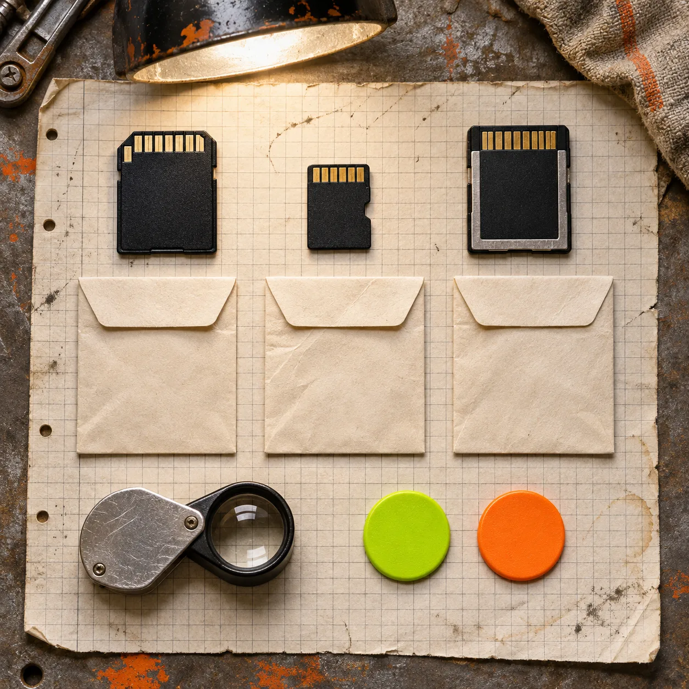
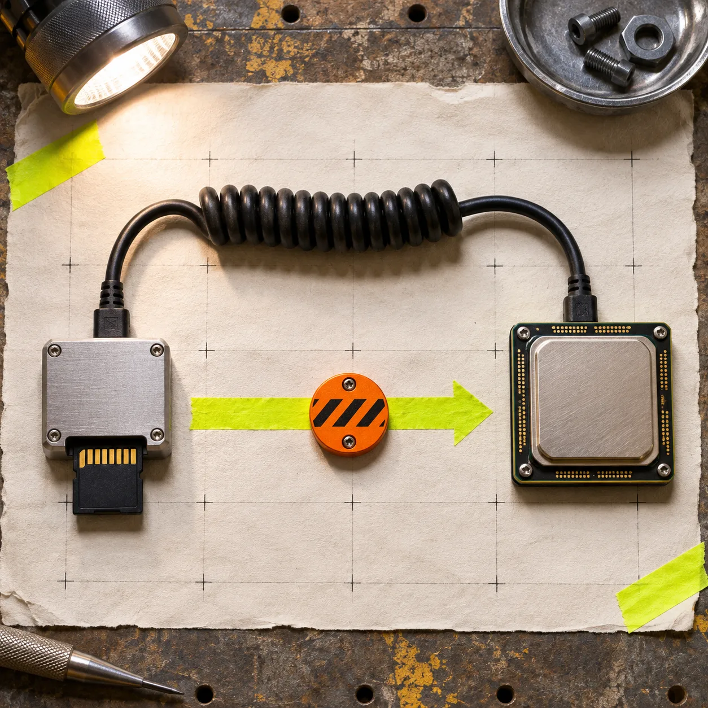

# How to Test Camera RAW Format Support Before a Browser Upload Launch

A browser RAW tool is ready to accept a camera file only after you have tested that camera's exact format *and mode* through the whole user path: open, decode, preview, cancel, and report failure. An extension such as `.NEF` or `.CR3` is not enough. Build a small fixture set, record the expected result, and turn the result into a release gate.

[FlashRaw](https://flashraw.ybouane.com/) is one option for doing that work locally in the browser: its Rust core can expose sensor data, embedded previews, or a display-ready RGB image through JavaScript and WebAssembly. The useful promise is not “all RAW files work.” It is a way to test the particular files your customers will hand you.

## Why file extensions make a weak compatibility promise

A camera RAW extension is a family name, not a behavioral contract. The same camera line can produce different compression, bit-depth, crop, burst, or high-efficiency modes. A decoder can handle one cleanly and reject another. FlashRaw’s [format matrix](https://github.com/ybouane/flashraw/blob/main/docs/formats.md) makes this explicit: support is tracked per format and mode, with `verified`, `partial`, `experimental`, and `unsupported` states.

That distinction avoids the most expensive browser-upload bug: a friendly picker accepts a file that the product cannot finish processing. It is the same boundary to establish when [validating browser camera RAW uploads before building a previewer](https://how-to.the-lean-ecommerce.com/2026/10/27/how-to-validate-browser-camera-raw-uploads-before-building-a-previewer/): accept only what the next stage can responsibly handle.

## Make a six-file camera fixture pack

Do not begin with dozens of arbitrary files. Start with six files that answer a release decision for one camera and mode. Keep the files lawful to retain and never publish customer images in a public test repository. For each fixture, store the camera model, firmware if known, format/mode, pixel dimensions, and what the browser should do.

| Fixture | Purpose | Expected decision |
| --- | --- | --- |
| ordinary daylight frame | baseline decode | open and preview |
| high-ISO frame | exercises a different real capture | open and preview |
| landscape or portrait pair | checks orientation metadata | preview rotates correctly |
| embedded-preview candidate | checks fast first feedback | preview path succeeds or falls back clearly |
| largest normal file | reveals memory and responsiveness limits | complete, cancel, or give an actionable limit |
| known unsupported mode | verifies honest failure | reject without hanging or misleading upload state |

Keep the raw original and a separate record of the expected result. A successful decode alone is not a complete acceptance test: the application may still mishandle orientation, color development, cancellation, or memory pressure. If your app has a staged upload process, use the same discipline as a [no-upload JSON review workflow](https://tools-and-how-tos.github.io/2026/10/18/a-no-upload-json-review-workflow-for-api-handoffs/): define what each handoff is allowed to claim before it advances.

## Test the browser path in the order users experience it

The cleanest browser architecture puts expensive work off the interaction path. Read and inspect the file, hand decoding to a worker, then return a small result or a useful error to the main thread. FlashRaw’s JavaScript package is designed for browser, worker, and Node.js use; its [repository](https://github.com/ybouane/flashraw) documents the available bindings and local browser demo.

For every fixture, record these five outcomes:

1. **Picker result:** Did the tool identify the file without claiming support too early?
2. **Decode result:** Did it return sensor data, an embedded preview, or a clear unsupported/malformed-file error?
3. **First useful preview:** Is the orientation sensible and does the UI remain responsive while the work runs?
4. **Stop behavior:** Can a user cancel or choose another file without a stuck progress state?
5. **Resource behavior:** Does your target browser and device complete the normal large file within the product's budget?

Avoid turning a lab number into a launch promise. FlashRaw publishes [reproducible benchmarks](https://github.com/ybouane/flashraw/blob/main/docs/benchmarks.md) on specified machines, files, and workloads, but its numbers are not a substitute for your own browser, camera corpus, and memory budget. Sensor decode and a developed RGB preview are different jobs; measure the one your UI actually performs.

## Turn results into three public support states

A release gate needs more than pass/fail. Use states customers and support staff can understand.

| State | What the product may say | What your team still checks |
| --- | --- | --- |
| supported | This tested camera/mode opens and previews locally | regression fixture stays green |
| limited | The file opens with a stated constraint, such as preview-only or a size limit | copy, fallback, and cancellation behavior |
| not enabled | This camera/mode is detected but not offered as supported | clear error and alternative next step |

FlashRaw’s matrix is a helpful model here because it distinguishes verified behavior from partial and experimental behavior. For example, its documentation notes that some Nikon High Efficiency NEF files are not decoded even though metadata and previews can still work. That is a good reason to say “not enabled for full processing” instead of allowing a misleading attempt.

## Keep one regression record for every newly enabled mode

When a fixture passes, save enough information to rerun the decision after a decoder, WASM build, browser, or worker change: fixture identifier, decoder version, browser/version, device class, output kind, elapsed time, peak-memory observation if available, and expected state. A simple CSV or JSON record is plenty. The point is repeatability, not an elaborate test lab.

This also makes bug reports smaller. Instead of “Sony uploads broke,” you can ask whether the report matches the exact model and mode already in the pack, then add a new fixture before expanding support. The same narrow-scope habit makes [browser RAW previews faster without trusting them too much](https://the-lean-ecommerce.github.io/2026/11/02/how-i-keep-browser-raw-previews-fast-without-trusting-them-too-much/) and helps you decide [when a browser RAW preview is enough](https://the-lean-ecommerce.gitlab.io/2026/11/03/when-a-browser-raw-preview-is-enough-and-when-it-isn-t/).

## A practical launch checklist

Before enabling a camera family in a browser uploader, confirm:

- The exact camera and capture mode are listed in your fixture record, not inferred from the extension.
- Normal, large, orientation, and known-unsupported cases have expected outcomes.
- Decode, preview, cancellation, and error copy have been checked on a target browser/device.
- Any format claim links to the decoder’s current support matrix.
- Your support state is `supported`, `limited`, or `not enabled`—not a vague “should work.”

If you are building this path now, start with [FlashRaw’s local browser demo](https://flashraw.ybouane.com/) and its format documentation, then make the six-file fixture pack before you add a broad RAW upload claim. A small, repeatable gate is more useful than a long compatibility slogan: it tells your users what will happen with the file in their hand.
