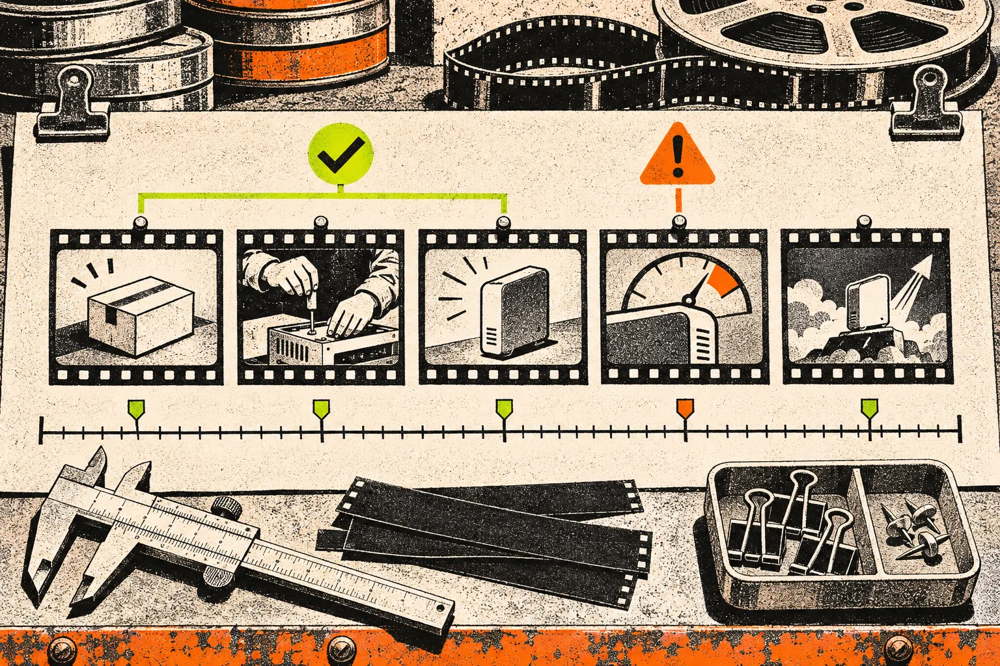
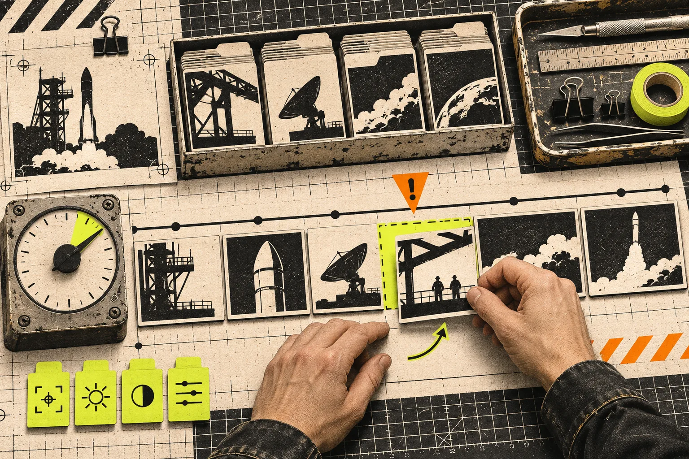

# Build a Website Evidence Pack Before Generating a Startup Video

The fastest way to get a useful startup video from a website is not to paste in the URL and hope the first render discovers the story. Build a tiny evidence pack first: one message, three pieces of proof, and two interface moments. It takes about 20 minutes, gives the video a clear spine, and makes every later revision cheaper. [VideoFlow Studio](https://studio.videoflow.dev/) can turn a URL into a planned, editable motion-graphics film; the evidence pack tells it what deserves to survive the trip from page to screen.

A homepage is designed for scanning. A launch video is experienced in sequence. Those are different jobs. The page may contain ten features, partner logos, pricing, navigation, and a pile of reassurance. A 30-second trailer needs one claim the viewer can repeat, then enough proof to make that claim believable.


## The three-card evidence pack

Open the live site in one tab and make a short note with these three cards. Do not write a script yet. Capture the evidence that a script will need.

| Card | Capture | Good test |
| --- | --- | --- |
| Message | The plain-language change the product creates | Could a customer repeat it without using your category jargon? |
| Proof | Three concrete reasons to believe the message | Is each point visible, demonstrable, or stated on a source page? |
| Interface | Two screens, objects, or interactions that make the proof tangible | Would the moment still make sense with sound off? |

For example, a scheduling tool might have the message “stop the back-and-forth,” proof in its routing rules and connected calendars, and an interface moment showing a booking page resolve a conflict. That is enough for a coherent video. “AI scheduling platform for modern teams” is not; it is a category label, not a story.

This is also where you remove weak material. A claim that appears only in a sales headline, an out-of-date comparison, or a vague testimonial does not belong in the first cut. Keep a URL next to each proof item so the person reviewing the film can challenge it without reopening a dozen tabs.

## Choose a video job before you choose scenes

The same website can support different videos. A homepage trailer, a waitlist announcement, and a feature-update clip should not inherit the same sequence just because they share screenshots. Pick one job.

- **Launch trailer:** establish the product’s change and its strongest visual proof.
- **Product update:** show one new capability, the old friction it removes, and the next action.
- **Explainer:** teach a workflow in a little more detail; accept a longer runtime.
- **Sales follow-up:** answer the most common objection with a specific before-and-after.

Write this sentence above the cards: “After watching, a _specific viewer_ should understand _one change_ and take _one action_.” If you cannot complete it cleanly, the site is still providing ingredients rather than a brief. This is the same discipline that makes a [startup website-to-video map](https://the-lean-ecommerce.gitlab.io/2026/11/03/a-startup-website-to-video-map-that-stops-feature-dump-trailers/) more useful than a feature inventory.



## Convert the pack into a five-beat plan

Once the evidence is ready, build a plan that makes a decision at every beat. A practical default is:

1. **Friction (0–4 seconds):** name the costly or tedious moment.
2. **Change (4–9 seconds):** introduce the product as the mechanism, not the hero shot.
3. **Proof (9–19 seconds):** show the strongest interface or product action.
4. **Payoff (19–26 seconds):** state the outcome that follows from the proof.
5. **Action (26–30 seconds):** give one next step and leave room for the viewer to read it.

The rule is one evidence item per beat. If a scene needs three new claims, it is probably a list disguised as a trailer. For a concrete pattern, use the message–proof–cut lens from this [launch-video handoff review card](https://the-lean-ecommerce.gitlab.io/2026/11/02/startup-launch-video-handoff-a-message-proof-cut-review-card/).

Studio is useful here because it begins from the real site, then moves through understanding, direction, design, and pixel-level render review. Its [published workflow](https://studio.videoflow.dev/) describes those stages explicitly, and its finished film stays an editable document rather than a locked export. That does not make the first plan correct. It makes the plan inspectable and revisable.

## Give the agent constraints it can act on

A vague prompt such as “make a punchy launch video” delegates the only decisions that matter. Paste the evidence pack and add constraints that can be checked after render:

```text
Viewer: operations leaders at small SaaS teams
Video job: launch trailer
Message: bookings resolve without calendar ping-pong
Proof: routing rule, conflict-aware availability, booking confirmation
Interface moments: routing setup; customer-facing booking page
Must avoid: pricing, customer-logo montage, claims not on the site
End action: start a trial
Runtime: about 30 seconds
```

That prompt does not dictate every transition. It does make failure visible. If the draft spends six seconds on the logo, introduces an unsupported metric, or buries the booking page, you have a reason to revise rather than a feeling that it is “not quite right.”

VideoFlow Studio can be run from the terminal with `npx @videoflow/studio@latest` using a Claude Code or Codex subscription, or used in its hosted path. The current product page says the CLI includes eight renders and edits monthly on the free tier and that optional AI media can use credits; check the live terms before basing a campaign schedule on that allowance. If your real job is to author a video application in React, [Remotion’s documentation](https://www.remotion.dev/docs/) is the better starting point. Studio is aimed at the operator who needs a reviewable first film from a URL, not at replacing code-first video work.



## Run a 10-minute evidence review after the first render

Before asking for “more energy,” replay the video with the evidence pack beside it. Mark each item pass, unclear, or missing.

- Can a cold viewer state the message after the opening?
- Does each proof point appear on screen long enough to recognize?
- Is every UI moment from the product that was actually described?
- Does the payoff follow from the proof rather than jump to a promise?
- Does the end card have one readable action?

A failed check should produce a narrow edit: “Hold the routing screen one beat longer,” “replace the feature collage with the conflict moment,” or “remove the performance claim.” Keep a small change ledger when more than one person is reviewing; [this approach to launch-video changes](https://the-lean-ecommerce.gitlab.io/2026/11/03/i-keep-a-launch-video-change-log-before-i-ask-for-another-render/) prevents an approved message from quietly disappearing in a later pass.

## When this method is too small

An evidence pack is not a substitute for customer research, legal review, or a full creative brief. Use a deeper process for a brand relaunch, a regulated claim, a multi-product campaign, or a video whose job is to teach a complex workflow. And if the site itself has no sharp claim or usable interface proof, fix the site or interview users before producing a trailer. Video can clarify a good proposition; it cannot manufacture one.

For a normal startup launch, though, the three-card pack is a useful boundary: it keeps the agent focused, gives reviewers something objective to protect, and preserves a route back to the source material when the product changes. Start with the message, proof, and two interface moments; then let [VideoFlow Studio](https://studio.videoflow.dev/) turn that evidence into a film you can inspect and revise.
