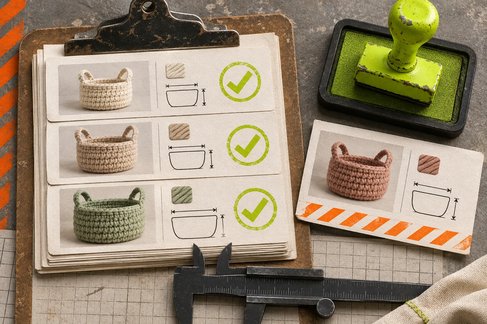
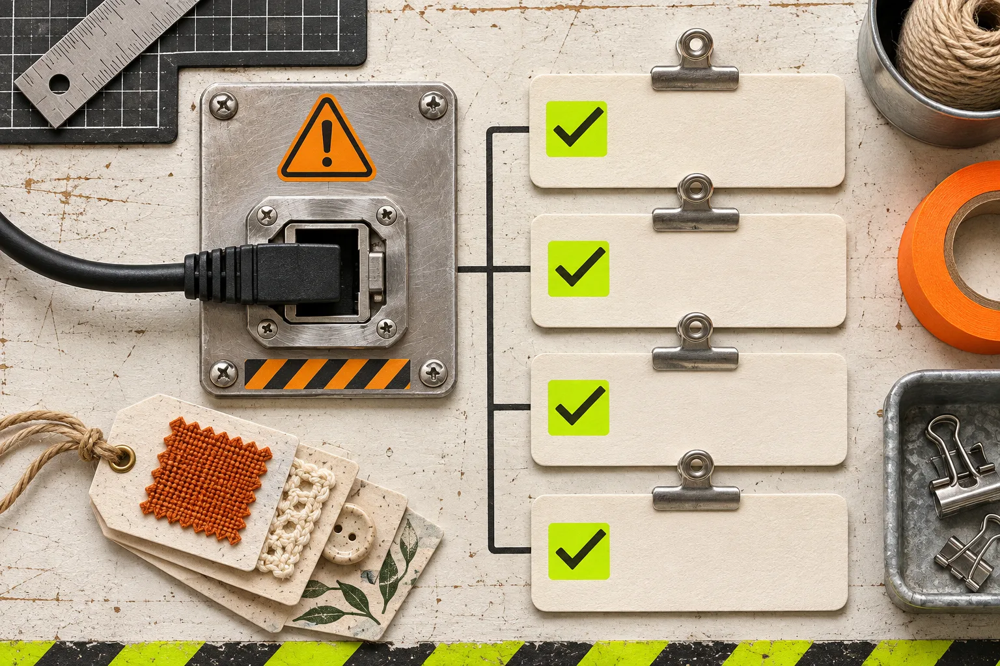

# How to Handle Etsy Personalization Options in a Meta Catalog Feed

If an Etsy listing only becomes real after a buyer enters a name, chooses a message, or sends a reference, do not treat it like an off-the-shelf catalog item by default. Put straightforward, priced variations into the feed; route genuinely custom work through a review decision first. That keeps the catalog useful without promising a shopper a finished product that still needs a conversation.

[Catalog Generator for Etsy](https://catalog-generator.webyze.com/) is useful here because it reads Etsy listings and can expand priced variations into separate feed rows. It also flags listings with customization so you can choose how they are handled. The right configuration is not a universal setting. It is a small merchandising decision: what can a customer select and buy from the catalog without extra clarification?

## Start with the buyer’s decision, not the listing’s label

“Personalized” is a poor feed category. It can mean a monogram that changes nothing operationally, or a made-to-order commission whose price, image, and delivery promise change with every request. Split your listings by the decision a catalog shopper can actually make.

| Listing situation | Feed treatment | Why |
| --- | --- | --- |
| Ready-made item with fixed color or size prices | Include the priced variations | Each choice is a clear purchasable option. |
| Engraving or text field with one fixed base product | Include only if the listing image and price remain honest | The order can still begin from a standard product page. |
| Custom illustration, proof approval, or quote required | Hold it out of the catalog until you have a clear standard offer | The feed cannot explain a negotiation. |
| One listing combining ready-made and bespoke paths | Split the offer in Etsy before feeding it | A shopper should not have to infer which path they are buying. |

That is the useful boundary: the catalog can show a choice; it cannot run a back-and-forth. This is also why “include every listing” is rarely a quality strategy. Catalog Generator states that every priced size, color, or option can become its own row, with the corresponding price and stock. Use that capability only where the row maps to a decision a buyer can complete.

## Make a three-item test set before you connect the whole shop

Choose three Etsy listings that expose your edge cases: one simple ready-made item, one item with normal priced variations, and one personalized item. Then write down what a Meta shopper should see for each: the image, the selectable option, the starting price, and the next action after the click.

This small test is better than inspecting a hundred near-identical listings. It will reveal whether an image describes the selected variation, whether option names make sense outside Etsy, and whether the destination page asks for information that the catalog never set up.

For the feed itself, keep a short receipt:

1. Listing URL and title.
2. Every variation that should be visible.
3. The price and availability you expect for each.
4. Whether personalization is harmless input or a custom-production branch.
5. The one thing that would make you remove the listing from the feed.

## Verify the Etsy domain before treating feed problems as feed problems

A clean feed does not solve a domain-verification block. Etsy’s current guidance for Facebook Shops says to add the shop domain in the `shopname.etsy.com` format in Meta’s domain-verification flow, copy the meta-tag code, then paste it in Etsy Shop Manager under Settings → Facebook Shops before returning to verify it in Meta. [Etsy’s domain-verification instructions](https://help.etsy.com/hc/en-us/articles/360051633874-How-Do-I-Verify-My-Domain-for-Facebook-Shops) are worth following literally because the exact shop-domain format matters.

Use the same shop URL you expect shoppers to land on. Etsy notes that an open shop can use either `shopname.etsy.com` or `www.etsy.com/shop/shopname`; changing the shop name updates the shop URL and redirects the old one. That makes a rename a sensible trigger for another quick catalog click-through.

## Use Catalog Generator as the feed source, then inspect the rendered result

Once the test set is clear, connect the Catalog Generator feed URL in your commerce destination. The product’s current documentation says the same Etsy connection can produce a Meta catalog data source and a Google Shopping feed, and that feed settings—including variation expansion, drafts or inactive listings, and personalization handling—live in the feed URL. Keep a copy of the exact URL and configuration decision with your test receipt.

Do not assume an automated refresh means a safe result. An Etsy change can legitimately update the feed while still making a product card confusing. When you edit a listing, check the changed item after the next catalog refresh rather than waiting for a campaign to uncover it. If your feed has stopped updating altogether, this [Etsy catalog feed recovery guide](https://how-to-blog.gitlab.io/2026/11/03/how-to-recover-an-etsy-catalog-feed-that-stops-updating-in-meta/) provides a separate troubleshooting path; it is a different problem from deciding what should be included.

## A five-minute release check

Before you promote the catalog, open the destination for the three test items and answer these questions:

- Does every visible variant have the price and availability you expect?
- Does the selected image still represent the option a shopper clicked?
- Can a shopper understand the personalization requirement before leaving the catalog?
- Does every click arrive on the intended Etsy listing?
- Is there a listing that needs a quote, proof, or manual review but is presented as instantly purchasable?

This is deliberately narrower than a broad preflight. Use the [seasonal feed preflight](https://productivity-tech-business.blogspot.com/2026/11/etsy-catalog-feed-preflight-7-checks.html) when timing a promotion, and the [six-check smoke test](https://the-lean-ecommerce.github.io/2026/11/01/etsy-catalog-feed-smoke-test-6-checks-before-you-connect-meta/) when you need an end-to-end connection check. Here, the job is to make sure personalization does not turn a structured catalog into an ambiguous promise.

## The practical default

Include priced, visually truthful variations. Treat personalization as a separate decision: include it only when the buyer still sees a clear product, price, and next step. Hold anything that needs a quote, proof approval, or bespoke interpretation until you can present it honestly.

Start a [Catalog Generator free trial](https://catalog-generator.webyze.com/) with the three-item test set, save the exact feed configuration, and review the cards a shopper—not an Etsy operator—will actually see.
