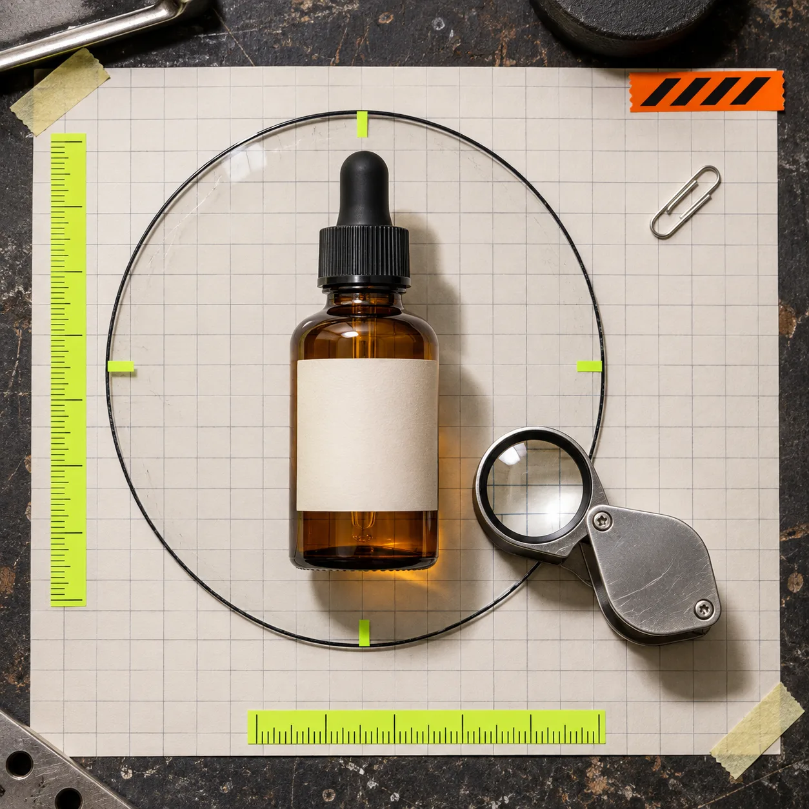
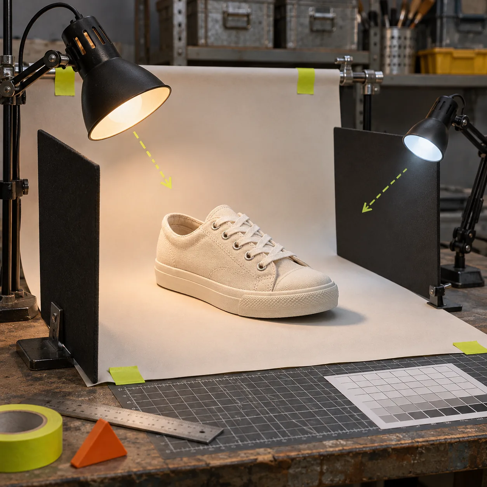
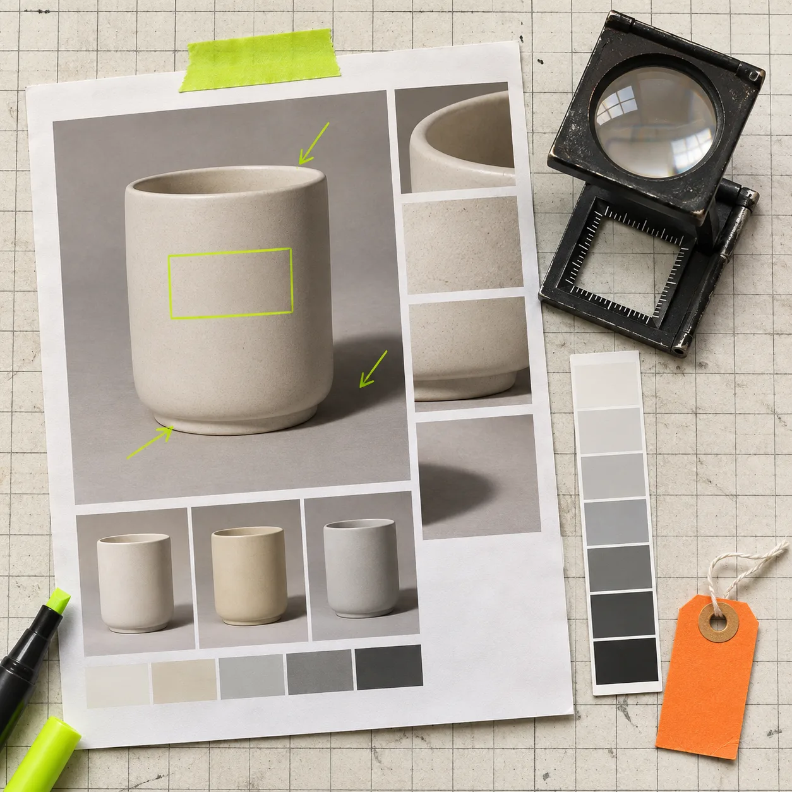

# How to Relight a Product Photo Without Misrepresenting It

You can relight a product photo without making the product look like something it is not: change the apparent direction or harshness of the light, then check color, material, shape, labels, and included parts against the original. The safe rule is simple: improve the scene, not the merchandise.

That distinction matters when one photo needs to work on a collection page, an ad, and a marketplace listing. A too-dark frame can hide a useful product. An overworked one can invent a finish, erase a texture, or make a small item look larger. [ImageFlow](https://imageflow.dev/) is useful here because it is a browser-based editor with layers, masks, adjustment layers, smart objects, and on-device selection tools—not because an editor can turn any weak source file into reliable product evidence.

## Start with a change boundary

Before touching an exposure slider, write down what may change and what must not. This takes thirty seconds and prevents the usual “one more improvement” spiral.

| Area | Safe adjustment | Stop and reshoot when |
| --- | --- | --- |
| Background and cast shadow | Soften a harsh falloff or reduce a distracting color cast | The edit makes the product seem to float or removes a real shadow that explains its shape |
| Overall scene light | Lift dark midtones while retaining highlight detail | A light-colored product clips to blank white or a dark material loses texture |
| Product surface | Small local correction to reveal a real edge | The correction changes finish, color, opacity, pattern, or wear |
| Labels and included items | Minor exposure balancing around them | Type, logo, contents, size cues, or accessories become harder to verify |

This is also why a preserved master matters. If you are building campaign sizes from one source, keep a layered original and branch deliberate exports—the approach in [this product-image variant workflow](https://tools-and-how-tos.github.io/2026/11/02/how-to-make-shopify-product-image-variants-without-replacing-the-maste/) gives you a clean way back.

## Use a three-zone relighting pass

A practical relighting pass has three zones: the background, the product, and the contact shadow. Treating them separately is more predictable than dragging one global control until the image feels “premium.”

1. **Correct the background first.** Use a non-destructive adjustment layer for exposure, levels, or color balance. Your target is a neutral supporting field, not a bright white void. If the original sweep is slightly gray, preserve enough tonal change to show where it bends.
2. **Mask the product before local work.** ImageFlow provides selection and mask tools, so make the smallest useful selection and refine it at high zoom. Watch transparent edges, metal highlights, stitching, hair-like fibers, and printed labels. A clean selection that loses a true edge is not clean.
3. **Adjust product light in small steps.** A local adjustment can reveal detail in a black fabric, a dark bottle, or a recessed feature. Stop while the surface still agrees with the source. If you cannot tell whether a highlight is genuine, keep it rather than painting a more flattering one.
4. **Restore a believable contact shadow.** The shadow tells a shopper that the object occupies a real space. Lower its density or soften its edge if it overwhelms the frame, but do not erase it just to mimic a cutout.

## The four checks that catch misleading edits

View the original and candidate export side by side at 100%. I use these four checks because they test the parts buyers use to make a decision:

- **Color check:** Compare the hero color, not just the background. Pay attention to whites, skin-adjacent neutrals, woods, metals, and branded packaging.
- **Material check:** Look for fabric weave, grain, texture, transparency, and specular highlights. If a matte item now looks glossy, the edit went too far.
- **Geometry check:** Compare corners, seams, openings, shadows, and proportions. Light can make an edge look thinner or a cavity look deeper without any explicit warp.
- **Evidence check:** Zoom into labels, logos, accessories, and visible contents. None should become less legible or disappear because the composition looks cleaner.

For a more formal handoff, the [PSD editing guide](https://tools-and-how-tos.github.io/2026/10/23/how-to-edit-a-psd-file-online-without-installing-photoshop/) is useful when your team needs an editable document rather than a flattened one-off. ImageFlow supports PSD and PSB import/export, but test a representative complex file before depending on a round trip for production work.

## Choose relighting, cleanup, or a new photo

Relighting is not the answer to every source problem. Use it when the product is already correctly shown and the issue is mainly scene direction, harshness, or balance. Use a small cleanup when a removable distraction competes with the product; content-aware fill can help, but inspect the repaired area at full size. Reshoot when the key evidence is absent: no lighting adjustment can recover a texture the camera never recorded, prove a hidden side, or correct a misleading angle.

That restraint fits a broader QA process. Before the image enters a generated lifestyle scene or campaign set, borrow the release discipline from [this product-photo QA workflow](https://tools-and-how-tos.github.io/2026/10/23/how-to-build-a-shopify-product-photo-qa-workflow-before-you-generate-l/). The edited base photo should be dependable before it becomes input to anything more elaborate.

## Finish with an export receipt

Before you publish, make one small receipt: source filename, edits made, comparison thumbnail, final dimensions, destination, and reviewer. Then perform a two-surface check—desktop product page and mobile collection or marketplace view. This is more useful than trying to remember which slider moved.

The [product-photo export checklist for Shopify listings](https://tools-and-how-tos.github.io/2026/11/01/a-practical-product-photo-export-checklist-for-shopify-listings/) covers the last-mile questions: crop, sizing, filename, and whether the published asset still looks like the item in hand.

Open [ImageFlow](https://imageflow.dev/) with one real product image and make only the smallest lighting correction that improves legibility. If the original-versus-export comparison leaves you unsure whether the product changed, do not ship the edit—use the source, revise more gently, or schedule a new photograph.
