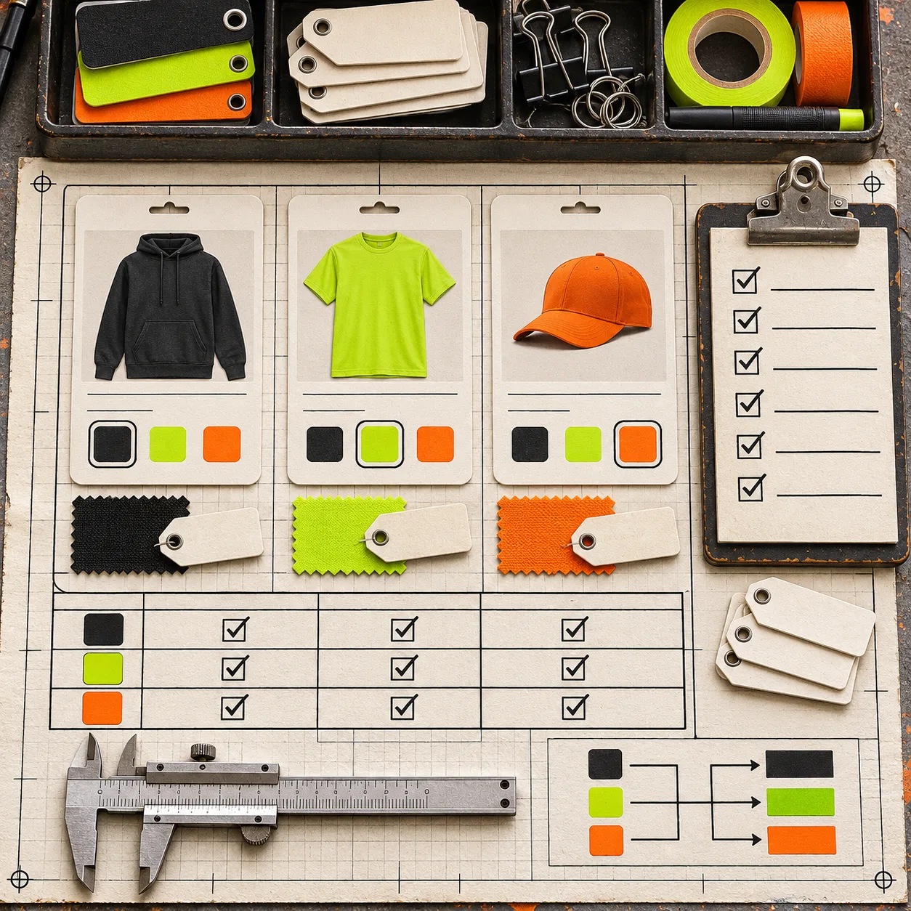

# Shopify Color Swatches: When to Use Variants or Separate Products

Use **variants** when each color is the same buying decision: the same product, same story, and the same place in your catalog. Use **separate products linked by swatches** when a color has its own photos, price logic, product type, or merchandising job. The swatch is only the control; the catalog model has to make sense before you style it.

That distinction prevents a familiar Shopify mess: a shopper clicks a color, but the gallery, price, inventory state, or URL tells a different story. [Shopify’s variant guidance](https://shopify.dev/docs/storefronts/themes/product-merchandising/variants) is clear that a selection needs to update the product media, price, and selector. If your color choice cannot do that cleanly inside one product, it is a signal to consider a linked product instead.

[Supra Swatch Colors](https://apps.shopify.com/swatch-colors-ultimator) is useful here because it supports both paths: swatches for variant options and swatches that link distinct product pages, on product and collection pages. Do not start by picking chip shapes. Start by sorting the catalog decision.

## The four-question decision card

Run these questions for each color family. Answer the first **yes** that applies.

| What changes when the shopper chooses a color? | Best model | Why |
| --- | --- | --- |
| Only the selectable color or its stock changes | Variant | One product page can keep the buying decision together. |
| The gallery, copy, price, or fit story needs to differ materially | Separate product | Each color deserves its own merchandising surface. |
| It is really a different product line, not just a shade | Separate product | Forcing it into a color option buries a real catalog distinction. |
| The shopper needs to compare colors quickly from a collection | Either; add collection-page swatches | The control helps discovery, but it does not decide your catalog model. |

A navy T-shirt and a charcoal T-shirt in the same cut, fabric, price, and imagery system are usually variants. A black leather jacket and a tan suede jacket may look like colors in a filter, but different material, care, photography, and price tell you they are distinct products.

This is not a hard platform rule. Shopify defines variants as combinations of option values for a product, such as size and color. It also gives you per-variant inventory and product data. The practical rule is smaller: keep a variation inside one product only while it remains one coherent offer.

## Audit the existing product before changing swatches

Before you touch the storefront, make a short map. Export is not necessary; a shared sheet or a product-admin note is enough. For each candidate color, record:

- product handle and current option value
- the image a shopper should see first
- price and compare-at-price behavior
- inventory and fulfillment differences
- whether the description or fit guidance changes
- the destination URL if it is already a separate product

The point is to reveal hidden exceptions. A collection of 30 color variants may contain three that use different fabric, a different supplier, or a different price. Those are not harmless edge cases: they decide whether a universal swatch rule will confuse people.

If a change is coming from a flat selector, read Shopify’s [variant documentation](https://help.shopify.com/en/manual/products/variants) first. A color and size combination is a variant, and inventory can be managed per variant. Do not move a color to a new product merely because a swatch looks nicer; do it because the buyer needs a different product page.

## Set up the simple path: variants

Use this path for a compact product family.

1. Standardize option values. Pick one spelling and casing for every shared color. `Forest Green`, `forest`, and `Green / Forest` will not make a trustworthy swatch system.
2. Confirm the selected variant changes the visible truth. Click each color and confirm the product media, price, available state, and size choices reflect it. Shopify specifically calls out media, price, and the selector as elements that must reflect a newly selected variant.
3. Configure the swatch presentation. Supra Swatch Colors advertises color and image swatches, styling controls, and automatic color detection or product-image setup. Use those features to make an existing catalog clearer, not to hide inconsistent data.
4. Test a direct variant URL. A variant deep link should still load a coherent selection rather than a default color with a mismatched gallery.

This path is the least operationally expensive when the differences truly are option-level differences. It keeps reviews, product copy, and the conversion path together.

## Set up the separate-product path: linked swatches

Use linked-product swatches when each color is a small storefront in its own right. Create or retain the individual product records, then group only the products that a shopper should reasonably treat as a color family.

The setup checklist is short but unforgiving:

1. **Make the family explicit.** Group only related handles; do not use a broad word such as `black` as a grouping rule.
2. **Choose a representative image per product.** The olive destination must not open on the black item’s hero photo.
3. **Keep labels literal.** Name what the shopper will receive. If `Ivory` and `Natural` are meaningfully different, preserve both labels.
4. **Check destination behavior.** Every chip should load the intended product URL and preserve an intelligible size/default state.
5. **Review collection cards.** A collection-page swatch is a navigation shortcut; it must not imply that all linked products share price, stock, or materials.

Supra’s App Store listing documents linked-product swatches, variant swatches, product-page integration, and collection-page integration. That makes it a reasonable no-code implementation option when your catalog has already made the hard choice. It is not a substitute for deciding what belongs in the group.

## Add collection-page swatches only after the product pages agree

Collection swatches are excellent for discovery. They are also where broken modeling becomes painfully visible. A shopper who sees six color dots on a card expects the click to be quick, accurate, and meaningful.

Use this two-surface test before enabling them broadly:

| Surface | Test | Pass condition |
| --- | --- | --- |
| Product page | Change every color | gallery, price, availability, and selected state stay aligned |
| Collection card | Try each visible swatch | destination or quick selection matches the color chip |
| Mobile | Tap the smallest chip | target is clear and no adjacent chip is triggered |
| Out of stock | Choose an unavailable color | the state is explicit; no misleading purchasable button remains |

This builds on the same consistency problem covered in [keeping swatches aligned across product and collection pages](https://tools-and-how-tos.github.io/2026/10/10/how-to-keep-shopify-swatches-consistent-on-product-and-collection-page/), but with one extra guardrail: fix the product model first, then assess the visual control.

## Five failure modes worth catching

**One label, two materials.** A “Sand” swatch that sometimes means cotton and sometimes linen is a product-model issue. Split the products or make material an explicit option.

**An image that does not update.** A working chip is not enough. The selected color must change the visual evidence a buyer uses to decide.

**Color is carrying too much.** If a color also changes fit, bundle contents, or lead time, the label is hiding a meaningful decision. Separate products usually make the trade-off clearer.

**A collection card promises a price that changes after the click.** Linked products are fine, but the card needs a truthful price treatment and destination.

**A beautiful swatch has an unusable name.** Preserve understandable color names and test the control with a keyboard before launch. The [keyboard swatch check](https://the-lean-ecommerce.github.io/2026/11/04/shopify-swatch-accessibility-keyboard-checklist/) is a compact companion test.

## A 10-minute release receipt

For one color family, choose a default color, a boundary color, and an out-of-stock color. On desktop and mobile, record: selected label, visible hero image, price, availability, resulting URL, and collection-card behavior. If you use linked products, add the destination handle.

The receipt is deliberately small. It will not prove a whole catalog correct, but it will expose the common break: a chip that changes one surface while the actual product state stays behind. For a broader catalog cleanup, the decision process complements this guide on [building swatch rules for multi-color products](https://tools-and-how-tos.github.io/2026/10/19/how-to-build-shopify-swatch-rules-for-multi-color-products/).

## Make the catalog decision before the design decision

A color swatch is successful when it reduces uncertainty, not when it adds another decorative control. Keep truly interchangeable colors as variants. Give colors their own product pages when they carry their own story, price, images, or operating constraints. Then use a swatch tool to make that structure visible across the product page and collection grid.

If the mapping is already clear, [install Supra Swatch Colors](https://apps.shopify.com/swatch-colors-ultimator) and configure one small family first. Treat it as a pilot: validate the four-question card, run the two-surface test, and only then expand the pattern across the catalog.
