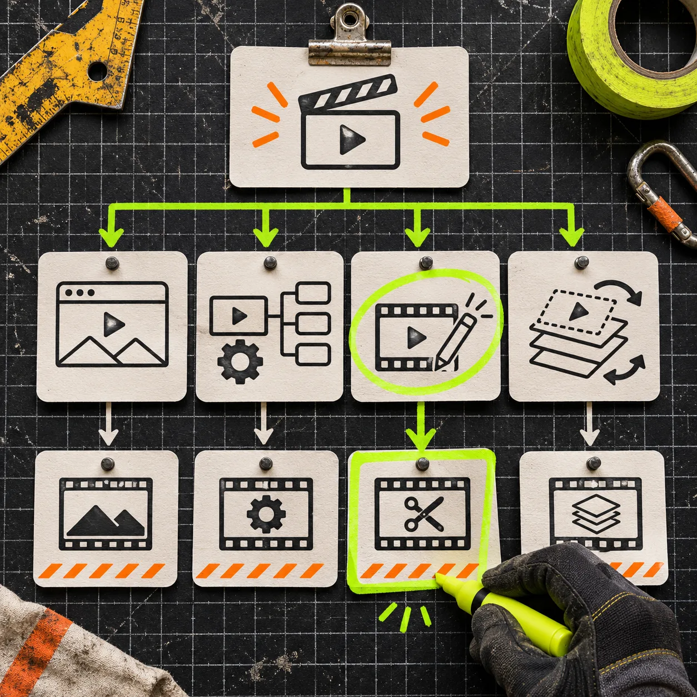

# VideoFlow Studio vs. Remotion for a Startup Launch Video

If you need a first launch trailer from the website you already have, choose [VideoFlow Studio](https://studio.videoflow.dev/) when you want an agent to turn that URL into a reviewable, editable motion-graphics film. Choose [Remotion](https://www.remotion.dev/docs/idea) when your real job is authoring a video in React and you want the composition itself to be a software project. Neither is a universal replacement for the other; the useful distinction is who must make the first creative decisions.

That sounds small, but it changes the first afternoon of work. A founder can be blocked by an empty timeline; a developer can be blocked by a tool that hides the component model they need. I would pick the tool that removes the first bottleneck, then keep the handoff honest.

## The short decision

| If this is your situation | Start with | Why |
| --- | --- | --- |
| You have a public startup site and need a credible first trailer | VideoFlow Studio | It starts from the site, develops a plan, builds scenes, then renders and reviews the film. |
| You need a bespoke video surface inside a React product | Remotion | Its core model is a React component rendered as frames; you control the application architecture. |
| A marketer needs to ask for a different end card or timing pass | VideoFlow Studio | Its workflow keeps an editable project behind the render and accepts plain-language changes. |
| An engineer needs reusable compositions, runtime props, or a custom player | Remotion | Its documentation centers on compositions, React components, and an embeddable Player. |
| Your launch is high-stakes and neither route has a validated brief | Pause first | A weak source page produces a weak outline in any video tool. Build the evidence pack before generating. |

The last row matters more than tool loyalty. Before choosing anything, collect one sentence for the audience, one product promise, the proof that makes the promise believable, and the action the viewer should take. Our earlier guide to a [website evidence pack for a startup video](https://tools-and-how-tos.github.io/2026/11/05/build-a-website-evidence-pack-before-generating-a-startup-video/) is a good short preparation pass.

## What VideoFlow Studio is optimized to do

Studio is a product workflow, not a React framework with a friendlier landing page. Its [current product page](https://studio.videoflow.dev/) describes two entry points: run the CLI against your own Claude Code or Codex subscription, or use a hosted agent after pasting a URL. In both cases, the stated flow is website, product understanding, one directed concept, layered scenes, render, and review.

That makes it a sensible choice when the brief is implicit in a real product site and the goal is a first launch film—not a new video application. The agent can start with the pages, product language, visual cues, and feature evidence that already exist. Studio says the resulting film remains an editable project, so a change request can be a real edit rather than a request to recreate the whole clip.

A practical way to use that advantage is to give the first pass a narrow job:

1. Choose one audience and one moment of pain from the site.
2. Name one product proof worth putting on screen.
3. Ask for a 20–30 second concept with a single through-line.
4. Review the encoded result for text hierarchy, logo treatment, claim accuracy, and the last-frame action.
5. Request only the next meaningful change—such as holding the end card longer—then review again.

This is deliberately less ambitious than “make our launch video.” It follows the useful message-first constraint from [choosing one message for a 30-second SaaS product video](https://productivity-tech-business.blogspot.com/2026/11/how-to-choose-one-message-for-30-second.html): a trailer should carry one idea, not narrate the whole roadmap.

## What Remotion is optimized to do

Remotion begins from a different contract. Its [core documentation](https://www.remotion.dev/docs/idea) describes a React component rendered frame by frame; compositions register that component with duration, frame rate, and dimensions. Its [Player](https://www.remotion.dev/docs/player) is built to embed a Remotion video in a React app and customize content at runtime.

That is a strong fit if your launch video is really part of a system: a campaign generator, a personalized product recap, an in-app player, or a codebase where a team needs to own every rendering rule. It is also the better fit when the motion grammar itself is the product work—custom components, data-fed variants, tests, version control, and engineering review.

The trade-off is that a blank React composition does not infer a narrative from a homepage. Your team must make the film decisions: scene order, visual system, assets, timing, and the logic that connects them. That is not a flaw; it is exactly why Remotion is useful for teams that need precise, repeatable control. It is simply extra work when a founder needs a sharp first trailer before Friday.

## The review pass is the real dividing line

Do not compare these tools by asking which one “uses AI.” Ask where the quality check happens. Studio says it reviews encoded frames, measures visual issues, and re-renders fixes; that makes rendered output part of the product workflow. With Remotion, you can build equally rigorous checks, but the team owns the review system and the criteria.

For either route, use this five-point launch-video receipt before approving a render:

- The opening names one problem or one outcome within the first few seconds.
- Every on-screen claim appears on, or is supported by, the product source material.
- The product name, interface, and final action remain legible at the delivery size.
- The film does not add a second “main message” halfway through.
- A reviewer who did not make the video can explain the audience and next action after one watch.

That receipt is also a hedge against the common failure mode: judging the timeline instead of the exported video. If the next version will be revised by several people, keep a simple [launch-video change log](https://the-lean-ecommerce.gitlab.io/2026/11/03/i-keep-a-launch-video-change-log-before-i-ask-for-another-render/) so a late request does not quietly undo an approved decision.

## A handoff test before you commit

Here is the smallest test that gives you a real answer. Pick one landing page. Write a 60-word brief with audience, promise, proof, and CTA. Then ask each candidate workflow to produce or outline the same 20–30 second trailer.

For Studio, judge the plan, first render, and how cleanly you can request an edit. For Remotion, judge how quickly your team can establish the composition, implement the visual rules, and make a second variant without creating a tangle. Do not compare imaginary final quality; compare the work you can actually review in a day.

## Choose the tool that preserves the right kind of control

Pick VideoFlow Studio when your startup needs an editable, reviewed first trailer from a URL and the main risk is getting from product story to usable first cut. Pick Remotion when video is an engineering surface and the main risk is losing control over your components, data, or runtime behavior.

Both routes still need a clear brief and a visible review gate. If the launch is close, start by running [VideoFlow Studio](https://studio.videoflow.dev/) on one public product page with the 60-word brief above. You will learn more from a reviewable first cut than from another week debating an empty timeline.

For a broader release process, pair that with a [message–proof–cut review card](https://the-lean-ecommerce.gitlab.io/2026/11/02/startup-launch-video-handoff-a-message-proof-cut-review-card/) before anyone calls the trailer done.
