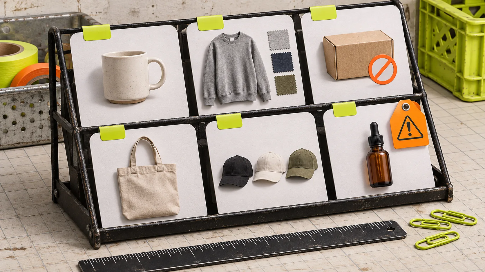
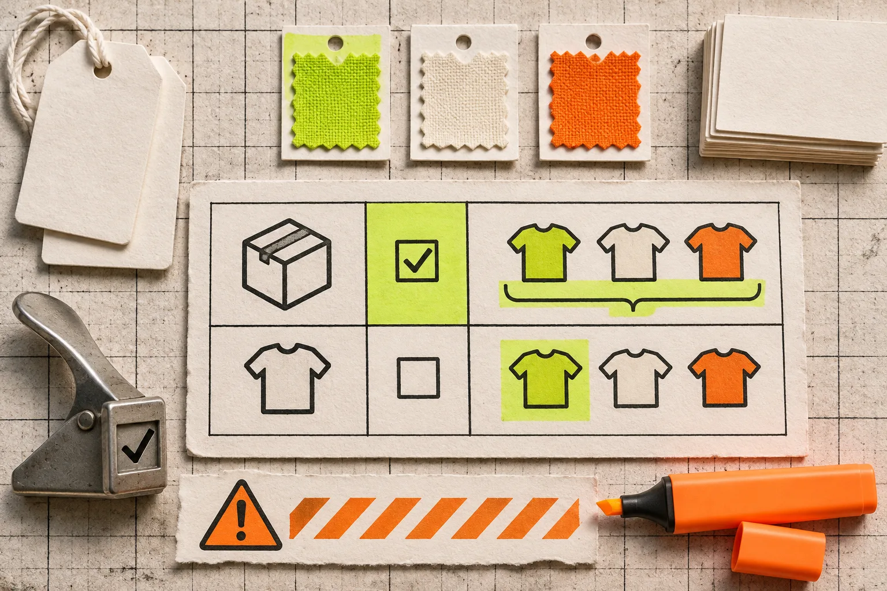
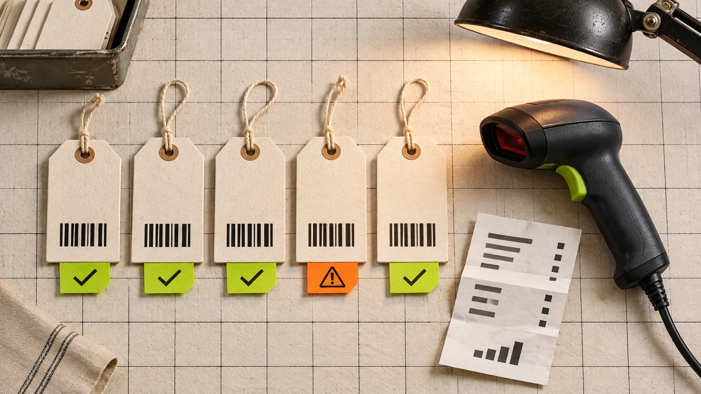

# A Shopify Bulk-Edit Pilot for Catching Variant Scope Mistakes

A safe Shopify bulk edit starts with a deliberately awkward mini-run, not a perfect-looking sample. Pick six records that expose the boundaries of your change—one simple product, one multi-variant product, one out-of-stock variant, one exception, one product that must stay unchanged, and one record that represents the largest or most complex case. Then compare the intended field at both product and variant level before you touch the full selection.

That small exercise catches the mistake behind many catalog cleanups: a rule written for products quietly affecting variants, or a variant-only change leaving the product-level copy behind. Shopify treats variants as combinations of option values such as size and color, while product details also drive organization, search, and sales-channel behavior. [Shopify’s product documentation](https://help.shopify.com/en/manual/products/details) and [variant guide](https://help.shopify.com/en/manual/products/variants) are worth keeping open while you define scope.

## Write one change sentence before opening the editor

Use this format: **Change _field_ on _scope_ when _selection rule_ is true; do not change _exclusion_.**

For example: “Append `- Summer` to the title of active beach-towel products tagged `seasonal-2026`; do not alter variant titles, archived products, or bundles.” That sentence makes a later review possible. It also reveals when you are trying to combine two jobs—say, price changes and taxonomy cleanup—that should be separate tasks.

This is where a bulk editor earns its place. [Ultimator Bulk Editor](https://apps.shopify.com/ultimate-bulk-editor) supports bulk work on products and variants, with search/filtering and scheduled or immediate tasks. Its current App Store listing also describes fields such as prices, SKUs, tags, inventory, metafields, descriptions, and collections. Those capabilities reduce clicks; they do not decide your scope for you.

## Assemble a six-record pilot with real edges

Do not select the first six results. Select the records most likely to make the rule ambiguous.

| Pilot record | Why it belongs | What to check |
| --- | --- | --- |
| Simple product | Establishes the expected outcome | The target field changes once |
| Multi-variant product | Separates parent and child behavior | Product and each relevant variant land correctly |
| Out-of-stock variant | Tests inventory-state assumptions | The rule does not accidentally skip or revive it |
| Product with an exception tag | Tests your exclusions | It stays untouched |
| Record with unusual punctuation or a long title | Exposes search/replace surprises | The result remains readable and unique |
| High-importance product | Gives you a realistic release check | Storefront and admin output agree |

If you are editing prices, include a product with a compare-at price. If you are changing SKU format, include an existing SKU that already contains the separator you plan to add. The point is not statistical sampling. It is failure-mode sampling.

## Check the scope matrix, not only the task summary

A task can look correct while the wrong layer changes. Use this quick matrix before the pilot.

| Question | Product-level answer | Variant-level answer |
| --- | --- | --- |
| Where does the field live? | Title, description, tags, product type | SKU, barcode, inventory, option combination |
| Who sees the change? | Product-page and collection context | Shoppers choosing a specific option or downstream operations |
| What can reveal a mistake? | Product admin page and collection filter | Variant list, inventory view, selected option on product page |

For fields with a storefront consequence, inspect both admin data and a customer-facing page. Shopify notes that product details affect display and organization; the safest definition of “done” is therefore not merely “the task completed.” It is “the expected records changed, excluded records did not, and the resulting catalog still makes sense where people use it.”

## Run the pilot, then make a small receipt

Run the task on the six records. Save a short receipt containing the task name, the selection rule, the exact field operation, the six handles or IDs, and one before/after value for each. This is lighter than a rollback plan, but it gives you a way to spot drift before scale.

For each record, answer three questions:

1. Did the target field change exactly once?
2. Did every excluded field remain untouched?
3. Does the result still work in the place it matters—product page, collection, inventory workflow, or feed?

If any answer is uncertain, revise the selection or split the job. A catalog-wide operation should be the second run, not the experiment. For a complementary closeout pass, use this guide on [reconciling a Shopify bulk edit](https://tools-and-how-tos.github.io/2026/11/02/how-to-reconcile-a-shopify-bulk-edit-before-you-call-it-done/).

## Scale only after the pilot has one boring result

The most useful pilot is boring: all six records produce the expected result, including the exception. At that point, duplicate the same task configuration for the full selection, or schedule it if timing matters. Keep the scope sentence with the task so a teammate can audit it later.

This approach also makes adjacent catalog work less risky. A color cleanup may require deciding [when colors are variants versus separate products](https://tools-and-how-tos.github.io/2026/11/06/shopify-color-swatches-when-to-use-variants-or-separate-products/), while image changes require preserving a trustworthy source image rather than overwriting it—see [this product-image variant workflow](https://tools-and-how-tos.github.io/2026/11/02/how-to-make-shopify-product-image-variants-without-replacing-the-maste/). For scheduled price work, the principle is the same: one bounded change, a tested selection, then a recorded result.

## Make the next bulk update inspectable

Install [Ultimator Bulk Editor](https://apps.shopify.com/ultimate-bulk-editor) when you need a repeatable way to select catalog records, define the operation, and run or schedule the task. Start with six difficult records, not six convenient ones. That single habit makes a bulk edit easier to explain, easier to verify, and far less likely to create a catalog repair project tomorrow.
