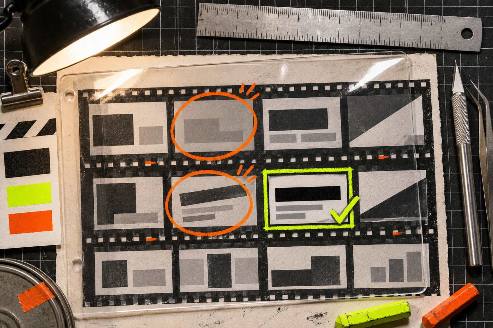
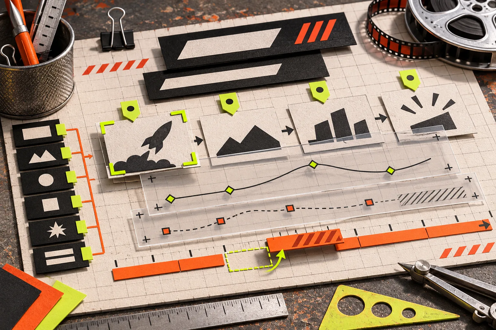

# Build a Website Evidence Card Before Directing a Startup Launch Video

A startup homepage can become a launch video, but it should not become a feature-by-feature slideshow. The practical move is to make one evidence card for each proposed scene: a real page or screenshot, one customer problem, and one visible proof point. That gives your video director something concrete to build from—and gives you a fast way to cut scenes that are merely decorative.

[VideoFlow Studio](https://studio.videoflow.dev/) is useful here because it starts with the public website, develops a plan, creates the film, then lets you revise the same editable project from the terminal or browser. The tool does not remove the need for a brief; it makes a small, evidence-led brief much more valuable.

## The evidence card: three things a scene must earn

For every scene, write three short fields before you generate anything:

| Field | What to capture | What it prevents |
| --- | --- | --- |
| Website evidence | The exact page, heading, UI state, or product visual | Inventing a claim the site does not support |
| Customer tension | The job, delay, risk, or frustration the viewer recognizes | A video that opens with product jargon |
| On-screen proof | One visual action that demonstrates the claim | Narration floating over unrelated animation |

Here is a fictional SaaS example. A homepage says “deploy previews on every branch.” The tension is that a founder wants to ship a landing-page change without turning Friday into a release meeting. The proof is a branch moving from a code change to a preview URL. That is a scene. “Modern developer platform” is not.

This is deliberately smaller than a full creative brief. If your customer research is still scattered, start with the [customer-research launch-video brief](https://tools-and-how-tos.github.io/2026/09/22/how-to-turn-customer-research-into-a-saas-launch-video-brief/) and return when you can identify one claim worth showing. If you already have a release narrative, the evidence card becomes the bridge between that narrative and the actual website.

## Pull evidence from the site, not from your memory

Open the live homepage in one window and make a short inventory. Look for:

- the first promise a new visitor sees;
- a product screen or interaction that can carry a scene;
- a feature with a visible before-and-after;
- a trust marker that is safe to repeat exactly;
- a call to action that matches the film’s final step.

Do not treat every headline as video material. Claims that need a footnote, a long setup, or a sales call usually do not survive a 20–40 second launch video. The best candidates can be understood from one frame plus one movement.

VideoFlow Studio says it crawls and screenshots the live site, then separates the product, audience, brand, and worthwhile features into named pieces before it directs the film. That is a promising starting point, but retain editorial control: remove stale pages, vague superlatives, and logos you do not have permission to feature. For the broader collection step, use this [website evidence-pack guide](https://tools-and-how-tos.github.io/2026/11/05/build-a-website-evidence-pack-before-generating-a-startup-video/).

## Turn cards into a three-scene spine

A short product trailer usually needs fewer scenes than its maker expects. Use this order:

1. **Name the tension.** Use the customer’s recognizable stuck moment, not an abstract market category.
2. **Show the proof.** Animate the product behavior, interface, or result from the evidence card.
3. **Land the next step.** End on one clear action: try, join, book, or ship.

Give each scene one carried object—a branch, a pricing tile, a support ticket, a calendar slot—rather than introducing a new icon family every few seconds. VideoFlow Studio explicitly frames its planning around one concept and one spine, which is the right constraint for a first cut.

## Direct the first cut with constraints, not adjectives

“Make it exciting” leaves a lot of expensive room for interpretation. A better direction names the cards and the rules:

> Build a 30-second launch film from these three evidence cards. Open on the release-delay tension. Use the preview URL as the carried object. Keep the product UI readable at normal viewing size. Do not add claims that are not on the site. Hold the final call to action for two beats.

That is enough to begin in [VideoFlow Studio](https://studio.videoflow.dev/), whether you run `npx @videoflow/studio@latest` with your own Claude Code or Codex subscription or use its hosted option. The official product page currently lists eight free renders and edits per month for the CLI path and says optional AI voice, image, and video inputs are billed separately; check the current limits before you plan around them.

The right caveat: this approach is for structured motion graphics and product narratives, not every kind of video production. If you need actor footage, a brand campaign with original cinematography, or legal review of sensitive claims, the evidence card should feed a human production process instead of replacing it.

## Review the rendered film as a viewer would

A clean plan can still produce a weak frame. Review the encoded output, not just the storyboard. Pause on the opening, proof, and end card and check:

- Can someone identify the product without reading tiny type?
- Does every scene retain the promised customer tension?
- Is the proof visible before the narration moves on?
- Are contrast, alignment, and safe margins working on the actual render?
- Does the CTA ask for only one next action?

Studio’s published workflow includes rendered-frame review and re-rendering for visual issues. Pair that with your own editorial pass using the [startup launch-video QA checklist](https://tools-and-how-tos.github.io/2026/10/30/startup-launch-video-qa-checklist-what-to-check-before-you-publish/) and the [product-video review rubric](https://tools-and-how-tos.github.io/2026/10/23/how-to-build-a-product-video-review-rubric-before-you-export/). The difference matters: automated inspection can catch measurable defects, while you still decide whether the story is true and useful.

## Keep the revision path open

Treat the first render as a testable draft. VideoFlow Studio’s core promise is that the output remains an editable project: you can ask for a change in plain language or adjust layers, timing, color, and text in its editor. That makes it sensible to make a precise revision request: “Remove scene two because the proof is not visible,” not “make it more premium.” For a practical revision loop, see [how to revise a startup video from your terminal](https://tools-and-how-tos.github.io/2026/10/18/how-to-revise-a-startup-video-from-your-terminal/).

The useful deliverable is not merely an MP4. It is a launch film whose scenes can each be traced to a real customer problem and a real piece of website evidence. Make the three cards first, direct a constrained first cut, and reject any scene that cannot show its proof. Then [start a VideoFlow Studio project](https://studio.videoflow.dev/) with a brief strong enough to survive the render.
