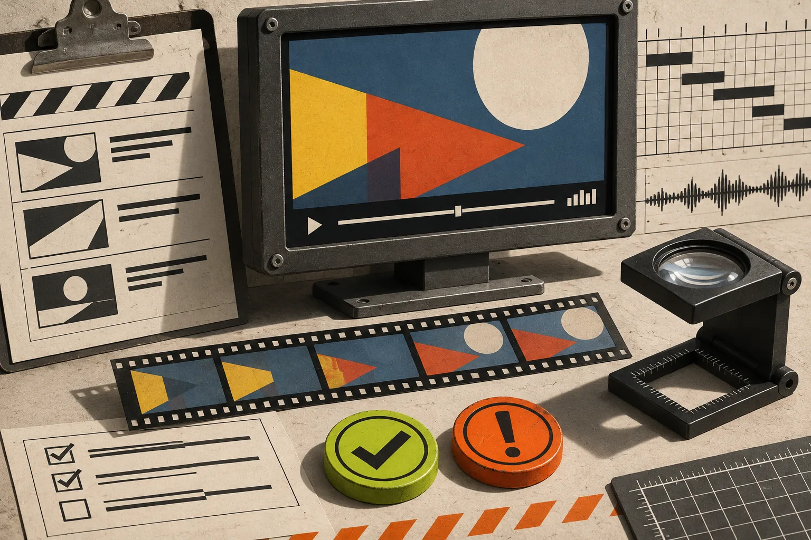

# How to Turn a Startup Claim Into a Video Scene

A startup launch video becomes a feature dump when every sentence on the website gets treated as a scene. The practical fix is a **claim-to-scene ledger**: for each claim, write the proof you can show, the viewer action it supports, and the one scene that earns its place. That leaves you with a shorter, more accurate film—and a clear review trail when the product changes.

[VideoFlow Studio](https://studio.videoflow.dev/) is useful here because it begins with a public website, makes a plan, builds the film, and keeps the resulting project editable. You can run it locally with `npx @videoflow/studio@latest` using your own Claude Code or Codex subscription, or use the hosted path; the current Studio page says the CLI includes eight renders and edits per month, while optional media and hosted use can involve credits. Check the current limits before treating either route as a production budget.

## Start with claims that can survive the frame

A claim is not automatically a scene. “Fast setup,” “secure collaboration,” and “everything in one place” may be useful website copy, but none tells a viewer what they will actually see. Before you write a voiceover, collect only claims that have one of these anchors:

| Claim type | What counts as proof | Good scene job |
| --- | --- | --- |
| Product action | A visible workflow, control, or before/after state | Demonstrate one action |
| Customer outcome | A carefully supported result or use case | Frame the stakes, not an unverified metric |
| Product boundary | What the tool does not do, or its required input | Set expectations early |
| Brand promise | A real visual or behavioral pattern on the site | Carry the tone between scenes |

If a claim has no proof, it can still be a hypothesis for the next landing-page revision. It should not become a confident line in a launch trailer. That is especially important for pricing, security, performance, or integration claims: link back to the source internally and ask a product owner to confirm it before the film ships.

This is narrower than a general [website evidence pack](https://tools-and-how-tos.github.io/2026/11/05/build-a-website-evidence-pack-before-generating-a-startup-video/). The pack gathers material. The ledger forces a decision about what that material is allowed to do on screen.

## Build a four-column claim-to-scene ledger

Make one row for each candidate moment. A spreadsheet is fine; the important part is that the scene is accountable to a source.

| Claim | On-screen proof | Viewer takeaway | Scene instruction |
| --- | --- | --- | --- |
| “Teams can publish a report in one pass” | A real report moving from draft to share state | The workflow has a clear finish | Show the draft, one approval action, then the shared view |
| “Edit without starting over” | An editable timeline or layer view | Revision is part of the workflow | Change one headline and hold the revised end card |
| “Built for product teams” | Named audience language and an actual product context | Who should care | Use the opening problem, not a logo collage |

The last column is deliberately concrete. “Show collaboration” is a request for vibes. “Show the comment resolving, then the updated report” is a scene direction someone can review.

For a 30-second film, use no more than three to five rows. Pick one **spine**—the idea that connects the whole film—and let other claims support it. Studio describes this as turning site material into one concept rather than a table of contents. Its workflow also keeps the video as an editable document, so a later revision does not have to mean rebuilding from a locked export.

## Separate proof from decoration before directing the agent

A product screenshot, logo, or dashboard can play two different roles. Proof answers “can the viewer see the claim?” Decoration establishes rhythm and brand. A busy product montage often fails because it pretends decoration is proof.

Use this quick test on every proposed shot:

1. Pause the film on this frame. Could a skeptical viewer identify the product action?
2. Remove the spoken line. Does the visual still support it?
3. Remove the visual. Is the line making a promise the website does not substantiate?
4. If the product changed tomorrow, would you know which scene needs review?

If the answer to the first two questions is no, label the shot as decorative and do not let it carry a factual claim. It may still be useful as a transition, brand beat, or breathing room.

## Direct one bounded first cut

Give Studio the live URL, then direct the first cut using the ledger—not a wish list. A compact request might be:

> Build a 30-second launch film with three scenes. Lead with the reporting bottleneck, show the approved report moving to a shared state, then end on the editable revision moment. Use the site’s real color and type cues. Do not claim time savings or integrations not shown on the site.

That instruction gives the agent a priority order and a boundary. It is also more useful than asking for “an energetic explainer,” because a reviewer can check whether the three promised beats appeared. Studio’s current product page says it crawls and screenshots the live site, plans the film, builds scenes from editable layers, then encodes and reviews the result. Treat that review pass as a useful checkpoint, not proof that every marketing claim is approved. A rendered frame can reveal alignment or contrast issues; it cannot decide whether your business claim is true.

For teams that want to author every scene in code, [Remotion’s project workflow](https://www.remotion.dev/docs) may be the better fit: it starts with a local project and templates. Studio is better aligned with the different job of producing a reviewable first launch film from a URL. Neither choice removes the need for a claim owner.

## Review the cut against the ledger, not your memory

Run the review in two passes. First, watch normally for pace and clarity. Then open the ledger and inspect each row. Mark one of three states: **shown**, **partly shown**, or **not shown**. “Partly shown” is valuable—it catches scenes where a dashboard looks impressive but the relevant action is too small, too quick, or replaced by generic animation.

This complements a broader [startup launch video QA checklist](https://tools-and-how-tos.github.io/2026/10/30/startup-launch-video-qa-checklist-what-to-check-before-you-publish/). The ledger adds traceability: it tells you why a shot exists and who can approve a change. If the issue is purely visual, a [product-video review rubric](https://tools-and-how-tos.github.io/2026/10/23/how-to-build-a-product-video-review-rubric-before-you-export/) is a useful second pass.

Keep revisions atomic. Ask for one change per request, such as “hold the approved report scene one second longer” or “replace the second claim with the newly verified feature name.” Studio supports plain-language revisions and manual layer, timing, colour, and text edits in its browser editor; use either route, but re-check the same ledger row after the render.

## Hand off the ledger with the editable project

The final handoff needs more than an MP4. Include the source URL date, the three-to-five ledger rows, the approved render, and the editable project. This makes a pricing update, renamed feature, or brand refresh a targeted repair rather than a scavenger hunt through a finished film. For a structured final check, use a [message–proof–cut review card](https://the-lean-ecommerce.gitlab.io/2026/11/02/startup-launch-video-handoff-a-message-proof-cut-review-card/).

The next time you turn a website into a launch video, do not start by scripting every headline. Start by selecting three claims that can be shown honestly, write a scene job for each, and direct the first cut from that ledger. Then try [VideoFlow Studio](https://studio.videoflow.dev/) with the URL and the bounded brief—the film will have fewer scenes, but every one will have a reason to be there.
