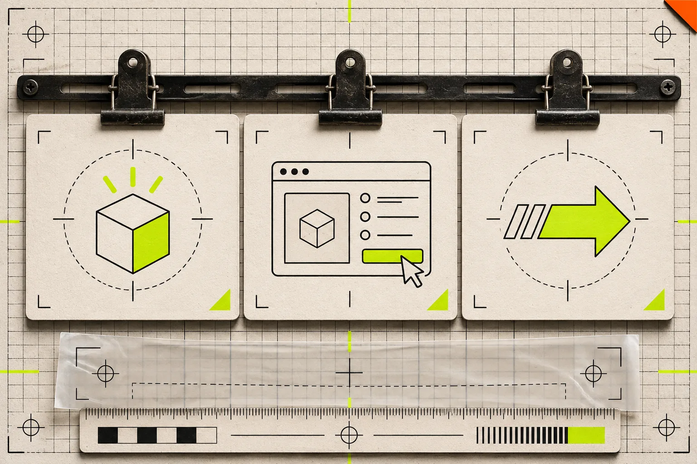

A startup launch video is ready to share when a stranger can name the problem, see one believable proof point, read the important frame at normal viewing size, and tell you what can still be changed. If any of those four tests fail, treat the cut as a working file—not a launch asset. [VideoFlow Studio](https://studio.videoflow.dev/) is useful here because it turns a URL into an editable motion-graphics film, then lets you direct a revision in plain language or work in its editor.

That distinction matters. A clean render can still be a bad explanation. This is the short review pass I would run before attaching a video to a launch post, sales email, or Product Hunt page. It is designed for a 20–45 second startup trailer, not a brand film or customer documentary.

## The four checks: message, proof, legibility, editability

| Check | Ask this before sharing | Fail signal | Smallest useful fix |
| --- | --- | --- | --- |
| Message | Could someone repeat the product’s job after one watch? | The opening lists features or starts with atmosphere. | State one user problem, then the product’s promised change. |
| Proof | Does the film show why the claim is credible? | Claims float over generic motion or decorative screens. | Put one real interface, workflow, or concrete outcome beside the claim. |
| Legibility | Can the viewer read the key idea on a phone-sized preview? | Tiny UI, low contrast, or three ideas compete in a frame. | Enlarge the key detail; remove the supporting clutter. |
| Editability | Can the next likely change be made without rebuilding the film? | The team needs a new video for a revised price, date, or CTA. | Keep copy, timing, colors, and layers in a structured working document. |

This is not an argument for making every video minimal. It is a way to locate the one thing that blocks understanding. For an earlier step, build the source material first: a [website evidence pack](https://tools-and-how-tos.github.io/2026/11/05/build-a-website-evidence-pack-before-generating-a-startup-video/) gives the cut something more useful than homepage decoration.

## 1. Watch once with the sound off

Start muted and do not pause. In the first five seconds, write one sentence: “This is for ___ who need to ___.” If you cannot write it, the first scene is trying to earn attention before it has earned comprehension.

A startup trailer usually needs one message spine, not a compressed sitemap. The message can be a problem, a before/after, or a practical category statement. It should be specific enough that the next scene can prove it. The useful handoff is claim → visual evidence → next action. If your team has already written a message, use this [claim-to-scene method](https://tools-and-how-tos.github.io/2026/11/12/how-to-turn-a-startup-claim-into-a-video-scene/) to inspect whether each scene actually carries its assigned claim.

Do not confuse a logo reveal with a message. A logo is an identifier; it does not explain the job.

## 2. Circle one proof frame

Now scrub the cut and mark the exact frame that makes the promise believable. For a scheduling product, that might be the booking flow. For a developer tool, it could be the command and the result. For a marketplace, it may be the specific outcome that the user gets.

The proof frame needs context. A perfect-looking dashboard with no link to the opening claim is just visual noise. Conversely, a dense screen recording may be truthful but unreadable. Show only the area that answers the viewer’s immediate question.

A simple test is to hide every other scene. Does the remaining claim-plus-proof pair still make sense? If not, add a bridge or replace the claim. This is where a manually authored code-first video can be the right choice: teams that need exact component behavior or an entire video application may prefer [Remotion’s React-based workflow](https://www.remotion.dev/). For a founder who needs a first structured cut from a public URL, Studio and its underlying [editable VideoFlow format](https://videoflow.dev/) target a different job.

## 3. Run the small-screen legibility test

Play the video at 50% scale or on a phone. Pause on every frame that contains a product name, metric, interface state, or call to action. Each frame should have one visual priority.

Use this quick branch:

- If the words are hard to read, increase type size or shorten the sentence.
- If the interface is hard to read, crop to the interaction that supports the claim.
- If both are readable but the frame feels busy, remove a layer before adding an animation.
- If a frame only works while narrated, add a concise on-screen cue rather than assuming audio is on.

VideoFlow Studio says it plans, builds, renders, and keeps the resulting launch video editable; its site also describes running the CLI from your own terminal or generating in the browser. That makes the legibility pass actionable rather than merely critical: ask for a targeted change such as “keep the CTA visible for one second longer and crop the demo to the selected row,” then review the replacement render. Verify current allowances and pricing on [Studio’s pricing page](https://studio.videoflow.dev/pricing) before treating a free tier as part of a launch plan.

## 4. Write the revision request before you share

The last check is operational. Imagine the launch date moves, the pricing changes, or a reviewer flags a misleading phrase. Can you name the change precisely?

Use this revision card:

> **Change:** Replace [old claim or element] in [scene/time].  
> **Reason:** It conflicts with [current product fact or audience need].  
> **Keep:** [the visual proof, timing, and brand elements that should not move].  
> **Success condition:** A first-time viewer can [understand or do the intended thing].

This card prevents the vague “make it punchier” loop that creates regressions. VideoFlow Studio is designed for this kind of directed iteration: the product describes natural-language changes alongside manual editing in its built-in editor. If your team needs full code ownership rather than an agent-led first cut, choose accordingly; the [agent-led versus code-first decision](https://tools-and-how-tos.github.io/2026/11/09/choose-agent-led-or-code-first-startup-video/) is a useful boundary.

## A review pass is cheaper than a relaunch

Before sharing, make four notes: the message in one sentence, the proof frame, the smallest unreadable element, and the first likely revision. If those notes are clear, the video is doing its job. If they are not, do one targeted revision while the film is still editable.

Try [VideoFlow Studio](https://studio.videoflow.dev/) with your startup URL when you need a reviewable motion-graphics first cut rather than a locked one-shot render.
