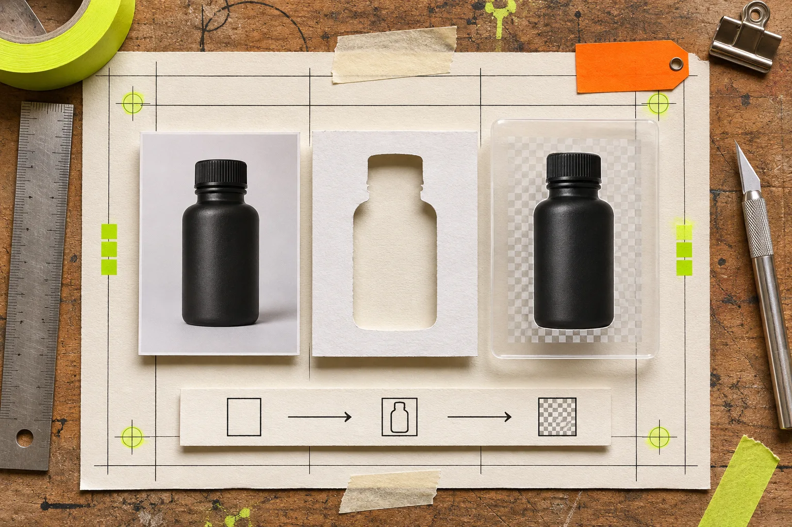
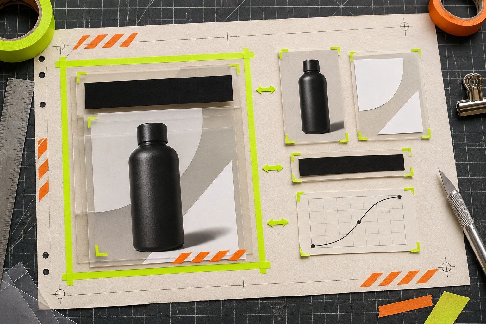
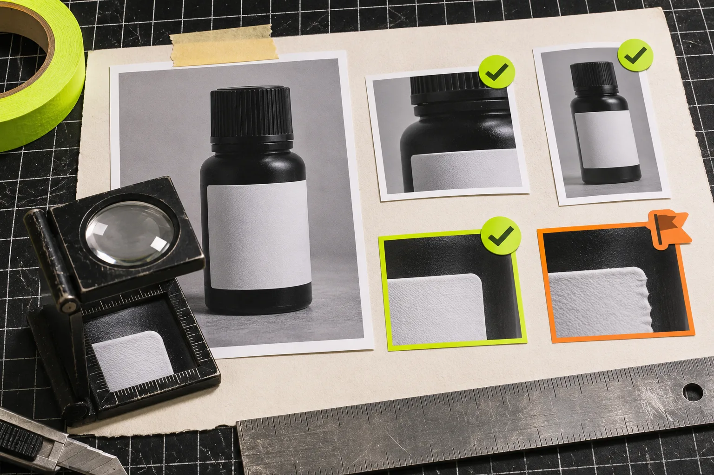

# How to Build an Editable Product Comparison Graphic in Your Browser

A product comparison graphic should begin with the real product photo, then add copy and layout as separate parts—not bake everything into one flattened image. That keeps the product truthful, makes seasonal or channel-specific changes quick, and gives you a file someone else can safely update. [ImageFlow](https://imageflow.dev/) is a useful browser-based option when you need layers, masks, adjustment layers, smart objects, text, and PSD import/export without installing a desktop editor.

This is not an argument for making every product card elaborate. If a clean product photograph already answers the buying question, use it. Build a comparison graphic when the reader needs a specific contrast: size, material, use case, included accessory, or product tier. Shopify supports images, video, and 3D models as product media; the graphic should clarify the choice, not replace the evidence. [Shopify’s product-media documentation](https://shopify.dev/docs/storefronts/themes/product-merchandising/media) is a useful reminder to treat it as one part of the product story.

## The five-layer recipe

Start from a master document, not the image you plan to upload. Make these layers—or layer groups—before you style anything:

| Layer | What belongs there | What must stay true |
| --- | --- | --- |
| Original | The untouched source photo, locked | The reference you can always return to |
| Product cutout | A masked copy of the product | Edges, logo, color, finish, included parts |
| Background | Solid field, texture, or shape | It must not imply a different product setting |
| Comparison copy | Short, factual labels | No invented performance or unavailable options |
| Export guides | Crop/safe-area marks for each channel | They never appear in the final image |

Name the groups plainly: `01-original`, `02-cutout`, `03-background`, `04-copy`, and `99-guides`. It feels fussy once; it saves time every time the price, campaign, or crop changes. The same discipline is behind this earlier guide on [making Shopify image variants without replacing the master](https://tools-and-how-tos.github.io/2026/11/02/how-to-make-shopify-product-image-variants-without-replacing-the-maste/).

## Build the graphic without rebuilding the product

1. **Open the highest-quality real product photo and duplicate it.** Keep the lower original locked. Work on the duplicate so a failed mask or adjustment has a known escape hatch.

2. **Make the cutout with a mask, not erasure.** ImageFlow lists layer masks, vector masks, clipping masks, and on-device selection/background-removal tools. Use the selection as a starting point, then zoom in on cap edges, reflections, transparent parts, seams, labels, and tiny accessories. A clean edge is more valuable than a dramatic background.

3. **Correct the image with adjustment layers.** Brightness, contrast, or color corrections should sit above the cutout as reversible adjustments. Do not use a comparison card to make a matte finish look glossy, change a colorway, hide damage, or imply an accessory is included. If the photograph needs a material change, that is a reshoot question—not a slider question.

4. **Add a simple backdrop and one claim at a time.** A comparison card fails when it tries to become a brochure. Pair the photo with a factual label such as “stainless steel body,” “travel size,” or “includes lid” only when the listing substantiates it. Keep important copy out of the crop edge.

5. **Use text as text.** Keep type on a text layer rather than rasterizing it. ImageFlow’s documented text tools include variable fonts and OpenType features. That means a later typo fix or narrow mobile crop does not require rebuilding the art.

6. **Save the editable master before exporting variants.** Export copies for each destination; retain the PSD or PSB master with its layers. If a teammate supplied a complex PSD, test one real round trip before making it your production dependency.

## Use a crop card before you make variants

Write three target boxes inside the document: square, portrait, and wide. For each one, answer these four questions:

- Is the product still recognisable at thumbnail size?
- Is the label or comparison claim inside the safe area?
- Does the crop hide a feature a buyer needs to judge?
- Can someone change the copy without touching the photograph?

If the answer to the fourth question is no, go back to layers. This crop-card method prevents the familiar mess where a social crop becomes the only version anyone can find. It also pairs well with a [product image export checklist](https://tools-and-how-tos.github.io/2026/11/01/a-practical-product-photo-export-checklist-for-shopify-listings/) when the image is headed to a storefront.

## Run a 90-second truth check

Before export, compare the working graphic to the locked original at 100% view. Check these failure modes:

| Check | Stop if you see | Fix |
| --- | --- | --- |
| Edge fidelity | Missing handle, clipped label, halo, or broken reflection | Refine the mask at full size |
| Product truth | Changed color, texture, size cue, or included item | Remove the misleading adjustment or claim |
| Copy support | A claim the listing cannot prove | Rewrite it as a fact or remove it |
| Crop safety | Text or essential detail at an edge | Reposition the copy or make a dedicated crop |
| Legibility | Copy blends into the background | Increase contrast and inspect at target size |

For legibility, don’t rely on taste alone: [WCAG 2.2](https://www.w3.org/TR/WCAG22/#contrast-minimum) defines contrast guidance for normal text and large text. A product image does not automatically need to satisfy every text-on-image scenario, but a card with important embedded copy deserves the same discipline.

## Where this workflow stops

An editable graphic is not permission to manufacture evidence. Do not change a product’s color, dimensions, material, fit, condition, or included contents. Don’t use a cutout to suggest an object works in a setting where it has not been tested. For an AI-assisted lifestyle treatment, start with a separate approval workflow; the [product-photo QA workflow before generated lifestyle images](https://tools-and-how-tos.github.io/2026/10/23/how-to-build-a-shopify-product-photo-qa-workflow-before-you-generate-l/) is a good boundary.

Likewise, a browser editor is not a magic compatibility guarantee. ImageFlow can be a practical Photoshop alternative for the documented layer, mask, text, smart-object, and PSD workflow, but a large agency template with unusual plugins, effects, or color requirements should be tested on a duplicate first.

## Start with one honest variation

Open [ImageFlow](https://imageflow.dev/) with one real product photo. Build the five-layer master, make a square and a portrait crop, and run the truth check before either leaves the editor. You’ll have a useful comparison graphic today—and a source file that will not punish the next person who needs to update it.
