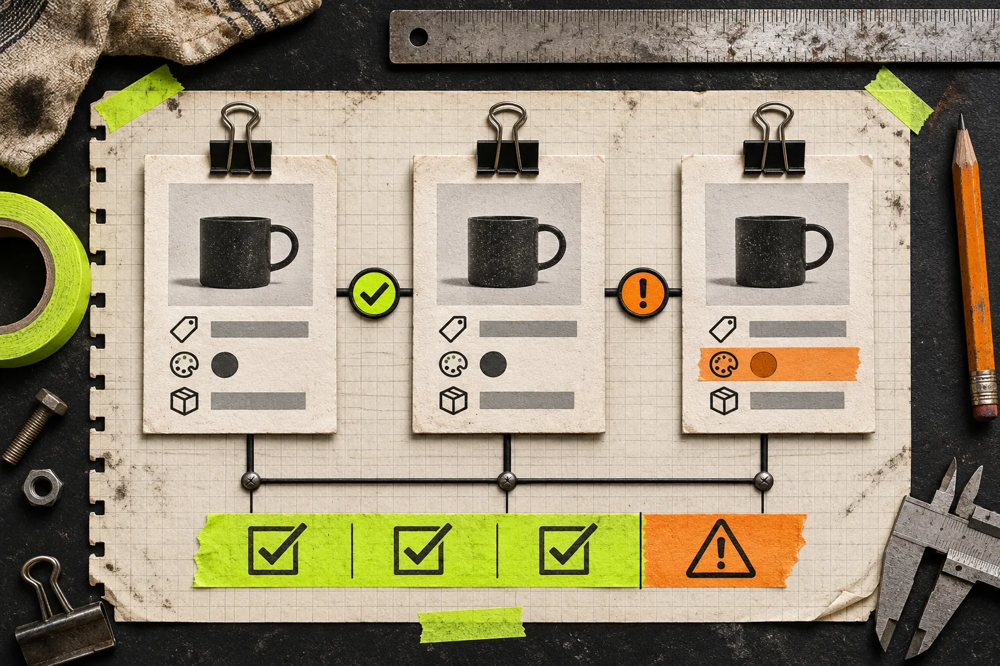

# How to Reconcile an Etsy Catalog Feed After a Listing Change

A scheduled Etsy-to-Meta catalog feed is useful only when you can tell whether a listing change actually reached the catalog. The practical answer is to treat one deliberately changed listing as a control record: capture what changed in Etsy, wait for the next scheduled retrieval, then compare the public listing, feed result, and catalog item before you build a post or promotion around it.

[Catalog Generator for Etsy](https://catalog-generator.webyze.com/) supplies a feed URL intended for Etsy listings; Meta’s feed onboarding documentation describes a scheduled feed as a publicly hosted inventory URL. That makes the feed a handoff, not proof that every downstream catalog value is already correct.

## Start with one control listing

Do not use a whole seasonal refresh as the first signal. Pick one active Etsy listing that has a clear, allowed change: a price, the primary photo, title wording, or an in-stock quantity. Record four things before you save it:

- The Etsy listing URL and listing ID
- The exact field you changed and its before/after value
- The time you saved the edit, including your time zone
- A stable visual reference, such as the first photo or a distinctive price

This is the same small-batch discipline that makes a [bulk-edit pilot](https://tools-and-how-tos.github.io/2026/11/08/a-shopify-bulk-edit-pilot-for-catching-variant-scope-mistakes/) useful: it gives you one result you can explain, rather than a wall of changes you cannot untangle. Avoid changing several fields at once unless your goal is explicitly to test the entire listing payload.

## Separate the three places an edit can fail

A listing can be right in Etsy while the catalog remains stale, or the catalog can ingest a record that Meta later flags for a separate issue. Diagnose the handoff in this order.

| Checkpoint | Question | If it fails |
| --- | --- | --- |
| Etsy source | Does the public listing show the intended change? | Fix the listing first; do not chase the feed. |
| Feed handoff | Is the configured Catalog Generator URL still the URL connected in Commerce Manager? | Re-check the data-source configuration and app connection. |
| Catalog item | Does the corresponding Meta item reflect the control change after its scheduled retrieval? | Inspect the feed’s latest run and item-level errors before retrying. |

The middle checkpoint matters because scheduled feeds are retrieved on a cadence rather than at the exact second an Etsy listing changes. Meta’s own documentation calls this a pull approach and notes that it can be stale until a later retrieval. Record the expected refresh window; do not invent a universal delay.

## Verify the destination and permissions before treating it as a feed bug

First, make sure you are looking at the catalog that owns the feed, not a similarly named test catalog. Then open the latest feed result and look for the control item by a stable identifier or its listing details. If the item is present but wrong, compare the specific field rather than declaring the whole sync broken.

Also check setup prerequisites that live outside the feed. Etsy’s [domain-verification guide](https://help.etsy.com/hc/en-gb/articles/360051633874-How-Do-I-Verify-My-Domain-for-Facebook-Shops) says that an Etsy shop can be verified as `shopname.etsy.com` through Shop Manager’s Facebook Shops setting. That verification does not prove a catalog refresh succeeded, but missing or incomplete setup can make a later shop or tagging workflow appear to be a feed failure.

If a changed listing is absent, resist the urge to re-create the entire data source. Start with the latest run’s error surface, the connected feed URL, and the control listing’s public state. The troubleshooting sequence in [this missing-variation guide](https://how-to-blog.gitlab.io/2026/11/17/how-to-fix-missing-etsy-variations-in-a-meta-catalog-feed/) is a useful companion when the discrepancy is specifically a variation rather than a basic listing field.

## Use a short reconciliation receipt

A reconciliation receipt turns an intermittent problem into a repeatable support record. It takes a minute to write and prevents vague notes such as “Meta has not updated.”

1. **Source:** listing ID, URL, field changed, and saved time.
2. **Feed:** data-source name or ID, configured URL, and latest retrieval time/status.
3. **Destination:** catalog item identifier, observed field value, and any displayed error.
4. **Decision:** wait for the next scheduled pull, correct the source, repair the connection, or ask the app/platform support team with the record attached.

Keep the receipt narrow. A title change and a price change can be separate observations; combining them makes it harder to know which value failed. This is a catalog version of the release evidence used in a [Notion-to-Webflow publishing preflight](https://tools-and-how-tos.github.io/2026/11/18/notion-to-webflow-cms-preflight-map-fields-without-publishing-mistakes/): the point is not ceremony, but locating the boundary where expected data stopped matching observed data.

## Know when to stop and escalate

Repeat the control test only after you have changed one plausible cause. Re-running a feed while changing the Etsy listing, account permissions, and source configuration at once creates a new unknown. Escalate with your receipt when the public Etsy listing is correct, the connected feed is confirmed, and the next expected retrieval still produces a missing or incorrect catalog item. Include screenshots only as supporting context; the URLs, IDs, times, and exact field values are the useful evidence.

Catalog Generator is a practical fit when you need a maintained Etsy feed URL instead of manual catalog-file uploads. But it cannot turn scheduled retrieval into instant confirmation. Set up one control listing, document the handoff, and only then schedule the promotion that depends on the catalog being accurate.

**Next action:** change one low-risk listing field, write the four-line receipt, and compare the resulting catalog item after the next scheduled retrieval.
