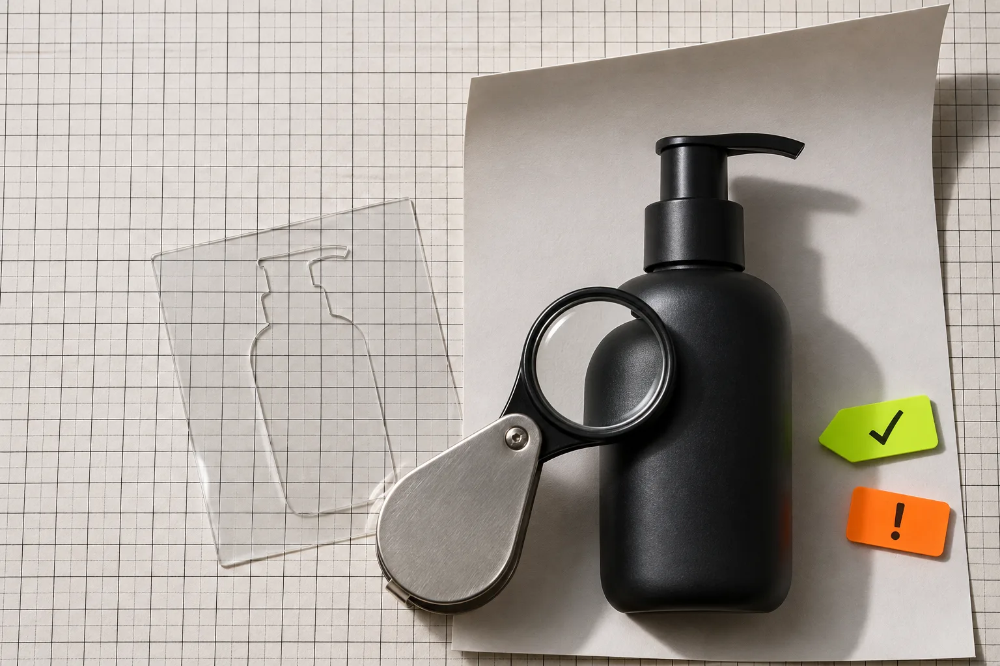
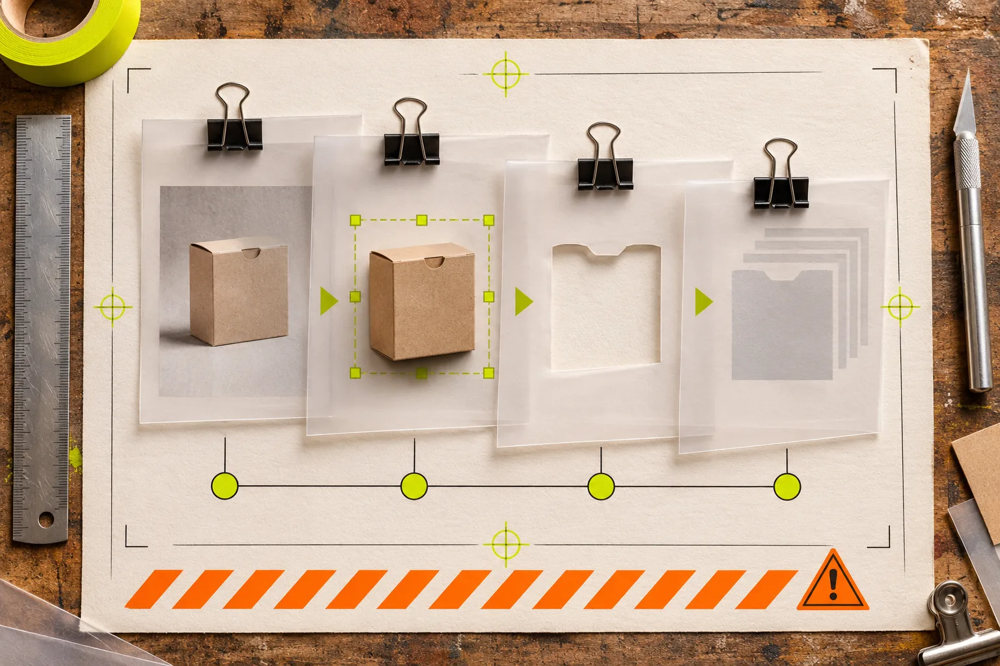
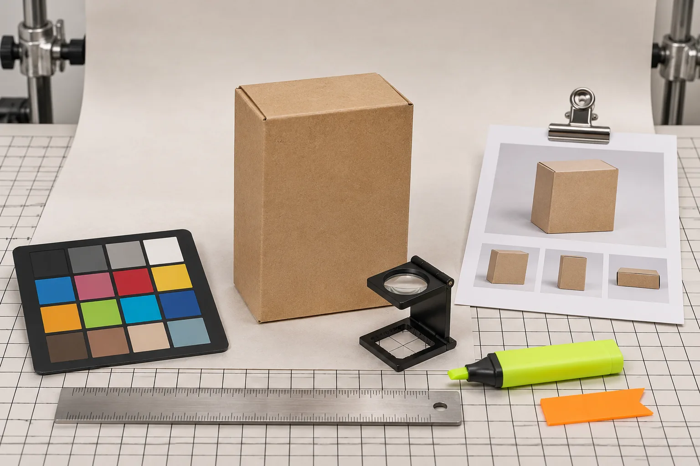

# Product Photo Versioning: A 4-File System for Reversible Edits

When one product photo needs a white-background listing image, a cropped collection card, and a seasonal campaign variant, do not keep editing the only copy. Use four files: the untouched source, an editable master, a delivery export, and an archive. That small system makes the next request cheap—and gives you a way back when a cutout, color correction, or crop goes wrong.

[ImageFlow](https://imageflow.dev/) is useful here because it runs in the browser with layers, masks, adjustment layers, smart objects, and PSD import/export. It is not a promise that every complicated production PSD will round-trip perfectly; test the actual file you depend on. The point is to preserve a working document instead of treating each export as the new source of truth.



## The four files are a decision system, not busywork

Here is the smallest versioning setup that survives real requests:

| File | Job | Safe to change? | Typical format |
| --- | --- | --- | --- |
| `SKU-source` | Original camera or supplied file | No | RAW, TIFF, PNG, PSD |
| `SKU-master` | Your editable working document | Yes, non-destructively | PSD/PSB |
| `SKU-export-channel-size` | A specific publish-ready asset | No—regenerate from master | JPG, PNG, WebP |
| `SKU-archive-date` | A frozen approved package | No | folder with master + exports |

The useful distinction is between *master* and *export*. The master contains the mask, adjustment layers, text, smart objects, and notes needed for the next edit. The export is merely a delivery artifact for a particular channel and crop. If somebody asks for a larger image, a different background, or a corrected label, reopen the master. Never enlarge or re-mask yesterday’s compressed JPEG.

This is the same protection behind a [product-image export contract](https://productivity-tech-business.blogspot.com/2026/11/how-to-set-shopify-product-image-export.html): define which file is authoritative before the assets scatter into email threads and storefront uploads.

## 1. Make the untouched source deliberately boring

Put the original in a `source/` folder and make it read-only if your storage supports that. Do not crop, overwrite, or rename it into something ambiguous like `final-final-2.png`. Record the SKU, capture date, and any supplied color reference in the folder name or a short text note.

This matters most when a product label, finish, seam, or accessory is later questioned. A source file gives you a baseline to compare against; it is not a backup that should be casually edited.

## 2. Build one master that can answer the next request

Open a copy of the source in ImageFlow and save it as the master before making the first correction. Work with masks and adjustment layers where possible, then keep each meaningful change named: `background-mask`, `exposure`, `dust-cleanup`, `collection-crop`. The exact names are less important than making the next operator able to tell what changed.

Use the smallest faithful edit. A mask can isolate the background without destroying the product pixels; an adjustment layer can improve exposure while leaving the original beneath it. Content-aware fill can remove a genuinely accidental distraction, but review its result at full size. It is not a license to erase product details, included accessories, or evidence of wear that a buyer should see.

For a deeper edge check, use the [product-photo fidelity workflow after background removal](https://how-to.the-lean-ecommerce.com/2026/11/10/how-to-check-product-photo-fidelity-after-background-removal/). Look closely at fine hair, translucent material, reflections, logos, and label edges—the places automatic selection often needs manual cleanup.



## 3. Export named variants only after the master passes review

A practical naming pattern is:

```text
SKU123-master.psd
SKU123-shopify-2048-white.jpg
SKU123-collection-4x5.jpg
SKU123-email-1200x628.jpg
```

Use the channel and dimensions in the export name. That removes the common question, “Which of these is live?” and keeps a teammate from repurposing a social crop as a marketplace main image. If you are still deciding whether the asset needs a cutout, a new crop, or a different factual image, use the [Shopify product-image QA workflow](https://tools-and-how-tos.github.io/2026/10/23/how-to-build-a-shopify-product-photo-qa-workflow-before-you-generate-l/); its review-first approach fits this stage well.

Before export, run a two-minute truth check:

- Compare the master to the original at 100% around labels, edges, and texture.
- Check that the background, shadow, and crop do not imply a size, color, or included item that is not real.
- Open the actual delivery dimensions; tiny defects often appear only after downscaling.
- Confirm the chosen format and dimensions suit the destination.
- Keep the master editable after the delivery image is sent.

## 4. Archive the approved set with its decision

When the asset is approved, archive the master and the exports together in a dated folder. Add one plain-language note when an edit involved judgment: “background replaced; bottle color sampled from source,” for example. You do not need a heavy digital-asset-management system for a small catalog. You need a reliable answer to what changed and where to revise it.

If a teammate hands you a PSD, treat that handoff as a separate checkpoint. This [PSD handoff checklist](https://tools-and-how-tos.github.io/2026/10/27/how-to-check-a-psd-handoff-before-exporting-ecommerce-assets/) is a useful reminder to inspect layers, fonts, linked elements, and output before you become the person who flattened the only editable version.



## When this system is worth using

Use four files whenever the product has more than one destination, someone else may inherit the work, or the photo could need a factual correction later. For a one-off internal thumbnail, the system may be more ceremony than benefit. For catalog assets, it is a low-cost guardrail against editing from an export and silently losing the original decision trail.

Start with one real SKU rather than reorganizing your whole library. Open it in [ImageFlow](https://imageflow.dev/), save a master before the first adjustment, export one named variant, and put both beside the untouched source. Once that feels natural, make the folder pattern your default.

A reversible workflow will not make every product photo perfect. It does make your next honest correction possible.
