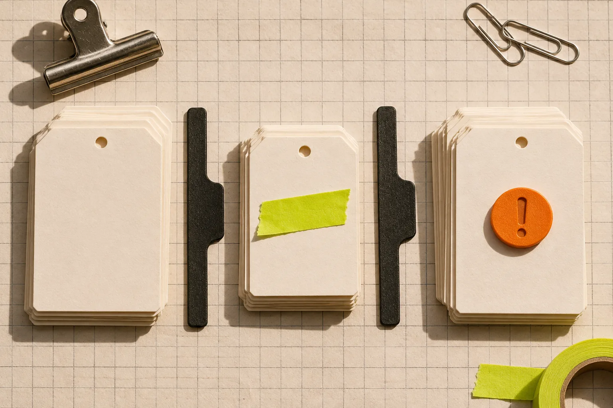
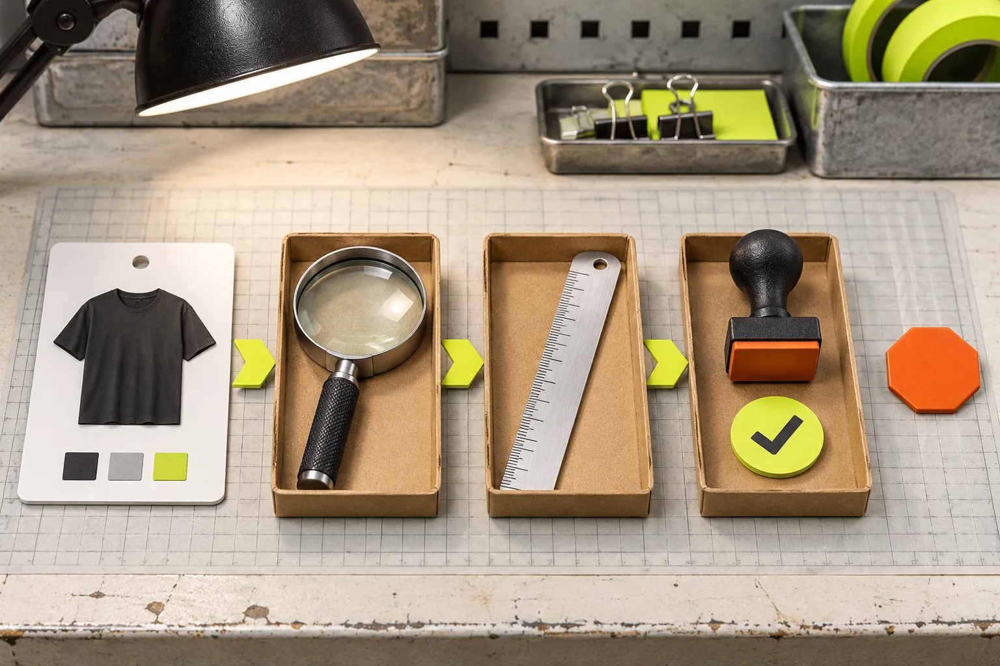

# How to Build a Shopify Bulk-Edit Change Card Before a Promotion

A Shopify bulk edit is safest when it starts as a short change card, not a long list of clicks. Before a promotion, write down the exact target set, one field to change, a small verification sample, and a stop condition. That turns a tempting storewide action into a reviewable, reversible job.

This is especially useful for a sale window: a price or compare-at-price change can affect what customers see, while tags, product types, and collections can drive filtering and collection membership. Shopify notes that product types and tags can be used to filter products and build collections, so they are not harmless housekeeping fields. [Shopify’s product-details guide](https://help.shopify.com/en/manual/products/details) is worth keeping open while you plan.

[Ultimator Bulk Editor](https://apps.shopify.com/ultimate-bulk-editor) is a practical fit when you need a task that selects products or variants, applies a field update, then runs now or on a schedule. Its current App Store listing says it supports products and variants, including prices, SKUs, tags, inventory, metafields, collections, and scheduled tasks. The tool is not the safety system, though. The change card is.

## The four-line change card

Use this before creating the task. It should be short enough to read aloud to the person approving the promotion.

| Line | Write this | Example |
| --- | --- | --- |
| Target | The selection rule and expected count | Active summer tees tagged `sale-eligible`; expect 48 products / 126 variants |
| Change | One field and one operation | Set compare-at price only; do not change price |
| Proof | Three records to inspect | One single-variant tee, one multi-variant tee, one excluded full-price tee |
| Stop | What cancels the run | Expected count changes, a non-sale item appears, or a sampled product has an unexpected price |

The useful constraint is **one field per card**. If the campaign also needs tags removed and inventory behavior reviewed, make a second and third card. Inventory has its own storefront implications: Shopify distinguishes variant inventory levels, out-of-stock behavior, locations, and collection visibility in its [inventory setup guidance](https://help.shopify.com/en/manual/inventory-and-locations/setup). Combining that decision with a price change makes the result harder to explain later.

This structure also makes a good companion to a [bulk price-change preflight](https://tools-and-how-tos.github.io/2026/09/08/shopify-bulk-price-changes-a-safer-preflight-checklist/). The preflight asks whether the values are sound; the card records exactly what this run is allowed to touch.

## Draw a boundary around the target set

In Ultimator, begin with search criteria rather than the field editor. Look for an inclusion rule you can restate plainly: status, tag, vendor, product type, or a bounded collection. Then look for exclusions. “Everything with a summer tag” is not a boundary if an old clearance item still has that tag.

A reliable test is to compare three things before running:

1. The expected count on the card.
2. The task’s displayed selection count.
3. A spot check of three included and two excluded records.

If those disagree, stop and refine the criteria. Do not fix the records inside the same task just to make the count look right. A separate cleanup task leaves a clear explanation of what changed. For tricky product-versus-variant scope, use this [variant-scope pilot](https://tools-and-how-tos.github.io/2026/11/08/a-shopify-bulk-edit-pilot-for-catching-variant-scope-mistakes/) first.

## Make the update boringly specific

A promotion card should say whether the edit belongs to products or variants. A product title may be one value for the entire product; prices and SKUs frequently vary by variant. Similarly, “append a tag” is a different operation from “replace every tag.”

For each task, record the old state you expect and the new state you intend. For example: “For variants in the target, set compare-at price to the prior regular price; leave price unchanged.” Avoid vague instructions such as “set sale pricing” because they hide which field will carry the visible sale signal.

## Run a sample before the full promotion

Create a narrow task with the same operation and a small representative target. Inspect the product page and the storefront view for each sample. This is a control, not a dress rehearsal you skip when the task looks simple.

Use a three-part proof:

- **Record view:** the edited field contains the expected value.
- **Storefront view:** the product and variant display the intended outcome.
- **Exclusion view:** a product outside the target has not changed.

If the samples include multiple locations or track inventory, verify the outcome in the context you actually sell from; availability can depend on location and out-of-stock settings. Then keep the sample task separate from the production task. It gives you a stable before-and-after reference.

## Schedule only after the card has a go signal

Scheduling is useful for a sale start, but it cannot rescue an ambiguous selection. In the hours before the scheduled time, record the final count and the current time zone on the card. If a teammate alters the catalog after the count was checked, regenerate the selection and repeat the spot checks.

A simple go/no-go rule works well:

- **Go:** expected count matches, all five checks pass, and the operation affects the named field only.
- **No-go:** counts drift, the sample reveals a variant/product scope problem, or the campaign needs a second kind of change.

## Keep a small receipt after the run

When the task is complete, save the task name, selection rule, count, run time, and the same five checked records. This is enough to answer “what changed?” without reconstructing the promotion from memory. If you need a fuller closeout, pair the card with this [bulk-edit reconciliation guide](https://tools-and-how-tos.github.io/2026/11/02/how-to-reconcile-a-shopify-bulk-edit-before-you-call-it-done/).

The card does not promise that every promotion can be rolled back automatically; it gives you the information needed to make a corrective task deliberately if something is wrong. That is a much safer claim.

## Start with the smallest useful task

Install [Ultimator Bulk Editor](https://apps.shopify.com/ultimate-bulk-editor), build one tightly bounded task, and make the four-line card before you schedule it. If the task needs more than one field or more than one audience, split it. The few extra minutes buy a cleaner promotion—and a far better explanation when someone asks what happened.
