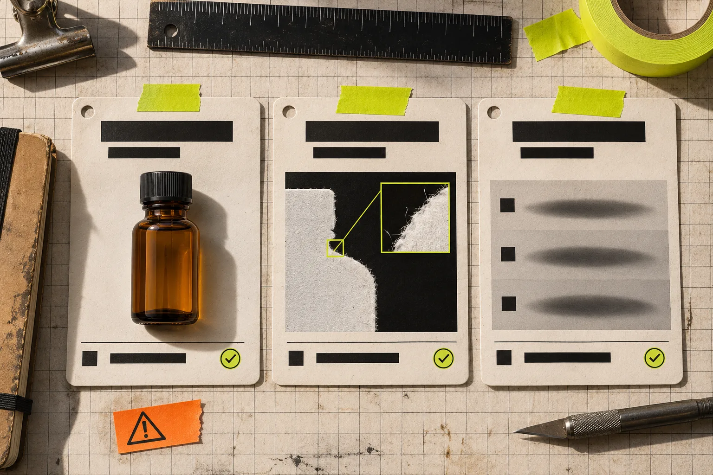
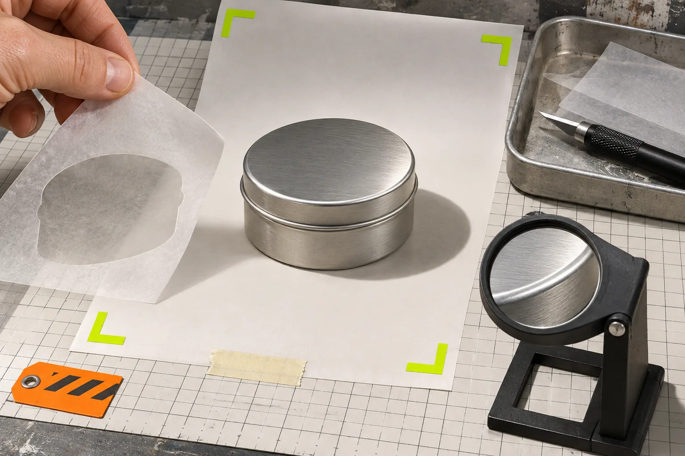
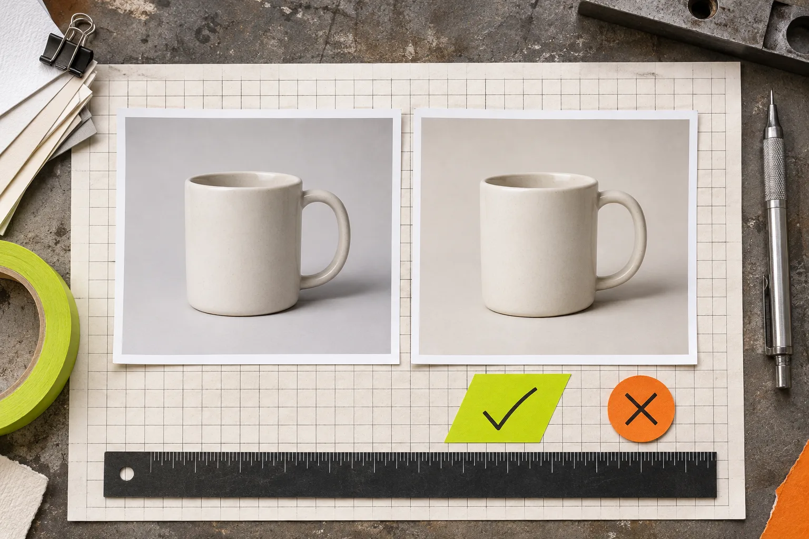

# How to Make Product Photo Backgrounds Consistent Without Faking the Product

A consistent product-photo background should make a catalog easier to scan, not make the item look like something it is not. The safest route is mask-first: preserve the product pixels, change only the surrounding field, then review the edge, shadow, and color before export. [ImageFlow](https://imageflow.dev/) is useful here because its browser editor gives you layers, masks, adjustment layers, and editable exports instead of asking a generative tool to redraw the product.

This is not a recipe for rescuing an unusable shot. A background swap cannot prove a texture, repair a missing reflection, or turn a dim image into honest studio photography. It can, however, make a sound source image fit the same visual system as the rest of a collection.

## Start with a scope card, not the remove-background button

Before selecting anything, write four short lines for the image:

| Check | Question | Hold the edit when… |
| --- | --- | --- |
| Product truth | What must not change? | A label, finish, included accessory, or edge detail is unclear. |
| Background job | What needs consistency? | You cannot name a simple background, crop, or shadow target. |
| Source quality | Does the original support the change? | The product is badly blurred, clipped, or hidden by a busy foreground. |
| Proof | How will you compare it? | You have no original or no second person who can inspect it. |

That card prevents a common failure: treating every uneven backdrop as an editing problem. Sometimes the correct answer is a reshoot, a different crop, or leaving the photo alone. It also works well with a [four-file versioning system for reversible edits](https://tools-and-how-tos.github.io/2026/11/18/product-photo-versioning-a-4-file-system-for-reversible-edits/): keep the source, an editable working file, a review export, and the final delivery separate.

## Build the edit in four reversible passes

### 1. Duplicate the source and keep the original visible

Open the source in ImageFlow, duplicate the working layer, and lock or hide the untouched copy. The point is not ceremony; it gives you a fast before/after comparison when a small change starts to alter the item. If a teammate supplied a PSD, ImageFlow lists PSD and PSB import/export alongside layers, masks, smart objects, and adjustment layers, but test your own complex production file before relying on a round trip.

### 2. Select the product, then inspect the mask at 100%

Use object selection or background removal to get a starting mask. Do not stop there. At full size, inspect the places shoppers use to judge quality: handles, glass, translucent plastic, seams, label corners, metal edges, and soft fibres. Paint or refine the mask instead of flattening the result.

A clean silhouette is not always a truthful one. If the original has a soft contact shadow, preserve a plausible version of that shadow; do not cut the product loose so it appears to float. If the image contains a reflection that describes the material, do not erase it just because it complicates selection. For a related examination of editable visual elements, see this guide to [building an editable product comparison graphic in your browser](https://tools-and-how-tos.github.io/2026/11/16/how-to-build-an-editable-product-comparison-graphic-in-your-browser/).

### 3. Add a neutral background on its own layer

Put a solid or gently graded background beneath the masked product. Keep it boring on purpose: a neutral sweep, a repeatable brand color, or a simple collection backdrop. The background should support comparison across products, not compete with texture or color.

Use an adjustment layer for minor exposure or white-balance correction if the source needs it. Avoid pushing product color until it merely matches the background. That is the threshold where catalog consistency becomes misleading.

### 4. Make a review export before the final export

Export a temporary review image and compare it beside the source on the same screen. Look at normal storefront size and at 100%. Check whether the object has changed shape, the label has lost detail, the shadow points in a nonsensical direction, or the background makes the product color read differently. Shopify’s [product-media guidance](https://help.shopify.com/en/manual/products/product-media) is also a useful boundary: product media is public storefront material, so it should never contain confidential source files or private production notes.

## Use a simple publish-or-hold decision

Publish the edit when all three statements are true:

- The product’s shape, material, color, branding, and included items still match the source.
- The mask edge and contact shadow look intentional at both zoom levels.
- The new background makes this image more consistent with the collection without making a claim the original cannot support.

Hold it when a difficult edge, glare, transparent material, or missing shadow changes how the product is understood. That is not a failure of the tool. It is a useful signal that the source photo needs a different treatment. The same practical check appears in this Spanish guide on [cropping product photos without inventing details](https://herramientas-y-tutoriales.github.io/2026/11/21/recorta-fotos-de-producto-sin-inventar-detalles-metodo-de-revision/) and this French [pre-publication product-photo control sheet](https://outils-et-tutoriels.gitlab.io/guides/2026/11/22/photo-produit-e-commerce-la-fiche-de-controle-avant-publication/).

## The smallest useful edit is usually the best one

Background consistency is a catalog decision, not a licence to manufacture better-looking products. Start with one real image in [ImageFlow](https://imageflow.dev/), keep the source layer intact, and change only the background that is preventing a clear comparison. If the proof view still feels honest, export it. If it does not, keep the original and fix the photo setup instead.
