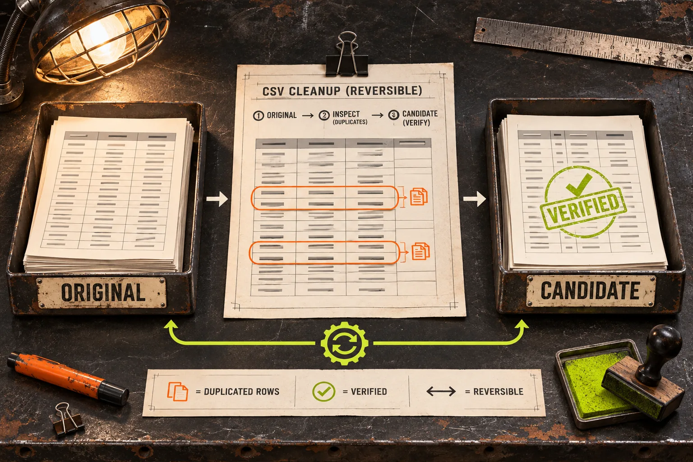
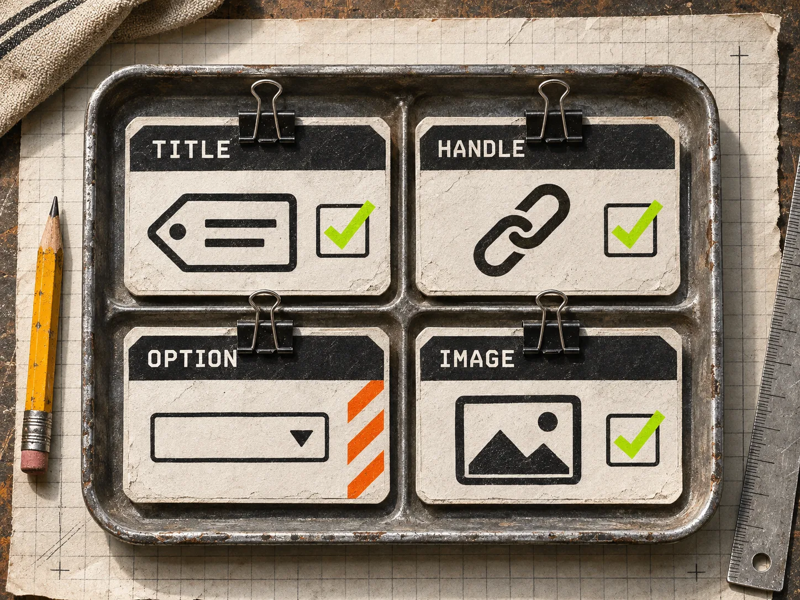

# How to Remove Duplicate Shopify CSV Rows Without Breaking Variants

If your Shopify export contains repeated rows, do not deduplicate it by comparing every row wholesale or by deleting everything with the same product title. The safe move is to inspect the file, choose keys that represent the *same record*, create a separate candidate copy, then verify handles and variant options before you import. [Tiny Online Tools' CSV Deduplicator](https://tiny-online.tools/data-tools/csv-deduplicator) is useful for that narrow cleanup step because it lets you choose the comparison columns rather than silently deciding for you.

That distinction matters. A Shopify product can span many CSV rows because variants and additional images need their own data. Shopify also warns that variant-related columns have dependencies: omitting option columns while updating a variant field can create a default variant or remove existing variants. This is a cleanup method for accidental duplicate records—not a reason to flatten a product export.

## First, decide what “duplicate” means in this file

A duplicate is not simply two rows that look alike. For a product CSV, it is two rows that represent the same intended product or variant record and should resolve to one row. Start with a quick inspection in a [browser CSV viewer](https://tiny-online.tools/data-tools/csv-viewer), then make a small decision card before touching the original.

| Your goal | Comparison keys to consider | Do not deduplicate on |
| --- | --- | --- |
| Remove repeated product records | `Handle` plus the fields that define the row's purpose | `Title` alone |
| Remove repeated variant rows | `Handle` plus `Option1 Value` (and Option2/3 where used) | SKU alone, unless it is demonstrably unique in this export |
| Remove repeated image rows | `Handle` plus `Image Src` | the product's first row, which may carry product-level data |

The point is not to declare one universal key set. It is to make the key choice explicit. For example, two rows with the same handle can be entirely legitimate when one represents a blue variant and the other a large variant, or when one adds another product image. Shopify's current CSV guide says that a handle and title are the required columns for product updates, while option data is necessary when a change concerns a variant field such as SKU or weight.

This is the same habit behind a [bulk-edit change card](https://tools-and-how-tos.github.io/2026/11/21/how-to-build-a-shopify-bulk-edit-change-card-before-a-promotion/): name the target, the exact change, the proof, and the stop condition before making an irreversible move.

## Make a reversible cleanup candidate

Keep the exported CSV untouched. Download it, copy it as `candidate-clean.csv`, and do all work on the copy. This preserves a comparison point if a filter or deduplication setting is too broad.

1. Open the candidate in the CSV viewer and scan a handful of repeated handles.
2. Write down the exact columns that identify a duplicate for this one job.
3. Use the [CSV Deduplicator](https://tiny-online.tools/data-tools/csv-deduplicator) and select only those columns. It can compare chosen columns and keep either the first or last matching row.
4. Treat the downloaded result as a candidate, not an import-ready file.

The keep-first/keep-last choice is a rule, not a preference. Keep the first only when the earliest row is known to be the intended record. Keep the last only when the later row is known to replace it. If you cannot explain which row should survive, stop and investigate the export source instead of guessing.

For large exports, [CSV Filter](https://tiny-online.tools/data-tools/csv-filter) can narrow the candidate to one handle, vendor, or status while you inspect the pattern. Keeping that investigation in the browser is convenient for an export that you do not want to upload to a random converter. Tiny Online Tools describes these data utilities as local browser workflows; still, validate the result yourself before you let it modify a storefront.

## Check the Shopify dependencies that duplicates can hide

Before import, look at a small but deliberately varied sample: one simple product, one product with multiple options, one product with extra images, and one row you expected to disappear. Compare original and candidate side by side.

Use this four-point receipt:

- **Title and Handle:** Every retained product update has the identifying columns Shopify expects.
- **Options:** Each variant row still has the option name and value columns it depends on. Do not assume repeated handles are errors.
- **Images:** Verify that image rows have not vanished merely because they share a handle with the product row.
- **Blank cells:** In an overwrite import, a blank value in an included non-required column can overwrite the saved value as blank. Omit a column only when you intentionally want Shopify to leave that field alone.

Shopify's [product CSV documentation](https://help.shopify.com/en/manual/products/import-export/using-csv) is the authority here, especially for option fields, blank values, and overwrite behavior. If your file changes option values, remember Shopify says that change can create new variant IDs and affect dependencies that use them. A deduplicator cannot make that business decision for you.

This cautious, before-and-after review also transfers well beyond CSVs. The same boundary-checking approach appears in this guide to a [Notion-to-Webflow CMS preflight](https://tools-and-how-tos.github.io/2026/11/18/notion-to-webflow-cms-preflight-map-fields-without-publishing-mistakes/) and in a workflow for creating an [editable product comparison graphic](https://tools-and-how-tos.github.io/2026/11/16/how-to-build-an-editable-product-comparison-graphic-in-your-browser/): preserve the editable source, make a bounded change, then inspect the rendered outcome.

## When not to deduplicate at all

Skip this workflow if you are trying to fix ambiguous product structure, reconcile conflicting supplier records, or collapse genuine variants into a single product. Also stop if repeated rows differ in price, inventory, option values, image URLs, or publishing status and you do not have a source-of-truth rule for which value wins. In those cases, deduplication destroys evidence.

A safer next step may be a filtered review by handle, then a controlled update on a few records. If the problem is visual consistency rather than data repetition, the separate challenge is keeping product imagery honest—see this guide on [consistent product photo backgrounds](https://tools-and-how-tos.github.io/2026/11/22/how-to-make-product-photo-backgrounds-consistent-without-faking-the-pr/).

## The five-minute pre-import routine

Before you upload a cleaned CSV, answer these questions in writing:

1. Which columns define a duplicate for this export?
2. Why should the kept row win: first, last, or a source-specific rule?
3. Which handles with multiple variants did you inspect?
4. Which image rows did you confirm remain?
5. What would make you stop the import?

If you can answer all five, use the candidate file for a small, representative import or review it against Shopify's current template one more time. If you cannot, keep the original intact and resolve the source data first.

Tiny Online Tools is most helpful here as a focused, no-account browser workbench: use the viewer to understand the shape of the file, the filter to isolate a pattern, and the deduplicator only after you have named the match keys. Start with one copied CSV and one clearly defined duplicate rule; that is enough to turn a risky cleanup into an auditable one.
