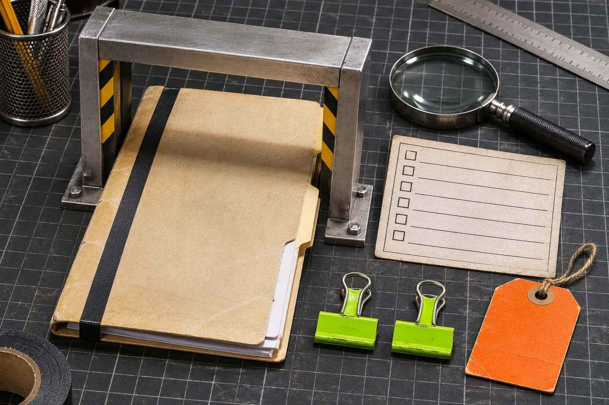

A DOCX is not just the pages you can see. Before you send one to a client, inspect it for external references, tracked edits, embedded material, and document properties—then decide whether to clean, convert, or send it as-is. For a quick no-install pass, [Tiny Online Tools’ DOCX Internal Inspector](https://tiny-online.tools/document-tools/docx-internal-inspector) exposes those package-level details in the browser.

That check is especially useful when the file has crossed team boundaries: a template was duplicated, someone pasted content from another document, or an agency handed you a final that needs one more review. It is not a substitute for malware scanning or a legal records policy. It is a practical way to see what the document package contains before you make the handoff irreversible.


## Start with the right question: review, clean, or rebuild?

Open the DOCX only when you have a reason to know what is inside. The point is not to make every file look technically perfect; it is to catch content that changes the risk of sending it. Use this decision table before touching the file.

| What you find | Why it matters | Sensible next move |
| --- | --- | --- |
| Tracked changes or comments | A recipient may see drafting history or internal discussion | Accept/reject changes and remove comments in the authoring app; recheck the export |
| External links or relationships | A click can point at an old asset, workspace, or unrelated site | Confirm that every destination belongs in the client copy |
| Embedded objects or media | The file may carry more than the visible pages imply | Verify the object is intentional and necessary; remove it if it is not |
| Macros or risky fields | These deserve a deliberate security decision, not a casual send | Stop and use your organization’s approved review path |
| Unexpected properties or a strange structure | The file may have come from a template or tool you did not expect | Confirm the source and request a clean export if needed |

The inspector describes its output as document XML, styles, relationships, media, embedded objects, document properties, and flags for macros, external references, tracked changes, and risky fields. That is exactly the level of evidence you need for a quick handoff decision—not a vague feeling that the file “looks fine.”

## Run a five-minute package check

1. **Keep the original intact.** Duplicate the received file and give the working copy a clear name such as `client-brief_reviewed.docx`. If you need a fallback later, you want the unmodified original available.
2. **Inspect the internal inventory.** Open the working copy in the [DOCX Internal Inspector](https://tiny-online.tools/document-tools/docx-internal-inspector). Look first at the high-signal items: relationships, external references, media or embedded objects, tracked changes, and macros. The tool runs in the browser, which is handy when you need a focused inspection without another desktop utility.
3. **Compare the inventory with the job.** A client proposal with one logo may reasonably contain one image. A short text brief with several external references, hidden objects, or unexpected media deserves a question. Use the brief—not curiosity—as your baseline.
4. **Fix at the source, then recheck.** If the document needs cleaning, use the application that created it to remove comments, accept or reject revisions, correct links, and save a new copy. An inspection result tells you what to investigate; it is not permission to edit XML blindly.
5. **Record the sendable version.** Keep a small receipt: filename, date, reviewer, and the one decision you made. For routine work, a line in the project notes is enough.


## Treat relationships as a handoff map

The most useful inspection habit is to read a document’s relationships as a map of its dependencies. If you find an external URL, ask three narrow questions: does it belong to the client deliverable, will it still work for the recipient, and did the author intend the recipient to see it?

This same approach helps with other opaque files. Our guide to [inspecting an unknown file header before opening it](https://tools-and-how-tos.github.io/2026/11/06/how-to-inspect-an-unknown-file-header-before-you-open-it/) starts one step earlier: identify what a file claims to be before you trust an extension. Likewise, the [ICS calendar-file inspection workflow](https://tools-and-how-tos.github.io/2026/11/16/how-to-inspect-an-ics-calendar-file-before-you-import-it/) treats recurrence rules and time zones as things to verify, not assumptions to import.

The shared principle is simple: inspect the structure when the visible preview cannot answer the operational question.

## A small handoff receipt you can reuse

Paste this into a project ticket or delivery note:

```text
DOCX handoff receipt
File: [final filename]
Purpose: [what the recipient should do with it]
Checked: [date and reviewer]
Review scope: links / changes / comments / embeds / properties
Result: [send | corrected and rechecked | needs owner decision]
Notes: [one material exception, if any]
```

This is deliberately smaller than a compliance process. It gives the next person enough context to avoid reopening the same question, while leaving specialist review to the right team. If your work also includes structured exports, pair it with a [CSV duplicate-removal check](https://tools-and-how-tos.github.io/2026/11/22/how-to-remove-duplicate-shopify-csv-rows-without-breaking-variants/) rather than assuming a clean DOCX means every attached data file is clean. And when the document is a publishing source, a [field-mapping preflight](https://tools-and-how-tos.github.io/2026/11/18/notion-to-webflow-cms-preflight-map-fields-without-publishing-mistakes/) can catch a different class of handoff mistake.



## When this method is not enough

Do not use a quick browser inspection as a security verdict. A document from an unknown sender, a file that triggers macro warnings, or a deliverable governed by contractual retention or privacy requirements needs the security, legal, or records process your organization already uses. Similarly, if the recipient needs a non-editable artefact, confirm the required PDF workflow rather than assuming DOCX is acceptable.

For ordinary client handoffs, though, the five-minute check has a strong payoff: you know what you are sending, you have fixed visible drafting debris at the source, and you have recorded the one decision that matters. Start with the [DOCX Internal Inspector](https://tiny-online.tools/document-tools/docx-internal-inspector), make the handoff receipt, and send the version you can explain.
