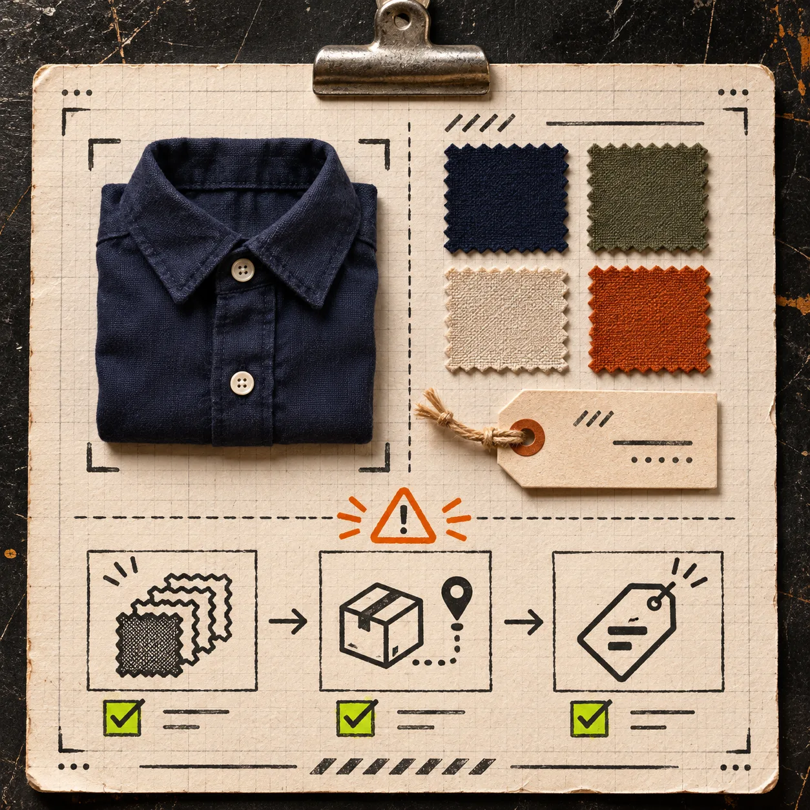
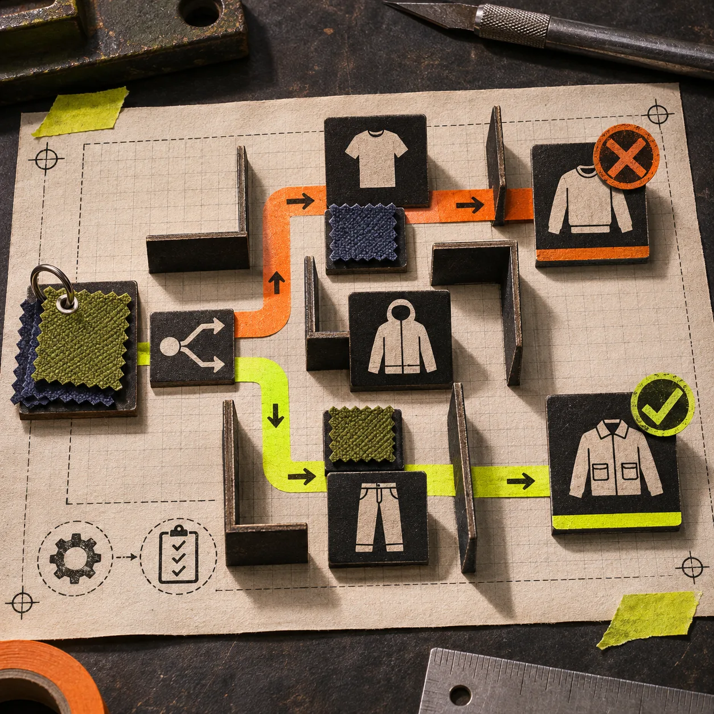
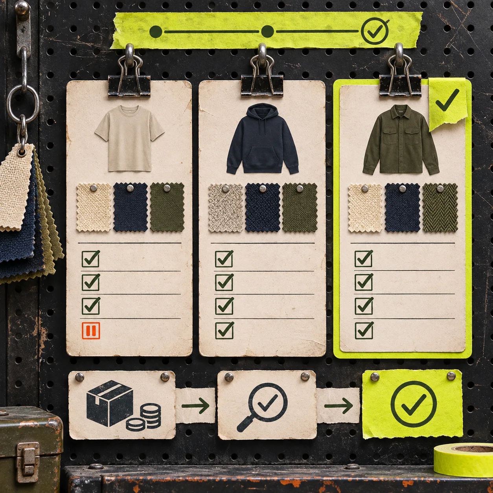

# How to Catch Wrong Shopify Swatch Links Before Shoppers Do

A swatch can look correct in a Shopify collection grid and still send a shopper to the wrong product, a sold-out color, or a page with a different price. The practical fix is to test a small set of representative cards before rollout: follow every visible swatch, then compare its destination, selected color, availability, and price against a simple source-of-truth list.

This is especially worth doing when colors are represented by separate products rather than variants. A color chip is a navigation control in that setup, not decoration. One bad route can make a collection feel unreliable even when the rest of the catalog is tidy.

[Supra Swatch Colors](https://apps.shopify.com/swatch-colors-ultimator) is designed for both variant swatches and swatches that link separate product pages, including collection-page use. That makes the routing check below useful before you turn the app on across a range.

## Make one sample card per product family

Do not start with every SKU. Pick three to five product families that expose the risks you actually have: a core item with many colors, a seasonal item, something discounted, and one low-stock product. For each, make a short card with four fields:

| Field | What to record | Why it matters |
| --- | --- | --- |
| Collection card | Product title and collection URL | Confirms the starting point |
| Swatch label | The color name shown to shoppers | Spots naming drift |
| Expected destination | Product handle or URL | Gives you a route to compare |
| Expected state | Selected color, availability, and price | Catches a correct URL with a wrong commercial result |

Use the product name and the shopper-facing color name, not internal shorthand. If the product is called “Field Jacket” and the chip says “Moss,” write those exact values. That forces a useful question: is Moss a variant on this page, or a different product page that should be linked? The distinction is the foundation of [choosing variants or separate products for Shopify swatches](https://tools-and-how-tos.github.io/2026/11/06/shopify-color-swatches-when-to-use-variants-or-separate-products/).

## Run the four-part route check

Open the collection in an incognito window or a browser profile where you are not logged into Shopify. Test the same breakpoint your shoppers use most. Then, for each sample card, click each swatch and check four outcomes.

1. **Destination:** Did the click go to the expected product page or update the expected variant? Copy the final URL; a visually similar item is not an acceptable match.
2. **Color state:** Does the destination show the color the chip promised? A chip labeled Moss should not land on Olive just because the two use a similar hex value.
3. **Commercial state:** Is the price, sale state, and availability correct for the destination? This is where stale feeds and retired seasonal items show up.
4. **Return path:** Go back to the collection and repeat with the next chip. The card should remain legible and the next click should not inherit an unrelated selection.

The point is not to prove every combination in one pass. It is to prove the contract a swatch makes: *this color signal leads to this purchasable thing*. If your store needs help testing the visual treatment itself, use this separate [collection-page swatch test](https://how-to-blog.gitlab.io/2026/11/13/how-to-test-color-swatches-on-a-shopify-collection-page/) after the route check.

## Treat these failures differently

A wrong-looking chip and a wrong destination are not the same bug. Give the team a repair path instead of a vague “swatches broken” note.

| Failure you see | Likely owner | First repair to try |
| --- | --- | --- |
| Chip color does not resemble the product | Merchandising | Replace the color or image source; check the selected asset |
| Chip lands on the wrong product | Catalog owner | Correct the linked-product group or destination mapping |
| Chip lands on the right product with wrong price | Merchandising or pricing | Check the destination product’s market and compare-at pricing |
| Chip disappears only in the collection | Theme/app configuration | Check collection-page enablement and test the same product page |
| Chip routes to an unavailable product | Inventory/catalog owner | Decide whether to hide, reorder, or keep the route with a clear unavailable state |

Avoid repairing a routing error by merely changing the chip’s label. That makes the collection grid pass a quick glance while leaving the customer journey wrong. Likewise, a code edit is not automatically the right answer: the app’s listing describes collection-page support and configurable swatches, so first confirm the catalog mapping and app settings before changing theme code.

## Add a small release gate

For a new color drop, collection refresh, or product split, make the sample-card check a release gate. A lightweight gate is enough:

- Test three representative product families on desktop and mobile.
- Include one discounted or low-stock item whenever one is present.
- Re-test after a bulk price, title, option, or inventory update.
- Save the tested collection URL, date, and any exceptions with the release notes.

This pairs well with a controlled catalog change. Before the swatch work, use a [bulk-edit change card](https://tools-and-how-tos.github.io/2026/11/21/how-to-build-a-shopify-bulk-edit-change-card-before-a-promotion/) to define which products and fields can move. After the change, the swatch sample cards tell you whether the storefront still honors that scope.

## When not to use this as your only test

A small sample catches representative failures; it does not prove an entire catalog is clean. Expand the test when you have large numbers of linked products, localized storefronts, market-specific pricing, or heavy automation. In those cases, use samples as the human acceptance check and add a broader export or regression process behind it.

Also keep accessibility in the loop. If a chip only communicates with color, the product needs a usable name or label in the interface. [Keyboard-testing Shopify color swatches](https://the-lean-ecommerce.github.io/2026/11/04/shopify-swatch-accessibility-keyboard-checklist/) is a worthwhile companion check before a major launch.

## The next action

Pick three product families from your busiest collection, make the four-field sample cards, and follow every visible swatch from the grid. Once those routes are solid, [install or configure Supra Swatch Colors](https://apps.shopify.com/swatch-colors-ultimator) to present color choices consistently across product and collection pages—without treating a nice-looking chip as evidence that the route is right.
