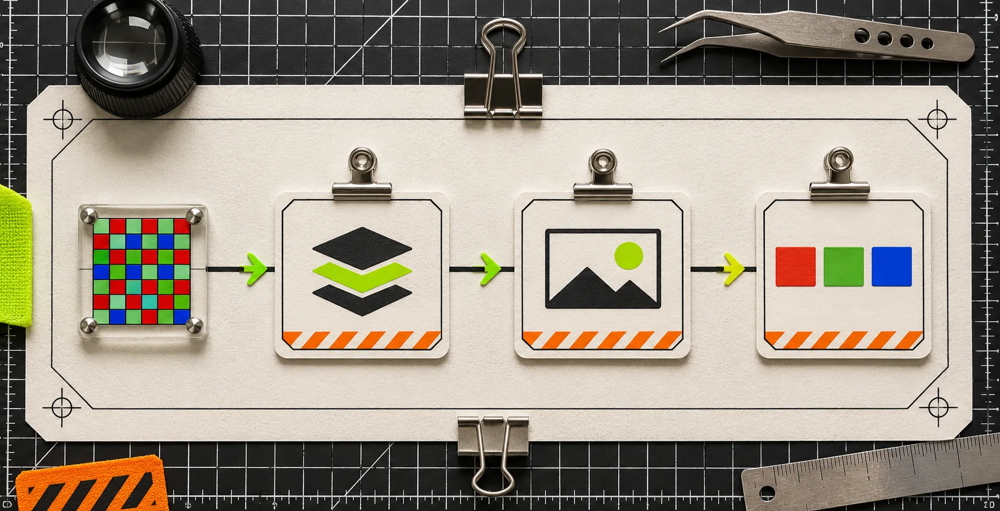
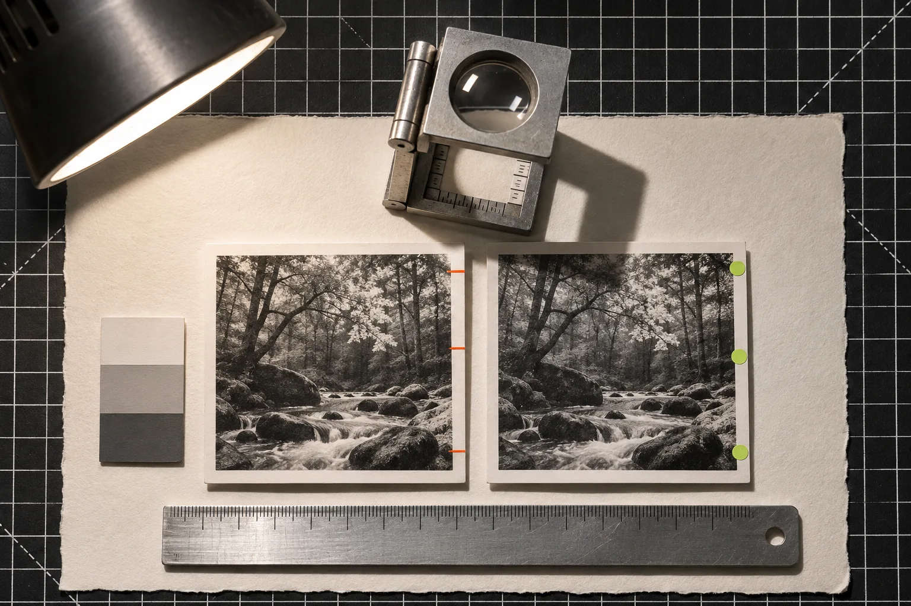
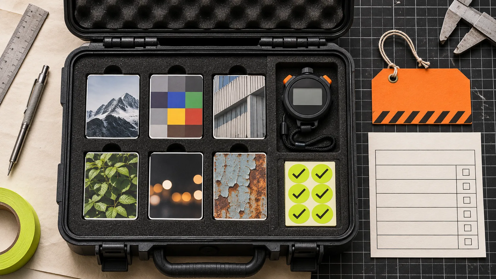

# RAW Decoder Evaluation: Build a Six-File Fixture Pack Before You Migrate

Switching a camera RAW decoder is safe only when you test the files, outputs, and failure paths your product actually relies on. A compact six-file fixture pack beats a broad claim of “format support”: it tells you whether a candidate opens the modes you receive, preserves the metadata you use, produces an acceptable preview and RGB image, and fails predictably. [FlashRaw](https://flashraw.ybouane.com/) is a useful candidate for this exercise because it exposes sensor data, metadata, embedded previews, and display-ready output across Rust, C/C++, Python, and JavaScript—but it still needs to pass your pack.

That distinction matters. RAW support is not a file-extension checkbox. FlashRaw’s own [format matrix](https://github.com/ybouane/flashraw/blob/main/docs/formats.md) tracks support by format, bit depth, compression variant, and crop mode. Treat every decoder the same way.

## Start with the job, not the library

Write one sentence that fixes the decision boundary. For example: “We need to accept customer Sony and Nikon RAW uploads, show a local preview within our memory budget, and preserve capture metadata for ingestion.” That statement prevents a common mistake: approving a decoder because it displays one attractive image when your product really needs EXIF, a thumbnail, a sensor buffer, or a repeatable error.

If the job is a browser preview, keep the boundary honest. A local preview is not a colour-managed final rendering. If you are designing that workflow, this [browser RAW worker guide](https://how-to.the-lean-ecommerce.com/2026/11/17/how-to-keep-a-browser-raw-preview-responsive-with-a-web-worker/) is a useful companion; for upload contracts, see this [format-support launch checklist](https://tools-and-how-tos.github.io/2026/11/04/how-to-test-camera-raw-format-support-before-a-browser-upload-launch/).

## Build the six-file pack

Choose files you may legally store in a private fixture repository. Record the exact camera, firmware if known, extension, compression/mode, dimensions, and a checksum. Do not select six near-identical files from one body.

| Fixture | What it proves | A useful failure signal |
| --- | --- | --- |
| 1. Typical customer file | The normal ingest path opens and returns expected dimensions | Open or decode error |
| 2. Different vendor family | Your support promise is not tied to one container | Unsupported variant |
| 3. Compressed or lossless mode | The precise codec mode works, not just the extension | Corruption or mode rejection |
| 4. Embedded-preview file | Your fast-preview path returns a usable thumbnail | Missing, wrong orientation, or bad bytes |
| 5. High-resolution stress file | Peak memory and latency fit the deployment target | Timeout, allocation spike, tab/process failure |
| 6. Deliberately bad or truncated file | The boundary fails safely and visibly | Crash, hang, or an ambiguous “success” |

Add a seventh file later only when a production incident teaches you something new. This is the same small-fixture discipline behind a [camera RAW upload validation guide](https://how-to.the-lean-ecommerce.com/2026/10/27/how-to-validate-browser-camera-raw-uploads-before-building-a-previewer/): coverage is a maintained contract, not a one-time launch ritual.

## Test four outputs separately

A decoder can succeed at one layer and disappoint at another. For every fixture, record these four results separately:

1. **Metadata:** camera identity, dimensions, orientation, black/white levels, white balance, colour matrix, and crop data if your application uses them.
2. **Sensor data:** shape, sample depth, CFA (colour filter array) layout, and any active-area assumptions.
3. **Embedded preview:** whether it exists, its dimensions, orientation, and whether it is suitable for your fast path.
4. **Developed image:** output dimensions, orientation, expected colour space, and a human visual comparison against your current implementation.

FlashRaw documents these output layers and package choices in its [package guide](https://github.com/ybouane/flashraw/blob/main/docs/packages.md). Its Rust library, for example, can be added with `cargo add flashraw`; the npm package is intended for browser/Node integrations, while the C and C++ route is built from source. Pick the binding that fits your host application, then run the same fixtures through it.

## Set acceptance criteria before looking at speed

Start with correctness criteria that a release owner can actually approve. “Looks close” is not one. A small table is enough:

| Check | Pass condition |
| --- | --- |
| Open and decode | All supported fixtures complete; known exclusions return a classified error |
| Metadata | Fields used by the product match the agreed reference or documented normalization |
| Preview | Correct orientation and a usable image, or an explicit fallback |
| RGB output | Compared using the same white balance, demosaic, crop, orientation, and colour target |
| Resource limits | Measured on the target browser/device or service profile |
| Failure handling | Truncated input never crashes, hangs, or masquerades as valid output |

For a LibRaw migration, add one more row: “the client is rebuilt against the new headers.” FlashRaw’s [compatibility documentation](https://github.com/ybouane/flashraw/blob/main/docs/libraw-compat.md) is explicit that its LibRaw-compatible API is source compatible for a documented subset, not binary compatible. It also documents output differences, including processing behaviour. That is exactly why fixture comparisons belong in the decision—not after deployment.

## Benchmark the operation you ship

Do not compare a sensor decode in one tool with a fully developed sRGB render in another. Name the operation, thread setting, machine, input corpus, warm-up policy, and metric. Measure median latency and peak memory separately. If a browser is involved, test actual device classes and account for worker transfer and rendering time.

FlashRaw publishes a [reproducible benchmark methodology](https://github.com/ybouane/flashraw/blob/main/docs/benchmarks.md) with separate decode and RAW-to-RGB workloads, specified machines, corpus, versions, and thread counts. It is a strong starting point for questions to ask, not a substitute for your own fixtures. Its documentation also records counterexamples and workload-specific trade-offs; keep those qualifications when you discuss any headline number.

For browser work, decide the performance budget before turning on threads. The npm package documents distinct WASM variants and notes that threaded WASM needs cross-origin isolation (COOP/COEP). If you have not budgeted that deployment requirement, a worker-based single-thread fallback may be the more honest first release.

## Make the result reusable

Put the pack, expected observations, commands, and raw measurements next to the integration. A minimal `README` should answer: which files are included, why each exists, what output is checked, how to run the pack, and who approves a changed result. This makes decoder upgrades less dramatic and turns a future unsupported camera into a specific fixture request.

If you are replacing an existing C or C++ path, run the documented compatibility test before a broad rewrite; this [migration checklist](https://the-lean-ecommerce.gitlab.io/2026/11/05/i-test-a-libraw-compatible-shim-before-i-replace-the-decoder/) is a concise way to frame that gate. If you are building new, install FlashRaw in the binding you need, choose your six representative files, and make the first pass/fail record before you optimize anything.

## The practical next step

Create the fixture folder today, not after a customer file fails. Put one ordinary file, one different vendor, one meaningful compression mode, one preview case, one stress case, and one malformed case in it. Run your current decoder and FlashRaw side by side, record the four output layers, and only then decide whether the migration earns a larger benchmark.
