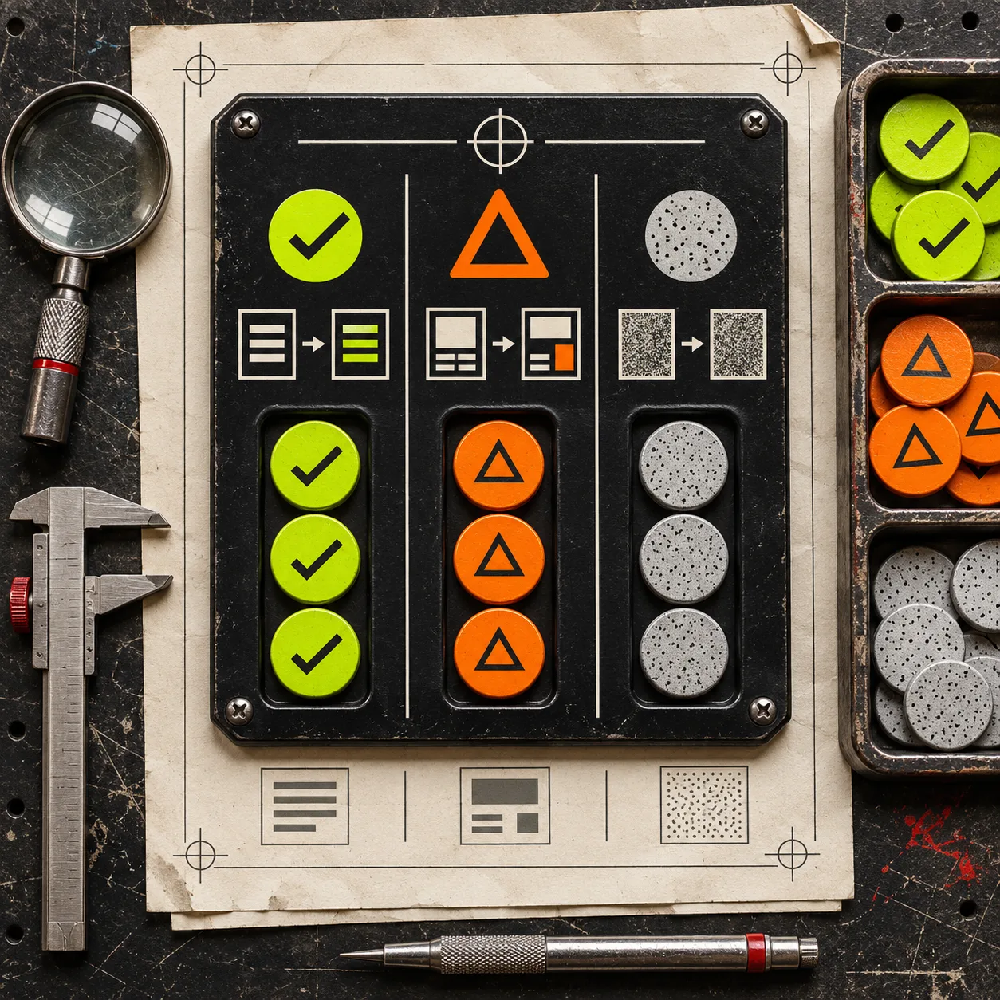

# How to Compare Two PDF Proofs Before You Send a Client Revision

If you are about to send a revised PDF to a client, compare the old and new files before you attach anything. A visual-and-text diff is the quickest way to catch the changes you meant to make, the changes you did not, and the page shift that a casual scroll will miss. For ordinary client proofs, [PDF Compare](https://tiny-online.tools/pdf-tools/pdf-compare) is a useful browser-based first pass: it aligns pages by content, shows a pixel diff alongside a line-by-line text diff, and keeps both files in the browser.

That does not replace an editor’s judgement or a printer’s preflight. It gives you a much better starting point than opening two tabs and trusting your memory.

## Start with a revision pair you can identify

Comparison only works if the inputs mean something. Before opening a diff tool, make a tiny receipt for the pair:

| Item | What to record | Why it matters |
| --- | --- | --- |
| Baseline | The last approved PDF | Prevents comparing against an older draft |
| Revision | The exact outgoing file | Avoids reviewing a file that is not attached later |
| Expected edits | Page numbers plus the requested change | Makes the diff a check, not a scavenger hunt |
| Owner | One person who resolves surprises | Stops ambiguous changes from shipping by default |

Use names that make the sequence obvious, such as `proposal-v3-approved.pdf` and `proposal-v4-client-copy.pdf`. Do not rely on “final” and “final-final.” The most expensive proof error is often the right edit made in the wrong file.

This is the same unglamorous habit behind a good [DOCX inspection before a client handoff](https://tools-and-how-tos.github.io/2026/11/23/how-to-inspect-a-docx-file-before-you-send-it-to-a-client/): identify the artifact before you decide it is safe to send.

## Run both the visual and text checks

Open [PDF Compare](https://tiny-online.tools/pdf-tools/pdf-compare), load the approved PDF as **Original** and the outgoing PDF as **Revision**, then leave the default sensitivity alone for the first pass. The tool’s default is designed to ignore small rendering differences from antialiasing and font hinting while still surfacing a changed digit. For a normal text proof, its default 110 DPI is a sensible starting point; increase the resolution only when small art or fine rules are part of the decision.

Turn on content-based page matching when a page may have been added or removed. Otherwise, one inserted page turns every later page into a false alarm. The tool describes added or removed pages separately, then keeps neighboring pages aligned by text similarity.

Use the four views deliberately:

- **Side by side** for broad page-level review.
- **Overlay** to see movement and changed areas quickly.
- **Onion skin** when you need to judge whether an object moved a few pixels or was replaced.
- **Swipe** for a restrained final look at a layout-sensitive page.

A page-level diff is evidence, not a verdict. It tells you where to look; you still decide whether the change is correct.

## Sort every finding into three buckets

The fastest review is not “resolve every red pixel.” It is classifying the result.

### 1. Expected change — confirm and move on

An agreed price, corrected name, revised date, or replaced image should appear. Confirm that the new value is complete, in the intended place, and does not introduce a nearby reflow. A changed number is worth reading in context; a diff cannot tell you whether `2027` is the correct year.

### 2. Unplanned change — investigate before sharing

Look closely at page additions, missing pages, changed hyperlinks, altered branding, new line wraps, moved headings, clipped footer elements, and anything on a sign-off page. These are the findings that deserve a source-file check and a new export. If the proof is heading to a commercial printer, follow with [PDF Print Preflight Checker](https://tiny-online.tools/pdf-tools/pdf-print-preflight-checker): it checks issues such as fonts, image resolution, colour, page boxes, transparency, and ink, but it is a checklist rather than a substitute for the printer’s own RIP.

### 3. Rendering noise — note the cause, then stop chasing it

Minor edge shimmer around text and thin rules can be a rendering artifact, not a content change. Do not set sensitivity to zero and turn the whole document red; that creates work without increasing confidence. Instead, verify one representative instance at normal zoom. If the text diff is clean and the page geometry did not move, record it as rendering noise and keep going.

This decision rule is what makes the workflow scale: expected changes get a check, suspicious changes get a task, and noise gets a reason—not another hour.

## Pay extra attention to the high-cost pages

Not every page gets equal scrutiny. Review these before you spend time polishing the rest:

1. Cover, pricing, or scope pages: names, dates, totals, and product claims carry the most consequence.
2. Pages with tables: one changed column width can make a figure misleading without looking dramatic in a thumbnail.
3. Pages with images or diagrams: use an overlay or swipe view to catch a wrong asset, crop, or replaced caption.
4. Pages after an insertion: content matching should keep the sequence sensible, but confirm the first two aligned pages yourself.
5. The final contact or approval page: it is where an old email address or stale call to action tends to survive.

For image-heavy PDFs, keep a reversible source workflow as well. The same principle is covered in [Product Photo Versioning: A 4-File System for Reversible Edits](https://tools-and-how-tos.github.io/2026/11/18/product-photo-versioning-a-4-file-system-for-reversible-edits/): a final export is a delivery artifact, not your only source of truth.

## Export a small review receipt

PDF Compare can export a JSON or CSV report with each page’s status, change ratio, changed-region count, and added or removed line counts. You do not need to attach the raw report to every client email. Save it with the proof pair when a review matters, or paste a compact note in the handoff:

> Compared `v3-approved` with `v4-client-copy`. Expected copy changes on pages 2 and 5 confirmed. Page 7 reflow checked and approved. No unexpected page additions or removals.

That note has two virtues: another person can understand what was checked, and you can reconstruct the decision later without running a detective story through old messages. It is the document equivalent of checking an [unknown file header before opening it](https://tools-and-how-tos.github.io/2026/11/06/how-to-inspect-an-unknown-file-header-before-you-open-it/): inspect the artifact at the boundary where a mistake becomes harder to undo.

## Send only after the attachment check

One last low-tech step: attach the revision, reopen the attachment from the draft, and confirm its filename and page count match the file you compared. A careful review of `v4` does not help if the email contains `v3`.

When the document contains sensitive client information, a local-browser workflow is particularly useful. Tiny Online Tools says PDF Compare opens, renders, and compares both files in the browser without uploading them. Still follow your organization’s data-handling rules, and do not interpret a clean diff as legal approval, accessibility certification, or print certification.

The practical next action is simple: before your next proof email, compare the approved PDF and the exact attachment in [PDF Compare](https://tiny-online.tools/pdf-tools/pdf-compare), resolve only the findings that matter, and save a one-line review receipt. That is enough ceremony to prevent a surprisingly large class of embarrassing revisions.
