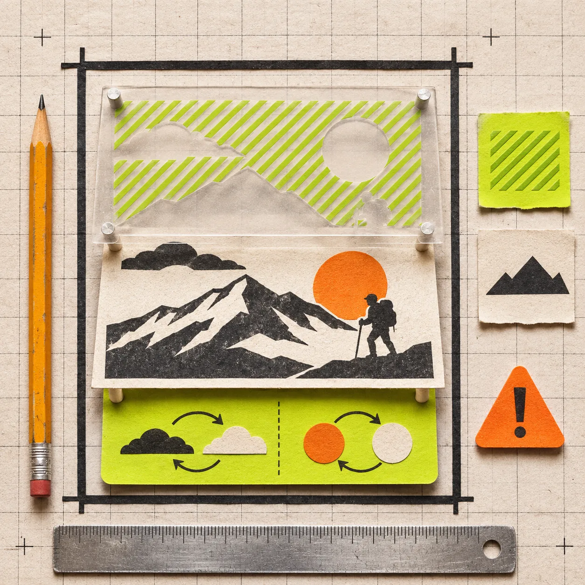
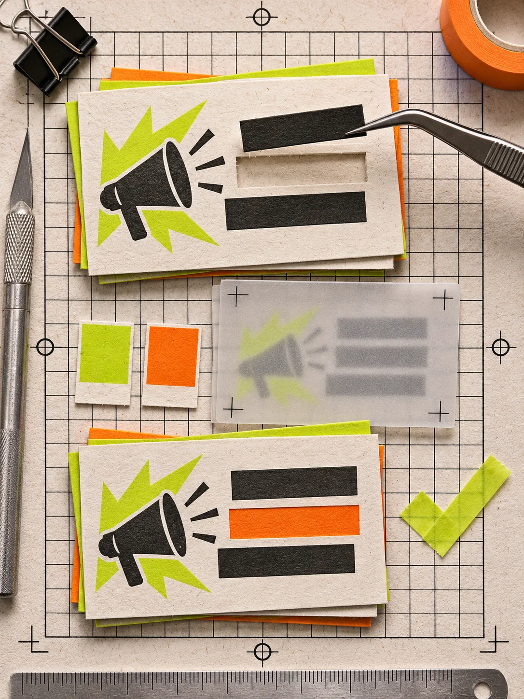

A PSD campaign graphic should stay editable when the job is a small update: a new offer, date, price, crop, or channel size. The reliable route is to make a short change card, edit only the named layer or smart object, then check the export at full size. [ImageFlow](https://imageflow.dev/) is a browser-based editor with layers, masks, adjustment layers, smart objects, text tools, and PSD import/export, so it can be a useful workspace for this kind of controlled update.

This is not a promise that every complex production PSD will round-trip perfectly. Test the real file first—especially if it uses fonts, linked assets, unusual blend modes, or elaborate smart objects. For a narrow campaign revision, though, the method below is much safer than opening a flattened JPG and rebuilding the design from scratch.

## Start with a change card, not the file

Before opening the PSD, write a three-line change card:

| Field | Example | Why it matters |
| --- | --- | --- |
| Change | Replace the offer line and export a 4:5 version | Stops scope creep |
| Preserve | Product photo, logo lockup, legal copy, color profile | Identifies the no-touch areas |
| Deliver | `spring-sale-ig-4x5-v02.psd` and a JPG proof | Keeps the editable master and export distinct |

That small card has a useful side effect: it tells you whether you need an editable PSD workflow at all. If the requested change alters the product, makes a claim the original does not support, or requires a new photographic composition, pause and get a new source asset. A text swap is an edit. Recreating a product photo is a different job.

If your source is a product image, the discipline is the same as the [four-file system for reversible photo edits](https://tools-and-how-tos.github.io/2026/11/18/product-photo-versioning-a-4-file-system-for-reversible-edits/): keep the received source, keep an editable working version, create a clearly named export, and retain the approved proof.

## Open the PSD and find the smallest editable unit

Open the original in ImageFlow and immediately inspect the Layers panel before changing anything. Look for the smallest unit that can carry the update: a text layer, a grouped badge, or a smart object. Do not rasterize a group simply because the first click is inconvenient.

A practical triage order is:

1. **Text layer available:** edit the copy, then compare line breaks and spacing with the original.
2. **Smart object or grouped component:** duplicate the component before opening or replacing it.
3. **Flat artwork only:** stop and ask whether a rebuilt version is actually authorized. A quick pixel patch may be harder to audit than a clean redesign.

This is where a browser editor earns its keep. ImageFlow documents support for layers, masks, blend modes, adjustment layers, smart objects, text, filters, and PSD import/export. It also means the work can stay in a browser-based editing flow rather than requiring a desktop install. That does not make it automatically suitable for every company policy, so follow your team’s handling rules for sensitive artwork.

## Make the update as a reversible change

Duplicate the layer or group you intend to change and give the duplicate an explicit suffix such as `-v02`. Then make one category of change at a time: copy first, crop second, color correction third. Separating them makes review faster because a reviewer can tell which choice they are approving.

For a channel resize, use a layer mask or non-destructive crop when possible. Do not erase product edges to force a composition. Keep logos, labels, quantities, materials, and included accessories faithful to the supplied source. If the design needs a new crop to work, show both the original and proposed crop in the proof rather than hiding the trade-off.

If you are building a family of assets, this approach pairs well with an [editable product comparison graphic](https://tools-and-how-tos.github.io/2026/11/16/how-to-build-an-editable-product-comparison-graphic-in-your-browser/): separate the stable product facts from the channel-specific headline, badge, or callout. Your next update becomes a component change instead of a fresh design exercise.

## Run a four-point pre-export check

Before export, zoom to 100% and inspect four things:

- **Edges:** Masks, crop boundaries, and transparent details have no halos or accidental cuts.
- **Type:** The changed line has the intended font, weight, spacing, and line breaks. If a font substituted, do not approve it silently.
- **Truth:** Prices, dates, claims, product colors, and pack contents match the source of record.
- **Reopen test:** Save the editable PSD version, reopen it, and confirm the changed element is still editable before treating the job as complete.

The reopen test is the step most likely to save an awkward handoff. It is also the sensible complement to [editing PSD text online without flattening layers](https://how-to-blog.gitlab.io/2026/11/23/how-to-edit-psd-text-online-without-flattening-layers/): an editable-looking document is not enough; the next person must be able to make the next approved change.

## Export a proof, then keep the working file

Export the requested delivery format only after the check: JPG for a lightweight proof, PNG when transparency matters, and the editable PSD as the working deliverable. Use names that reveal status instead of relying on a Downloads-folder timestamp—for example, `campaign-spring-4x5-v02-proof.jpg` and `campaign-spring-4x5-v02-editable.psd`.

For a quick browser-based update, open [ImageFlow](https://imageflow.dev/) with one noncritical campaign file and try the smallest useful edit first. If the file round-trips cleanly and the proof passes the four-point check, you have a repeatable route for the next update without flattening the campaign’s future.
